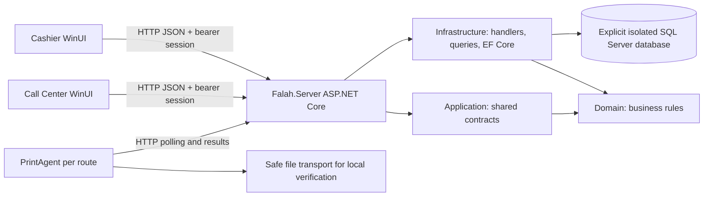

# Fale7C#: architecture discovery and isolated local runtime plan

Date: 2026-10-16 (Africa/Cairo). Source: main at c35816ecae49633674775dd32061c6ee92f94aaf.
This is runtime discovery, not a security, performance, or code-quality audit. No source fixes are proposed.

## Architecture and all solution projects

| Project | Responsibility established from code | Current verification |
|---|---|---|
| Falah.Domain | Business rules and value types: money, orders, shifts, authorization, inventory, delivery, reporting, ticket composition and ESC/POS rules. No package or project dependencies. | WORKING AND VERIFIED for exercised core flows; all rules are not exhaustively tested |
| Falah.Application | Shared request/response contracts and mapping; references Domain. Used by server and station clients. | WORKING AND VERIFIED for exercised API/client contracts |
| Falah.Infrastructure | EF Core SQL Server DbContext, 34 migrations, persistence entities, command handlers, read queries, sessions, seed data, backup worker. References Domain and Application. | WORKING AND VERIFIED for migrations, seed, sessions, sale, queries and print records |
| Falah.Server | Existing ASP.NET Core API and composition root. Registers handlers and DbContext; authenticates requests; owns all database access and startup migrations. Can run directly or as a Windows service named FalahServer. | WORKING AND VERIFIED on loopback with isolated SQL Server |
| Falah.Client.CashierWinUI | Active WinUI cashier and management shell. HTTP API client, PIN screen, menu/cart/checkout, management screens, retained unresolved requests, online status. | WORKING AND VERIFIED: real user login, menu, shift and online UI observed; broader management screens not exhaustively tested |
| Falah.Client.Cashier | Separate older WPF cashier, still part of solution. Not the selected frontend for this deployment. | BUILDS BUT NOT RUNTIME VERIFIED |
| Falah.Client.CallCenterWinUI | Separate phone-order workstation, customer/delivery desk, shared server session protocol. Discovers the current cashier shift instead of opening a drawer shift itself. | WORKING AND VERIFIED for real user login, shared shift/menu and cart display. Delivery submission/settlement NOT TESTED |
| Falah.PrintAgent | Independent per-route print worker. Authenticates to API, polls pending jobs, renders tickets, sends via Windows spooler/TCP/serial/file transport and reports results. Does not connect to SQL directly. | WORKING AND VERIFIED end to end on Receipt/CallCenter FILE transports only. Physical printing NOT TESTED |
| Falah.Domain.Tests | xUnit business-rule tests. | BUILDS BUT NOT RUNTIME VERIFIED; tests not run |
| Falah.Client.Tests | xUnit client/view-model tests and optional native layout probe sources. | BUILDS BUT NOT RUNTIME VERIFIED; tests not run |
| Falah.Server.IntegrationTests | API/persistence/printing integration tests, with their own SQL test provisioning assumptions. | BUILDS BUT NOT RUNTIME VERIFIED; deliberately not run against unknown SQL instances |

There is already a real backend. Creating another backend is unnecessary. SQL Server is required by the implemented provider; an installed PostgreSQL service cannot replace it without source/schema work.

## Code paths and runtime behavior

- `src/Falah.Server/Program.cs`: `AddDbContext` resolves `ConnectionStrings:Falah`, otherwise falls back to the restaurant database named `Falah` on `.\SQLEXPRESS`. That fallback must never be used for this task.
- Actual server default URL in `src/Falah.Server/appsettings.json`: `http://localhost:5151`. Development launch profiles also include optional HTTPS on 7116. The local plan uses explicit loopback HTTP, without firewall or LAN exposure changes.
- Both WinUI `Services/AppSession.cs` files read `FALAH_SERVER_URL`, falling back to the same localhost URL. `Services/ApiClient.cs` uses HttpClient and shared DTOs, JSON and bearer authorization. The clients do not access SQL.
- Server startup runs `db.Database.Migrate()`, enables READ_COMMITTED_SNAPSHOT when needed, then calls `DemoDataSeeder.SeedIfEmptyAsync`. Merely starting the server can write schema and data. It must follow target verification and approval.
- The 34 checked-in migrations start at `20260902120327_InitialCreate` and end at `20260919234725_AddSettingsDefaultOpeningCash`. The order-type rename migration updates data in its connected database; this is another reason to use a new isolated database only.
- DemoDataSeeder returns when Products already contains rows. On an empty database it creates two legitimate sample users (cashier and manager), sample menu/categories, variants, recipes, an inventory item and price rules. PINs will be obtained from this code internally and never printed in reports. This seeder does not establish a working business day or cashier shift; those need verified application flows.
- `POST /api/auth/login-by-pin` verifies active users' PBKDF2 hashes, issues a random bearer session and persists only its hash. `AuthenticationMiddleware` checks API sessions and claimed actors. Health/login are anonymous. Sessions have a 16-hour idle lifetime, are refreshed during use and can be revoked through logout. Server command handlers enforce permission strings; the UI also adapts navigation by permissions.
- Cashier MainViewModel polls health every five seconds and chooses cashier or management shell after login. API health uses `CanConnectAsync` against the configured database: an open HTTP port alone is insufficient proof of readiness.
- Only one hosted service was found registered: ScheduledBackupService. Defaults: enabled, first check after 90 seconds, then every 30 minutes, due after 20 hours, retains 60 verified backups. It writes database records, backup files and can prune previously recorded files. Default directory points to an old E: drive. The isolated runtime must disable this worker and override its directory before first startup.
- User-initiated backup/restore endpoints are implemented. They will not be invoked on an existing database. Production backup validation is separate from getting this isolated runtime online.
- Cashier and Call Center retain uncertain submitted operations under separate `%LOCALAPPDATA%\Falah\pending-operations` directories. Existing retained operations must never be replayed into the new test database. Their metadata/existence should be inspected before any login or workflow test; do not delete them.
- PrintAgent takes an explicit JSON config path as its positional argument; `--test-print` renders/sends a sample without starting normal API polling. Production defaults use Windows printing. Use a separate generated file-transport config for software verification only. Its per-route mutex prevents duplicate workers on one machine. Startup authentication failure exits; the agent must start after the API is healthy.
- Server shutdown uses the .NET host lifecycle; close station apps first, stop print agent next, then stop server gracefully. Do not stop unrelated SQL instances.

## Local environment discovered

- Windows 11 Pro, version 10.0.26200, x64; Intel Core i7-8850H, 64-bit.
- .NET SDKs: 6.0.428, 8.0.303, 10.0.401. The current build selected SDK 10.0.401/MSBuild 18.9.11 because the repository has no global.json.
- .NET 8 core, ASP.NET Core and Windows Desktop runtime 8.0.31 are present (other 6/8/10 versions also installed).
- Visual Studio Community 2026 is installed at version 18.10.12201.205.
- Windows SDK directories include 10.0.19041.0 and older versions. WinUI consumes NuGet SDK BuildTools 10.0.22621.3233. WinUI targets net8.0-windows10.0.19041.0, minimum Windows build 17763, x64. Windows App SDK is bundled beside the unpackaged executable, with no MSIX installation required.
- No MSSQLSERVER/SQLEXPRESS database-engine service or registered full SQL Server instance was found. SQLWriter is running, which is not a database engine. PostgreSQL 17 is running on 5432.
- SQL Server LocalDB is installed. Existing user instances: MSSQLLocalDB 17.0.4025.3; POS2016 13.0.7037.1; ProjectModels 17.0.4025.3. All were stopped when inspected. They were not started or connected to; their databases have not been enumerated or changed.
- SQLCMD and SqlLocalDB management tools are available. No installation is presently proposed.
- No listener was found on 5151, 1433 or 9100. LocalDB uses named pipes rather than requiring a TCP listener.
- Relevant inherited environment variable name found: DOTNET_ROOT. No FALAH_SERVER_URL or ConnectionStrings override was present in the inspected process environment. Secret values are excluded from reports.
- Printer queues: AnyDesk Printer, Microsoft Print to PDF, and `XP-80C (copy 1)` on USB001. The checked-in PrintAgent config expects `XP-80C`, a different name. No driver/queue was changed and nothing was sent to a physical printer.
- NuGet.Config contains an old absolute E: package-cache path. Restore will override packages location on its command line to this repository's ignored `.nuget-packages` directory without changing tracked configuration.

Complete direct dependency versions and project references are recorded in `projects.json` next to this report. Key packages: WindowsAppSDK 1.7.260224002, Windows SDK BuildTools 10.0.22621.3233, CommunityToolkit.Mvvm 8.3.2, EF Core SQL Server/Design 8.0.11, ASP.NET OpenApi 8.0.30, WindowsServices 8.0.1, Swashbuckle 6.6.2, QRCoder 1.8.0, System.IO.Ports/Encoding.CodePages/Drawing.Common 8.0.0. Test dependencies are also listed there. Transitive dependencies are resolved in each project's generated project.assets.json.

## Build evidence and failures recorded so far

- Initial sandbox build was interrupted after no compiler progress; it was not a successful build. Its abandoned WPF temporary project was removed, leaving source unchanged.
- Full Release build outside sandbox completed: all 11 projects, 0 errors, 1 warning, elapsed 6m48s. Command: `dotnet build Falah.sln -c Release --no-restore --nologo -v minimal -m:1 -nr:false -p:UseSharedCompilation=false`.
- Warning MSB5018: compiler response-file cleanup briefly conflicted with a read-only PowerShell inspection of that temporary file. This was a build-tool temporary file warning, not an application compilation error.
- A dependency restore followed by a final recorded Release build is in progress; results will be appended. Builds do not prove runtime correctness.

## Proposed isolated deployment: approval required before execution

1. Verify installed LocalDB versions and confirm a dedicated instance named `Fale7CSharpDev` does not already exist. If it exists unexpectedly, stop and report; do not reuse it automatically.
2. Create and start that new LocalDB instance using the installed 17.x engine. Leave MSSQLLocalDB, POS2016 and ProjectModels untouched. Do not install a Windows service or software.
3. Connect only to the new instance's master database to verify server identity and confirm test database `Fale7CSharp_Test` does not exist. Create only that database, with MDF/LDF under `artifacts/local-runtime/data`. Refuse any unexpected existing target.
4. Supply a process-local integrated-auth connection override targeting precisely that instance and test database. Never fall back to Falah. Set `Backup__Automatic__Enabled=false`, override backup directory into this ignored runtime folder, bind to localhost:5151 and avoid global environment/configuration changes.
5. Start the existing built Falah.Server. Its real EF migrations and seeder initialize only the new test database. Record stdout/stderr in this runtime folder, excluding authentication secrets from any validation output.
6. Confirm SQL identity and DB name, all 34 migration records, expected seeded user identities and real menu data, then HTTP /health=200.
7. Authenticate legitimate seeded accounts using their existing code-defined credentials internally; never put PINs/tokens in this report. Verify menu/current shift/day API responses and client connectivity.
8. Use the real UI to open a test business day/shift if necessary, inspect key screens and exercise only explicitly disclosed test records in this isolated database. No restaurant data or existing pending operation may be used.
9. Open Call Center against the same API. Validate printing through file output/rendering only. Do not start any worker using the checked-in physical-printer configuration.
10. Leave verified local processes running and provide exact start/stop scripts and process IDs. A production installation and physical printer verification remain separate decisions.

No missing business component is asserted from documentation alone. Screens and endpoints exist, but correctness/completeness cannot be claimed from a build or source inspection. Production/LAN deployment is NOT TESTED; LocalDB here is a single-user development runtime.

## Execution updates

- User approved the isolated plan and selected display name Fale7C#, instance Fale7CSharpDev and database Fale7CSharp_Test. Internal project names and namespaces remain unchanged.
- Dependency restore succeeded for all 11 projects into the repository-local package cache; see restore.log.
- An intermediate rebuild conflicted with the concurrent offline print process holding output DLLs (MSB3026 retries, MSB3027/MSB3021 copy errors). That attempt was stopped; no source fix was needed. Its log is build-release.log.
- The final sequential Release build succeeded for all 11 projects: **0 warnings, 0 errors**, elapsed 5m46s. Evidence: build-release-final.log.
- The new LocalDB instance was confirmed unused before creation, then created and started on installed SQL Server 2025 LocalDB 17.0.4025.3. Fale7CSharp_Test was created with MDF/LDF inside artifacts/local-runtime/data. It is the only non-system database on this new instance. Existing instances were not started or connected to.
- The server was launched using the explicit new database connection, loopback URL and disabled automatic backups. Startup is unusually slow while loading .NET assemblies; at the last observation it had not yet reached migrations/listening. This is not reported as a healthy server. Runtime checks continue.
- Both final client processes were launched with FALAH_SERVER_URL explicitly set to http://localhost:5151. The real cashier PIN screen was inspected and correctly showed the backend offline while startup continued. UI login/menu remain unverified at this point.
- Offline file-transport printing completed successfully, producing a 56,050-byte ESC/POS sample. The actual raster data was decoded to preview-1.png (576x296) and preview-2.png (576x482) and visually inspected: Arabic text and both ticket segments rendered. This verifies software rendering/file transport only, not physical printing or backend print-job processing.
- All four selected executable PE headers are x64 (0x8664), recorded in executables.json. The backend resolved .NET Core runtime 8.0.31.
- Both existing station pending-operation directories contained zero files before launch. No retained requests were deleted or replayed.
- Tracked source remains identical to the target commit, and Git status is clean. Generated diagnostics, scripts, logs and database files are under ignored artifacts/local-runtime.

## Successful runtime verification and handoff

Later observations supersede the intermediate startup notes above.

- Schema history contains **34** migrations, with the exact identifiers matching the checked-in migration files. Initial counting accidentally excluded four real migration names containing Snapshot; this was corrected before final validation. No migration was skipped.
- The real backend PID 16756 owns both loopback listeners on port 5151. Its SQL session was independently verified on Fale7CSharp_Test before authenticated test writes.
- SQL reports Express Edition (64-bit), version 17.0.4025.3. READ_COMMITTED_SNAPSHOT is enabled on the new test database. Its MDF and LDF files are both in the approved data folder.
- Health returned HTTP success/status ok. Legitimate seeded manager and cashier accounts authenticated through the real API; no PIN or session token is included in any report. Verification sessions were logged out after checks.
- Real API menu: **10 categories / 37 products**. Settings, inventory items, owner dashboard, current business day, current shift and order details all loaded successfully.
- Test writes by the assistant: one business day dated 2026-10-16; one open shift named Fale7C# local test with zero opening cash; **one cash cola sale for 1,000 piastres (EGP 10)**, order **#0128**, and its normal financial/treasury/print records. Resubmission of the identical checkout request returned the same order with WasReplayed=true. No duplicate sale was created.
- The initial order number #0128 comes from the existing code's OrderSequence seed of 127 in the InitialCreate migration/DbContext; it is not evidence of copied restaurant orders. The new database had zero orders before the test.
- Additional test writes: a single CallCenter reprint request for that same sale, its reprint audit record, login sessions and print-attempt records. The final checked print state was **Receipt: 2 Succeeded; CallCenter: 1 Succeeded; no failed/pending jobs**.
- Receipt worker authenticated and processed the shift-opening slip plus sale receipt. CallCenter worker authenticated and processed the reprint. Every worker was launched with explicit file transport and empty physical transport targets. No physical ticket was sent. Actual file sizes and job IDs are recorded in print-flow-verification.json. The CallCenter worker was then stopped after verification; the receipt file worker remains available for test sales.
- User manually entered the test PIN. The actual Cashier UI was read through Windows accessibility: signed-in cashier, Fale7C# local test shift, category grid and real product/price data, with the offline banner gone. No UI authentication was automated.
- The user also manually logged into CallCenter. Its actual UI showed the same shift/menu and a draft cart containing cola at EGP 10. An incomplete customer phone field blocked delivery submission as expected. No delivery sale was claimed or fabricated. The user's draft was left open rather than discarded.
- The client launcher now opens Cashier only by default. CallCenter is optional through -IncludeCallCenter. Both use the same backend/database; they are different workstation roles, not duplicate backends.

### Problems and practical limits

- Initial cold backend startup took many minutes while progressively loading .NET assemblies. A read-only Windows wait-chain check did not show a deadlock. The exact external/runtime-loading cause is unresolved; no protection setting was changed. A warm backend restart has not been tested because the user is now using the application.
- The first 15-second health probe timed out during cold endpoint initialization. A later real probe and all subsequent API smoke checks succeeded. The failed attempt is preserved in runtime-smoke-first-attempt.log; it was not silently counted as success.
- Server log contained two EF Core warning 20504 entries about loading multiple related collections with SingleQuery. The queries completed successfully. No source refactoring was attempted, and the current log had no fail/crit headers at that observation.
- The intermediate build output lock errors were caused by launching the offline print sample while rebuilding. Sequential execution resolved them; the final solution build has zero warnings/errors.
- Seed data is explicitly sample data. There are no real opening inventory balances, production staff accounts or restaurant transactions in this test database. Full delivery lifecycle, refunds, payroll, purchasing, business-day closure, backup/restore and all management UI workflows are NOT TESTED in this runtime session.
- The WPF client and the three test projects build, but their tests/runtime were not run. No full audit, benchmark, security scan or refactoring was started.
- Automatic backup is intentionally disabled only for this test launch. Backups/restores and physical printer readiness remain NOT TESTED; the configured production printer name also differs from the installed queue name. No printer configuration was modified.

Exact restart/shutdown commands, optional client/worker launch flags and log locations are in START-HERE.md. Runtime smoke details are in runtime-verification.json and print-flow-verification.json. Do not rerun the one-time initializer on an existing environment.

Final read-only checks confirmed health=ok, original local instances MSSQLLocalDB/POS2016/ProjectModels still Stopped, only Fale7CSharpDev Running, source equal to c35816ecae49633674775dd32061c6ee92f94aaf, and clean Git status. Both client UIs were observed authenticated with the real test menu/shift. The user experimented with draft delivery entry; no draft fields or personal contact values are copied into this report. No automation discarded the draft. At the final process snapshot, only Cashier, the backend and the Receipt file worker were present; CallCenter was no longer running. The current process snapshot is running-processes.json. Initial consoles are managed by Codex; ask Codex to stop this run gracefully, or use Ctrl+C for later runs started in your own terminals as documented.
