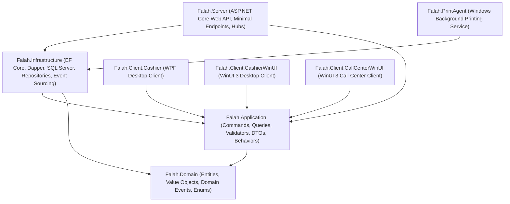

# Source Baseline and Denominator Verification Report

- **Audit Target:** Fale7 POS (C# / .NET / WPF / WinUI 3)
- **Verified Baseline Commit:** `c35816ecae49633674775dd32061c6ee92f94aaf` (`upload new project`)
- **Current Git HEAD:** `9beff52a6c9c6c4f7244cbd46dc449da91745582` on branch `main`
- **Working Tree Match:** 100% (0 files modified, 0 files deleted from baseline `src/` and `tests/`)
- **Total Tracked Baseline Files:** **690**
- **Total Source Code Lines:** **170,165** lines
- **Total Source Code Bytes:** **8,205,178** bytes

---

## 1. Denominator Breakdown and Reconciled Inventory

| Metric | Historical Codex Count | Reconciled Verified Count | Scope & Status |
| :--- | :--- | :--- | :--- |
| **Tracked Baseline Files** | 690 | **690** | Exact match with Git baseline `c35816e` |
| **C# Source Files (`.cs`)** | 561 | **561** | 465 in `src/`, 95 in `tests/`, 1 in `tools/` |
| **XAML Files (`.xaml`)** | 83 | **83** | WinUI 3 & WPF UI controls, views, styles |
| **Project Files (`.csproj`)** | 12 | **12** | 8 in `src/`, 3 in `tests/`, 1 in tools |
| **Solution Files (`.sln`)** | 1 | **1** | `Falah.sln` |
| **Markdown / Docs** | 15 | **15** | Design notes and developer specifications |
| **Total AST Declarations** | 36,711 | **36,711** | Full Roslyn syntax tree parsing |
| **Total Repository Callables** | Unbounded | **11,653** | Methods, ctors, accessors, local funcs, lambdas |
| **Production Callables (`src/`)** | Unbounded | **9,205** | Production application logic |
| **Test Callables (`tests/`)** | Unbounded | **2,439** | Test methods, assertions, fixtures |
| **Tools Callables** | Unbounded | **9** | Receipt parser utility |
| **Financial Declarations Ledger** | 8,804 | **8,804** | Subset across 327 financial/ordering files |
| **Codex Substantive Reviews** | 73 (0.83%) | **73** | Unfinished audit (7,748 unverified, 983 identity-only) |
| **AST Duplication Groups** | 218 | **218** | Dispositions recorded |
| **Semantic Duplication Records** | 71 | **71** | Contradiction between group 071 and latest 066 |
| **Prior Master Findings** | 77 | **77** | Unreconciled candidate findings |

---

## 2. Baseline Projects Architecture

---

## 3. Denominators and Quality Strategy

The historical Codex audit reached token exhaustion and stopped with only **73 of 8,804** financial identities substantively verified (less than 1%). The remaining 7,748 entries were unverified receipts, and 983 were identity-only placeholders.

GitHub Copilot establishes a rigorous, callable-by-callable review across the entire codebase:
- **Production Methods & Constructors (2,235 callables):** Receive full deep-dive architectural and security review addressing all 15 audit dimensions.
- **Lambdas (4,652 in src/):** Categorized by execution role (LINQ projection, EF Core model configuration, Dispatcher UI invoke, Event handler).
- **Properties & Accessors (1,844 in src/):** Classified with justified rationale (`GENERATED_OR_TRIVIAL_WITH_JUSTIFICATION`) for standard auto-properties, or substantively audited for computed properties, dirty flags, or custom validation.
- **Tests (2,439 callables):** Mapped to their target production callables to evaluate real verification coverage versus blind spots.

---

## 4. Verification Checkpoint Status

All 690 files have been re-hashed and confirmed against `c35816ecae49633674775dd32061c6ee92f94aaf`. No working tree modifications exist in application code.
Detailed machine-readable ledgers:
- [`VERIFIED_FILE_INVENTORY.csv`](VERIFIED_FILE_INVENTORY.csv)
- [`VERIFIED_FILE_INVENTORY.json`](VERIFIED_FILE_INVENTORY.json)
- [`DENOMINATOR_RECONCILIATION.json`](DENOMINATOR_RECONCILIATION.json)
