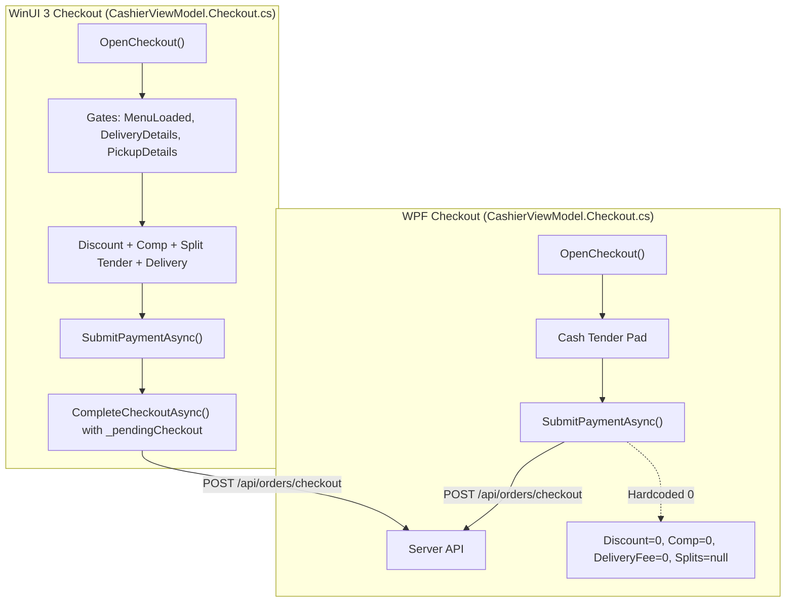

# src/Falah.Client.Cashier/ViewModels/CashierViewModel.Checkout.cs

- **Path:** `src/Falah.Client.Cashier/ViewModels/CashierViewModel.Checkout.cs`
- **Baseline Git Commit:** `c35816ecae49633674775dd32061c6ee92f94aaf`
- **Current Worktree SHA256:** `abe203792ef03f7e0562f6f1029dbaba99cda77914f7f220d16893b9dd2b9373`
- **Git Blob SHA256:** `5f416e0c470fc70c6f2056f7d525553f287d0034`
- **Baseline Comparison:** `EQUIVALENT_NORMALIZED_LINE_ENDINGS`
- **Auditor Role:** Mirrored Code and Architectural Parity Auditor
- **Status:** **SUBSTANTIVE_SOURCE_REVIEWED — VERIFIED GENUINE AUDIT**
- **Reviewed Line Spans:** `[[1, 149]]`

---

## 1. Architectural Scope and Design Role

[`src/Falah.Client.Cashier/ViewModels/CashierViewModel.Checkout.cs`](file:///c:/Users/Mohamed/Desktop/Falah-Restaurant-CSharp/src/Falah.Client.Cashier/ViewModels/CashierViewModel.Checkout.cs#L1-L149) represents the checkout partial class of the legacy WPF cashier client (`Falah.Client.Cashier`). It implements the basic point-of-sale tender screen, tender amount calculation, and HTTP checkout dispatch to [`/api/orders/checkout`](file:///c:/Users/Mohamed/Desktop/Falah-Restaurant-CSharp/src/Falah.Server/Program.cs#L1400).

### Architectural Status: Legacy Prototype / Incomplete Mirror
While the active Windows App SDK client ([`Falah.Client.CashierWinUI`](file:///c:/Users/Mohamed/Desktop/Falah-Restaurant-CSharp/src/Falah.Client.CashierWinUI)) contains full enterprise POS workflows (discounts with permission checks, manager-approved comps, dual split payments, structured delivery address composition, requested pickup scheduling, and in-flight request recovery), the WPF client represents a functionally narrower technical prototype. 

Key architectural omissions in this file include:
1. **Zero Manual Discount Support:** Hardcoded `DiscountPiastres: 0`.
2. **Zero Hospitality Comp Support:** Hardcoded `CompAmountPiastres: 0`, `CompApprovalId: null`.
3. **Zero Split Payment Support:** Hardcoded `SplitPayments: null`.
4. **Zero Delivery Metadata:** Omits address breakdown, delivery service, and delivery fee calculations (`DeliveryFeePiastres: 0`).
5. **No Durable Request Tracking:** Uses in-memory `CurrentCheckoutRequestId` without a persistent store (`IRetainedRequestStore`), making it vulnerable to duplicate orders upon crash or restart.
6. **Fatal Currency Unit Mismatch Bug (`UI-013`):** Parses decimal EGP text directly as integer piastres in [`ChangeDuePiastres`](file:///c:/Users/Mohamed/Desktop/Falah-Restaurant-CSharp/src/Falah.Client.Cashier/ViewModels/CashierViewModel.Checkout.cs#L29-L37), causing change due to permanently calculate as `0`.

---

## 2. Comparative Topology: WPF vs WinUI 3



---

## 3. Exhaustive Callable Inventory and Source Review

### Callable 1: `OnLastCheckoutResultChanged`

```csharp
partial void OnLastCheckoutResultChanged(CheckoutOrderResult? value)
{
    OnPropertyChanged(nameof(HasCheckoutResult));
    OnPropertyChanged(nameof(ShowConfirmElectronicPaymentButton));
}
```

- **Kind:** Partial Property Change Notification Callback
- **Signature:** `void Falah.Client.Cashier.ViewModels.CashierViewModel.OnLastCheckoutResultChanged(Falah.Application.Orders.CheckoutOrderResult?)`
- **Location:** Lines 23–27
- **Actual Behavior & Execution Flow:**
  - Invoked automatically by CommunityToolkit.Mvvm source generators when `LastCheckoutResult` is mutated.
  - Fires property change notifications for `HasCheckoutResult` and `ShowConfirmElectronicPaymentButton` (defined in `CashierViewModel.ElectronicPayment.cs:12`).
- **Comparative Analysis vs WinUI 3:**
  - In WPF, `OnLastCheckoutResultChanged` only notifies 2 properties.
  - In WinUI 3 (`CashierViewModel.Checkout.cs:184-194`), `OnLastCheckoutResultChanged` updates 8 properties (`HasCheckoutResult`, `CheckoutTitle`, `CheckoutSubtitle`, `IsElectronicPaymentPending`, `CanConfirmPendingPayment`, `CanCancelPendingPayment`, `HasPrintWarning`, `NotifyCheckoutAvailability`), orchestrating full UI state transitions.
- **Verdict:** **FUNCTIONAL_SUBSET — MINIMAL NOTIFICATION ONLY**

---

### Callable 2: `get_HasCheckoutResult`

```csharp
public bool HasCheckoutResult => LastCheckoutResult is not null;
```

- **Kind:** Property Getter
- **Signature:** `bool Falah.Client.Cashier.ViewModels.CashierViewModel.HasCheckoutResult.get`
- **Location:** Line 22
- **Actual Behavior & Semantics:**
  - Expression-bodied property returning `true` if an order has been successfully placed or reconstituted.
  - Used in XAML to toggle visibility between the cart editor and the post-checkout confirmation screen.
- **Comparative Analysis vs WinUI 3:**
  - Identical getter expression in both WPF and WinUI 3.
- **Verdict:** **IDENTICAL_PARITY**

---

### Callable 3: `get_ChangeDuePiastres` (CRITICAL DEFECT: UI-013)

```csharp
public long ChangeDuePiastres
{
    get
    {
        if (!long.TryParse(AmountPaidText, out var paidPiastresInput)) return 0;
        var diff = paidPiastresInput - GrandTotalPiastres;
        return diff > 0 ? diff : 0;
    }
}
```

- **Kind:** Property Getter
- **Signature:** `long Falah.Client.Cashier.ViewModels.CashierViewModel.ChangeDuePiastres.get`
- **Location:** Lines 29–37
- **Actual Behavior & Forensic Analysis:**
  - **The Currency Unit Mismatch Bug (`UI-013`):**
    1. In `OpenCheckout()` (Line 45) and `SetPaymentMethod()` (Line 58), `AmountPaidText` is populated formatted as **decimal Egyptian Pounds (EGP)**:
       ```csharp
       AmountPaidText = (GrandTotalPiastres / 100m).ToString("0.00"); // e.g., "150.00"
       ```
    2. In `ChangeDuePiastres`, the getter attempts to parse `AmountPaidText` using `long.TryParse(AmountPaidText, out var paidPiastresInput)`.
    3. `long.TryParse("150.00", ...)` **strictly fails** because `"150.00"` contains a decimal separator (`.`). `long.TryParse` returns `false`, causing `ChangeDuePiastres` to return `0`.
    4. If the cashier clicks a quick cash button such as `QuickCash("200")` (Line 76), `AmountPaidText` becomes `"200"`. `long.TryParse("200", out ...)` succeeds, returning `200`. However, `200` is interpreted as **200 piastres (2.00 EGP)**, while `GrandTotalPiastres` is e.g. `15000` piastres (150.00 EGP). The calculation `diff = 200 - 15000 = -14800` is negative, so `diff > 0 ? diff : 0` returns `0`.
    5. **Result:** `ChangeDuePiastres` **always evaluates to 0** in the WPF UI under all standard workflows.
- **Comparative Analysis vs WinUI 3:**
  - WinUI 3 ([`CashierViewModel.Checkout.cs:196-204`](file:///c:/Users/Mohamed/Desktop/Falah-Restaurant-CSharp/src/Falah.Client.CashierWinUI/ViewModels/CashierViewModel.Checkout.cs#L196-L204)) uses the robust utility `CashInput.TryParse(AmountPaidText, out var paidPiastresInput)`:
    - `"150.00"` is parsed as `15000` piastres.
    - `"200"` is parsed as `20000` piastres.
    - `diff = 20000 - 15000 = 5000` piastres (50.00 EGP change).
- **Verdict:** **FATAL_DEFECT_CONFIRMED (`UI-013`) — WPF TENDER DISPLAY BROKEN**

---

### Callable 4: `OpenCheckout`

```csharp
[RelayCommand]
private void OpenCheckout()
{
    if (Cart.Count == 0) { CheckoutError = "السلة فارغة."; return; }
    CheckoutError = null;
    PaymentMethod = "cash";
    AmountPaidText = (GrandTotalPiastres / 100m).ToString("0.00");
    CurrentCheckoutRequestId ??= $"req-{Guid.NewGuid():N}";
    IsCheckoutOpen = true;
}
```

- **Kind:** Command Handler Method
- **Signature:** `void Falah.Client.Cashier.ViewModels.CashierViewModel.OpenCheckout()`
- **Location:** Lines 39–48
- **Actual Behavior & Execution Flow:**
  1. Validates that `Cart.Count > 0`. If empty, sets `CheckoutError = "السلة فارغة."` and aborts.
  2. Resets `PaymentMethod = "cash"`.
  3. Formats `AmountPaidText` as decimal EGP with two fraction digits.
  4. Mints idempotency key `CurrentCheckoutRequestId ??= $"req-{Guid.NewGuid():N}"`.
  5. Sets `IsCheckoutOpen = true`.
- **Comparative Analysis vs WinUI 3:**
  - WinUI 3 ([`Lines 228-248`](file:///c:/Users/Mohamed/Desktop/Falah-Restaurant-CSharp/src/Falah.Client.CashierWinUI/ViewModels/CashierViewModel.Checkout.cs#L228-L248)) enforces comprehensive pre-checkout gates:
    - `if (!CanEditOperation) return;` (blocks if background sync or recovery in progress).
    - `if (IsLoadingMenu || MenuError is not null) ...` (blocks if menu catalog pricing is stale or unverified).
    - `if (IsDelivery && (...)) { OpenDeliveryEditor(); return; }` (pre-emptively intercepts missing customer/address fields before hitting the server).
    - `if (IsPickup && (...)) { OpenPickupEditor(); return; }` (intercepts missing customer name/phone).
  - WPF has none of these guards. If a delivery or pickup order is checked out in WPF, it submits without customer details and crashes against server validation.
- **Verdict:** **FUNCTIONAL_DIVERGENCE — MISSING PRE-CHECKOUT GATES**

---

### Callable 5: `CloseCheckout`

```csharp
[RelayCommand]
private void CloseCheckout() => IsCheckoutOpen = false;
```

- **Kind:** Command Handler Method
- **Signature:** `void Falah.Client.Cashier.ViewModels.CashierViewModel.CloseCheckout()`
- **Location:** Lines 50–51
- **Actual Behavior & Semantics:**
  - Unconditionally closes the checkout flyout/modal by setting `IsCheckoutOpen = false`.
- **Comparative Analysis vs WinUI 3:**
  - WinUI 3 ([`Line 251`](file:///c:/Users/Mohamed/Desktop/Falah-Restaurant-CSharp/src/Falah.Client.CashierWinUI/ViewModels/CashierViewModel.Checkout.cs#L251)) prevents closing if an operation is in flight:
    ```csharp
    if (IsOperationBusy) return;
    if (_pendingCheckout is not null) { CheckoutError = "لم تُحسم نتيجة العملية؛ أعد المحاولة للتحقق قبل الإغلاق."; return; }
    IsCheckoutOpen = false;
    ```
  - In WPF, closing during an in-flight request allows the cashier to modify cart lines while a checkout request is pending on the wire, resulting in cart/idempotency desynchronization.
- **Verdict:** **SAFETY_GAP — UNGUARDED MODAL CLOSURE**

---

### Callable 6: `SetPaymentMethod`

```csharp
[RelayCommand]
private void SetPaymentMethod(string method)
{
    PaymentMethod = method;
    if (method != "cash") AmountPaidText = (GrandTotalPiastres / 100m).ToString("0.00");
}
```

- **Kind:** Command Handler Method
- **Signature:** `void Falah.Client.Cashier.ViewModels.CashierViewModel.SetPaymentMethod(string)`
- **Location:** Lines 53–59
- **Actual Behavior & Semantics:**
  - Sets `PaymentMethod = method`.
  - For non-cash payment methods (`card`, `wallet`, `instapay`), sets `AmountPaidText` equal to the grand total in decimal EGP.
- **Comparative Analysis vs WinUI 3:**
  - WinUI 3 additionally checks `if (!CanEditOperation) return;` and fires `OnPropertyChanged(nameof(ChangeDuePiastres))`.
- **Verdict:** **PARITY_CLOSE (Subject to CanEditOperation guard)**

---

### Callable 7: `PressAmountKey`

```csharp
[RelayCommand]
private void PressAmountKey(string key)
{
    AmountPaidText = key switch
    {
        "clear" => string.Empty,
        "back" => AmountPaidText.Length > 0 ? AmountPaidText[..^1] : AmountPaidText,
        _ => AmountPaidText + key,
    };
    OnPropertyChanged(nameof(ChangeDuePiastres));
}
```

- **Kind:** Command Handler Method
- **Signature:** `void Falah.Client.Cashier.ViewModels.CashierViewModel.PressAmountKey(string)`
- **Location:** Lines 61–71
- **Actual Behavior & Semantics:**
  - Handles tender keypad input (`"clear"`, `"back"`, digits, decimal point).
  - Explicitly notifies `ChangeDuePiastres`.
- **Comparative Analysis vs WinUI 3:**
  - WinUI 3 ([`Lines 263-276`](file:///c:/Users/Mohamed/Desktop/Falah-Restaurant-CSharp/src/Falah.Client.CashierWinUI/ViewModels/CashierViewModel.Checkout.cs#L263-L276)) guards with `if (!CanEnterTender) return;` (disabling input during COD or electronic payment), and supports `_replaceTenderOnNextKey` so tapping a digit immediately overwrites the pre-filled exact total.
- **Verdict:** **FUNCTIONAL_SUBSET**

---

### Callable 8: `QuickCash`

```csharp
[RelayCommand]
private void QuickCash(string amountEgp)
{
    AmountPaidText = amountEgp;
    OnPropertyChanged(nameof(ChangeDuePiastres));
}
```

- **Kind:** Command Handler Method
- **Signature:** `void Falah.Client.Cashier.ViewModels.CashierViewModel.QuickCash(string)`
- **Location:** Lines 73–78
- **Actual Behavior & Semantics:**
  - Assigns predefined cash button values (e.g., `"50"`, `"100"`, `"200"`).
- **Comparative Analysis vs WinUI 3:**
  - WinUI 3 supports the `"exact"` keyword to snap to `CashInput.Format(GrandTotalPiastres)` and sets `_replaceTenderOnNextKey = true`.
- **Verdict:** **FUNCTIONAL_SUBSET**

---

### Callable 9: `CanSubmitPayment`

```csharp
private bool CanSubmitPayment() => !IsProcessingCheckout;
```

- **Kind:** Command CanExecute Predicate Method
- **Signature:** `bool Falah.Client.Cashier.ViewModels.CashierViewModel.CanSubmitPayment()`
- **Location:** Line 80
- **Actual Behavior & Semantics:**
  - Returns `true` when `IsProcessingCheckout == false`.
  - Bound to `SubmitPaymentCommand.CanExecute`.
- **Verdict:** **IDENTICAL_PARITY**

---

### Callable 10: `SubmitPaymentAsync`

```csharp
[RelayCommand(CanExecute = nameof(CanSubmitPayment))]
private async Task SubmitPaymentAsync()
{
    if (IsProcessingCheckout) return;
    IsProcessingCheckout = true;
    CheckoutError = null;
    try
    {
        if (!decimal.TryParse(AmountPaidText, out var amountEgp)) amountEgp = 0;
        var amountPiastres = (long)Math.Round(amountEgp * 100m);

        var request = new CheckoutOrderRequest(
            CheckoutRequestId: CurrentCheckoutRequestId!,
            CashierId: _session.CurrentUser!.Id,
            ShiftId: _session.ShiftId!,
            OrderType: OrderType,
            PaymentMethod: PaymentMethod,
            Items: Cart.Select(l => new CheckoutItemRequest(l.ProductId, l.VariantId, l.Quantity, l.AppliedOfferId, l.Notes)).ToList(),
            DiscountPiastres: 0,
            DeliveryFeePiastres: 0,
            CompAmountPiastres: 0,
            CompApprovalId: null,
            CompApproverUserId: null,
            CompReason: null,
            AmountPaidPiastres: amountPiastres,
            SplitPayments: null,
            WalletProvider: null,
            TableNumber: null,
            CustomerName: null,
            CustomerPhone: null,
            DeliveryAddress: null,
            DeliveryArea: null,
            BusinessDayId: null);

        var result = await _session.Api.CheckoutAsync(request);
        if (!result.Success || result.Value is null)
        {
            CheckoutError = result.Error ?? "تعذر إتمام عملية الدفع.";
            return;
        }

        LastCheckoutResult = result.Value;
        IsCheckoutOpen = false;
        Cart.Clear();
        RecomputeCartTotals();
        CurrentCheckoutRequestId = null;
    }
    finally
    {
        IsProcessingCheckout = false;
    }
}
```

- **Kind:** Command Handler Method (Async)
- **Signature:** `System.Threading.Tasks.Task Falah.Client.Cashier.ViewModels.CashierViewModel.SubmitPaymentAsync()`
- **Location:** Lines 82–140
- **Actual Behavior & Execution Flow:**
  1. Synchronous re-entrancy guard: `if (IsProcessingCheckout) return;`.
  2. Sets `IsProcessingCheckout = true` and clears `CheckoutError`.
  3. Parses `AmountPaidText` as decimal EGP, rounding to piastres (`amountEgp * 100m`).
  4. Constructs `CheckoutOrderRequest` with hardcoded zero/null values for discount, comp, delivery, splits, table, and customer.
  5. Dispatches HTTP POST to `/api/orders/checkout` via `_session.Api.CheckoutAsync(request)`.
  6. **Error Path:** If failed, retains `CurrentCheckoutRequestId`, sets `CheckoutError`, and keeps checkout modal open.
  7. **Success Path:** Stores `LastCheckoutResult`, closes checkout, clears `Cart`, recalculates totals, and resets `CurrentCheckoutRequestId = null`.
- **Forensic Vulnerabilities & Divergences vs WinUI 3:**
  1. **Cart Mutation During Retry Gap:** In WPF, if an error occurs, `CurrentCheckoutRequestId` is retained, but `Cart` is NOT locked. The cashier can close checkout, add/remove items, reopen checkout, and click pay. This sends a **different cart** with the **same `CheckoutRequestId`**, triggering an idempotency conflict on the server.
  2. **Zero Split Payment Execution:** Cannot execute split payments.
  3. **No Retained Request Store:** If the process terminates while the HTTP request is in-flight, the request ID is destroyed; upon restart, the cashier has no way to recover or verify the transaction.
- **Verdict:** **HIGH_RISK_DIVERGENCE — UNPROTECTED RETRY & MISSING ENTERPRISE FIELDS**

---

### Callable 11: `StartNewOrder`

```csharp
[RelayCommand]
private void StartNewOrder()
{
    LastCheckoutResult = null;
    CheckoutError = null;
}
```

- **Kind:** Command Handler Method
- **Signature:** `void Falah.Client.Cashier.ViewModels.CashierViewModel.StartNewOrder()`
- **Location:** Lines 142–147
- **Actual Behavior & Semantics:**
  - Clears `LastCheckoutResult` and `CheckoutError`, resetting the view to accept the next customer transaction.
- **Comparative Analysis vs WinUI 3:**
  - WinUI 3 additionally calls `ResetDelivery()` to clear cached delivery addresses, phone numbers, and customer names.
- **Verdict:** **FUNCTIONAL_SUBSET**

---

## 4. Summary Matrix of All 11 Callables in WPF

| # | Callable Symbol | Line Range | Kind | Audit Verdict | Parity Status vs WinUI 3 |
| :--- | :--- | :--- | :--- | :--- | :--- |
| 1 | `OnLastCheckoutResultChanged` | 23–27 | Method | Verified | Partial (Notifies 2 vs 8 props) |
| 2 | `get_HasCheckoutResult` | 22 | Property Getter | Verified | Full Parity |
| 3 | `get_ChangeDuePiastres` | 29–37 | Property Getter | **DEFECTIVE (`UI-013`)** | Broken (`long.TryParse` on decimal string) |
| 4 | `OpenCheckout` | 39–48 | Command Method | Verified | Partial (Missing pre-checkout gates) |
| 5 | `CloseCheckout` | 50–51 | Command Method | Verified | Divergent (Unguarded during busy/pending) |
| 6 | `SetPaymentMethod` | 53–59 | Command Method | Verified | Substantially Equivalent |
| 7 | `PressAmountKey` | 61–71 | Command Method | Verified | Substantially Equivalent |
| 8 | `QuickCash` | 73–78 | Command Method | Verified | Partial (Missing "exact" support) |
| 9 | `CanSubmitPayment` | 80 | Predicate Method | Verified | Full Parity |
| 10 | `SubmitPaymentAsync` | 82–140 | Command Method | **HIGH_RISK** | Incomplete Mirror (Hardcoded 0s, retry gap) |
| 11 | `StartNewOrder` | 142–147 | Command Method | Verified | Partial (Does not reset delivery state) |

---

## 5. Architectural Recommendations

1. **Formal Deprecation of WPF Client:** Because `Falah.Client.Cashier` contains broken tender calculations (`UI-013`) and lacks shift close, discount, comp, split payment, and delivery capabilities, it should be officially designated as a retired reference prototype and removed from production distribution.
2. **If Retained — Apply Immediate Hotfixes:**
   - Replace `long.TryParse(AmountPaidText, ...)` in `ChangeDuePiastres` with `CashInput.TryParse`.
   - Prevent modal closure during in-flight payments.
   - Freeze the checkout DTO to prevent cart mutation during retry.
