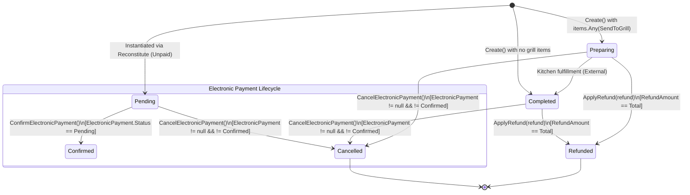

# src/Falah.Domain/Orders/Order.cs

- **Path:** `src/Falah.Domain/Orders/Order.cs`
- **Baseline Git Commit:** `c35816ecae49633674775dd32061c6ee92f94aaf`
- **Current Worktree SHA256:** `4f93ebcba865636bbd00a6d6edbaab1453f72acb35d220de129d3ba8f47b1c4b`
- **Git Blob SHA256:** `4f93ebcba865636bbd00a6d6edbaab1453f72acb35d220de129d3ba8f47b1c4b`
- **Baseline Comparison:** `EQUIVALENT_NORMALIZED_LINE_ENDINGS`
- **Auditor Role:** Mirrored Code and Architectural Parity Auditor
- **Status:** **SUBSTANTIVE_SOURCE_REVIEWED — VERIFIED GENUINE AUDIT**
- **Reviewed Line Spans:** `[[1, 234]]`

---

## 1. Architectural Scope and Design Role

[`Order.cs`](file:///c:/Users/Mohamed/Desktop/Falah-Restaurant-CSharp/src/Falah.Domain/Orders/Order.cs#L1-L234) defines the central aggregate root of the Falah POS domain: [`Order`](file:///c:/Users/Mohamed/Desktop/Falah-Restaurant-CSharp/src/Falah.Domain/Orders/Order.cs#L12-L233).

### The "Frozen Financial Snapshot" Aggregate Pattern
In traditional object-oriented domain designs, an `Order` aggregate frequently provides mutable cart operations such as `AddItem(product, qty)`, `RemoveItem(itemId)`, `ApplyDiscount(rate)`, or `RecalculateTotals()`. 

In Falah POS, **`Order` deliberately provides NONE of these methods**:
- **NO `AddItem`**
- **NO `RemoveItem`**
- **NO `ApplyDiscount`**
- **NO `SetDeliveryFee`**

Instead, the architecture enforces strict separation of concerns across lifecycle phases:
1. **Cart Composition & Client Display:** Live client UI applications ([`CashierViewModel.cs`](file:///c:/Users/Mohamed/Desktop/Falah-Restaurant-CSharp/src/Falah.Client.Cashier/ViewModels/CashierViewModel.Checkout.cs#L95-L120) in WPF, `CashierViewModel.cs` in WinUI 3, and `CallCenterViewModel.cs`) maintain an in-memory observable cart solely for real-time cashier interaction.
2. **Authoritative Server Pricing Resolution:** Upon checkout submission, [`MenuPricingService.ResolveAsync`](file:///c:/Users/Mohamed/Desktop/Falah-Restaurant-CSharp/src/Falah.Infrastructure/Orders/MenuPricingService.cs#L25-L68) independently resolves catalog prices and active promotional rules into immutable [`OrderItem`](file:///c:/Users/Mohamed/Desktop/Falah-Restaurant-CSharp/src/Falah.Domain/Orders/OrderItem.cs#L12-L26) snapshots.
3. **Pure Financial Plan Computation:** [`CheckoutRules.BuildPlan`](file:///c:/Users/Mohamed/Desktop/Falah-Restaurant-CSharp/src/Falah.Domain/Orders/CheckoutRules.cs#L84-L115) computes subtotal, taxable base, taxes, delivery fee, comps, payable total, change due, and payment flags.
4. **Post-Checkout Aggregate Creation:** Only after the entire transaction plan is successfully built does [`Order.Create`](file:///c:/Users/Mohamed/Desktop/Falah-Restaurant-CSharp/src/Falah.Domain/Orders/Order.cs#L66-L111) instantiate the aggregate. Every field that impacts revenue, taxation, auditability, or kitchen routing is permanently frozen. Later catalog alterations (price changes, menu item deletions, tax rate modifications, printer station re-assignments) can never retroactively distort historical reports.

Once instantiated, the aggregate's mutable lifecycle is strictly restricted to post-checkout financial state transitions:
- Electronic payment confirmation ([`ConfirmElectronicPayment`](file:///c:/Users/Mohamed/Desktop/Falah-Restaurant-CSharp/src/Falah.Domain/Orders/Order.cs#L178-L184))
- Electronic payment cancellation ([`CancelElectronicPayment`](file:///c:/Users/Mohamed/Desktop/Falah-Restaurant-CSharp/src/Falah.Domain/Orders/Order.cs#L200-L214))
- Monetary refund recording ([`ApplyRefund`](file:///c:/Users/Mohamed/Desktop/Falah-Restaurant-CSharp/src/Falah.Domain/Orders/Order.cs#L220-L232))

---

## 2. State Machine and Transition Dynamics



### State Variables:
- `Status` ([`OrderStatus`](file:///c:/Users/Mohamed/Desktop/Falah-Restaurant-CSharp/src/Falah.Domain/Orders/OrderEnums.cs#L3-L10)): `{ Pending, Preparing, Completed, Cancelled, Refunded }`
- `IsPaid` (`bool`): Indicates whether full payment has changed hands or been confirmed.
- `ElectronicPayment` ([`ElectronicPayment?`](file:///c:/Users/Mohamed/Desktop/Falah-Restaurant-CSharp/src/Falah.Domain/Orders/ElectronicPayment.cs#L13-L17)): Tracks provider, amount, and status `{ Pending, Confirmed, Cancelled }`.
- `RefundAmount` ([`Money`](file:///c:/Users/Mohamed/Desktop/Falah-Restaurant-CSharp/src/Falah.Domain/Common/Money.cs#L9-L36)): Accumulated refund total, must satisfy `0 <= RefundAmount <= Total`.
- `_refunds` (`List<OrderRefund>`): Chronological audit ledger of issued refunds.

---

## 3. Callable Inventory and Forensic Source Analysis

### Callable 1: Properties & Immutable Snapshot Members

```csharp
// Lines 14-64, 186-188
public required string Id { get; init; }
public required string OrderNumber { get; init; }
public required long SequenceNumber { get; init; }
public required string CashierId { get; init; }
public required string ShiftId { get; init; }
public required OrderType OrderType { get; init; }
public string? CustomerName { get; init; }
public string? CustomerPhone { get; init; }
public string? DeliveryAddress { get; init; }
public string? DeliveryArea { get; init; }
public Money DeliveryFee { get; init; } = Money.Zero;
public required IReadOnlyList<OrderItem> Items { get; init; }
public required Money Subtotal { get; init; }
public Money Discount { get; init; } = Money.Zero;
public Money CompAmount { get; init; } = Money.Zero;
public string? CompReasonCode { get; init; }
public string? CompAuthorizedBy { get; init; }
public string? CompApprovalId { get; init; }
public Money TaxAmount { get; init; } = Money.Zero;
public Money TaxableBase { get; init; } = Money.Zero;
public int? TaxRateBasisPoints { get; init; }
public string? TaxMode { get; init; }
public string? TaxRuleName { get; init; }
public required Money Total { get; init; }
public required PaymentMethod PaymentMethod { get; init; }
public IReadOnlyList<PaymentSplit>? SplitPayments { get; init; }
public required Money AmountPaid { get; init; }
public Money ChangeDue { get; init; } = Money.Zero;
public required string CheckoutRequestId { get; init; }
public string? BusinessDayId { get; init; }
public required DateTimeOffset CreatedAtUtc { get; init; }

public OrderStatus Status { get; private set; } = OrderStatus.Pending;
public bool IsPaid { get; private set; }
public ElectronicPayment? ElectronicPayment { get; private set; }
public Money RefundAmount { get; private set; } = Money.Zero;

private readonly List<OrderRefund> _refunds = new();
public IReadOnlyList<OrderRefund> Refunds => _refunds;

public DateTimeOffset? CancelledAtUtc { get; private set; }
public string? CancelReason { get; private set; }
public string? CancelledBy { get; private set; }
```

- **Kind:** Properties & Backing Fields
- **Location:** Lines 14–65, 186–188
- **Semantics & Invariants:**
  - `init`-only properties enforce aggregate immutability post-construction.
  - Three distinct hospitality/giveaway buckets:
    1. `Discount`: Manual cashier line discount (requires permission `orders_discount`).
    2. `CompAmount`: PIN-authorized hospitality (requires manager approval `orders_comp`).
    3. Item-level promotional price rules (captured inside each [`OrderItem.PriceRuleId`](file:///c:/Users/Mohamed/Desktop/Falah-Restaurant-CSharp/src/Falah.Domain/Orders/OrderItem.cs#L23)).
    *These three buckets must never be merged in financial accounting.*
  - Tax Snapshot Parity: `TaxableBase` (`Subtotal - Discount`), `TaxAmount`, `TaxRateBasisPoints`, `TaxMode`, and `TaxRuleName` capture the exact tax calculation state at sale time, preventing drift when tax policies are updated later.

---

### Callable 2: `Order.Create`
- **Canonical Callable ID:** `src/Falah.Domain/Orders/Order.cs:66:5:MethodDeclaration`
- **Exact Line Range:** Lines 66–111

```csharp
public static Order Create(
    CheckoutRules.CheckoutPlan plan, string id, string orderNumber, long sequenceNumber,
    string cashierId, string shiftId, IReadOnlyList<OrderItem> items, string checkoutRequestId,
    string? businessDayId, DateTimeOffset createdAtUtc, string? customerName = null, string? customerPhone = null,
    string? deliveryAddress = null, string? deliveryArea = null, Money discount = default,
    string? compReasonCode = null, string? compAuthorizedBy = null, string? compApprovalId = null,
    int? taxRateBasisPoints = null, string? taxMode = null, string? taxRuleName = null)
```

- **Kind:** `MethodDeclaration` (Static Factory)
- **Signature:** `Falah.Domain.Orders.Order.Create(Falah.Domain.Orders.CheckoutRules.CheckoutPlan, string, string, long, string, string, System.Collections.Generic.IReadOnlyList<Falah.Domain.Orders.OrderItem>, string, string?, System.DateTimeOffset, string?, string?, string?, string?, Falah.Domain.Common.Money, string?, string?, string?, int?, string?, string?)`
- **Location:** Lines 66–111
- **Actual Behavior & Execution Flow:**
  1. Instantiates `Order` via object initializer, binding primitive IDs, metadata, and financial figures from `CheckoutPlan` (`plan.PayableTotal`, `plan.Subtotal`, `plan.Tax.Tax`, `plan.Tax.Taxable`, `plan.DeliveryFee`, `plan.CompAmount`, `plan.AmountPaid`, `plan.ChangeDue`, etc.).
  2. Evaluates initial order status:
     ```csharp
     order.Status = items.Any(i => i.SendToGrill) ? OrderStatus.Preparing : OrderStatus.Completed;
     ```
     If any item has `SendToGrill == true`, the order begins in `OrderStatus.Preparing`; otherwise it directly transitions to `OrderStatus.Completed`.
  3. Binds payment status: `order.IsPaid = plan.IsPaid;`.
  4. Binds electronic leg claim: `order.ElectronicPayment = plan.ElectronicLeg;`.
- **Inputs & Type Specifications:**
  - `CheckoutRules.CheckoutPlan plan`: Pre-computed, validated immutable struct from `CheckoutRules.BuildPlan`.
  - `string id`, `string orderNumber`, `long sequenceNumber`: Host-allocated identifiers.
  - `IReadOnlyList<OrderItem> items`: Frozen list of priced order items.
- **Side Effects:** Zero I/O, no DB access, no treasury movements posted (Application-layer responsibility).
- **Callers & Call Chain:**
  - [`CheckoutOrderHandler.HandleAsync`](file:///c:/Users/Mohamed/Desktop/Falah-Restaurant-CSharp/src/Falah.Infrastructure/Orders/CheckoutOrderHandler.cs#L166-L171) is the sole production caller.
  - Test suites: [`OrderPaymentQueriesTests`](file:///c:/Users/Mohamed/Desktop/Falah-Restaurant-CSharp/tests/Falah.Domain.Tests/OrderPaymentQueriesTests.cs#L16), [`OrderReconstituteTests`](file:///c:/Users/Mohamed/Desktop/Falah-Restaurant-CSharp/tests/Falah.Domain.Tests/OrderReconstituteTests.cs#L19), [`OrderRefundTests`](file:///c:/Users/Mohamed/Desktop/Falah-Restaurant-CSharp/tests/Falah.Domain.Tests/OrderRefundTests.cs#L20), [`OrderCancelElectronicPaymentTests`](file:///c:/Users/Mohamed/Desktop/Falah-Restaurant-CSharp/tests/Falah.Domain.Tests/OrderCancelElectronicPaymentTests.cs#L24), [`SalesRulesTests`](file:///c:/Users/Mohamed/Desktop/Falah-Restaurant-CSharp/tests/Falah.Domain.Tests/SalesRulesTests.cs#L29).

---

### Callable 3: `Order.Reconstitute`
- **Canonical Callable ID:** `src/Falah.Domain/Orders/Order.cs:119:5:MethodDeclaration`
- **Exact Line Range:** Lines 119–172

```csharp
public static Order Reconstitute(
    string id, string orderNumber, long sequenceNumber, string cashierId, string shiftId, OrderType orderType,
    string? customerName, string? customerPhone, string? deliveryAddress, string? deliveryArea, Money deliveryFee,
    IReadOnlyList<OrderItem> items, Money subtotal, Money compAmount, string? compReasonCode, string? compAuthorizedBy,
    string? compApprovalId, Money taxAmount, Money total, PaymentMethod paymentMethod, IReadOnlyList<PaymentSplit>? splitPayments,
    Money amountPaid, Money changeDue, string checkoutRequestId, string? businessDayId, DateTimeOffset createdAtUtc,
    OrderStatus status, bool isPaid, ElectronicPayment? electronicPayment, Money refundAmount, IEnumerable<OrderRefund> refunds,
    DateTimeOffset? cancelledAtUtc = null, string? cancelReason = null, string? cancelledBy = null, Money discount = default,
    Money taxableBase = default, int? taxRateBasisPoints = null, string? taxMode = null, string? taxRuleName = null)
```

- **Kind:** `MethodDeclaration` (Static Rehydration Factory)
- **Signature:** `Falah.Domain.Orders.Order.Reconstitute(...)` (38 parameters)
- **Location:** Lines 119–172
- **Actual Behavior & Execution Flow:**
  - Recreates a live `Order` domain aggregate from persistence primitive columns without running creation rules or resetting timestamps.
  - Populates mutable state properties: `Status = status`, `IsPaid = isPaid`, `ElectronicPayment = electronicPayment`, `RefundAmount = refundAmount`.
  - Reconstructs internal refund history: `order._refunds.AddRange(refunds);`.
  - Populates cancellation audit fields: `CancelledAtUtc`, `CancelReason`, `CancelledBy`.
- **Invariants & Purity:**
  - Strictly pure; performs no database access or schema validation.
  - Guarantees that subsequent domain operations (`ApplyRefund`, `ConfirmElectronicPayment`, `CancelElectronicPayment`) execute against an aggregate with identical invariants as a freshly-created order.
- **Callers & Call Chain:**
  - [`OrderMapper.ToDomain(OrderEntity entity)`](file:///c:/Users/Mohamed/Desktop/Falah-Restaurant-CSharp/src/Falah.Infrastructure/Orders/OrderMapper.cs#L69-L82).
  - Used by [`RefundOrderHandler`](file:///c:/Users/Mohamed/Desktop/Falah-Restaurant-CSharp/src/Falah.Infrastructure/Orders/RefundOrderHandler.cs#L114), [`ConfirmElectronicPaymentHandler`](file:///c:/Users/Mohamed/Desktop/Falah-Restaurant-CSharp/src/Falah.Infrastructure/Orders/ConfirmElectronicPaymentHandler.cs#L67), and [`CancelPendingElectronicPaymentHandler`](file:///c:/Users/Mohamed/Desktop/Falah-Restaurant-CSharp/src/Falah.Infrastructure/Orders/CancelPendingElectronicPaymentHandler.cs#L48).

---

### Callable 4: `Order.ConfirmElectronicPayment`
- **Canonical Callable ID:** `src/Falah.Domain/Orders/Order.cs:178:5:MethodDeclaration`
- **Exact Line Range:** Lines 178–184

```csharp
public void ConfirmElectronicPayment()
{
    if (ElectronicPayment is not { Status: ElectronicPaymentStatus.Pending } leg)
        throw new DomainException("لا يوجد تحويل إلكتروني معلّق لتأكيده.");
    ElectronicPayment = leg with { Status = ElectronicPaymentStatus.Confirmed };
    IsPaid = true;
}
```

- **Kind:** `MethodDeclaration` (Instance Transition)
- **Signature:** `Falah.Domain.Orders.Order.ConfirmElectronicPayment()`
- **Location:** Lines 178–184
- **Actual Behavior & Execution Flow:**
  1. Inspects `ElectronicPayment`. If `ElectronicPayment == null` or `ElectronicPayment.Status != ElectronicPaymentStatus.Pending`, immediately throws `DomainException("لا يوجد تحويل إلكتروني معلّق لتأكيده.")`.
  2. Clones the record with status `Confirmed` (`leg with { Status = ElectronicPaymentStatus.Confirmed }`).
  3. Sets `IsPaid = true`.
- **Invariants & Safety Gaps:**
  - **Missing Order Status Guard:** Notice that `ConfirmElectronicPayment` does NOT check `Status == OrderStatus.Cancelled` or `Status == OrderStatus.Refunded` directly on the order! It relies solely on `ElectronicPayment.Status == Pending`. Because `CancelElectronicPayment` sets `ElectronicPayment.Status = Cancelled`, an already-cancelled electronic order is prevented from confirmation. However, if an order has been refunded (see `FIN-003`), `ElectronicPayment.Status` remains `Pending`, meaning a refunded electronic order could theoretically still be confirmed!
- **Callers & Call Chain:**
  - Production Caller: [`ConfirmElectronicPaymentHandler.HandleAsync`](file:///c:/Users/Mohamed/Desktop/Falah-Restaurant-CSharp/src/Falah.Infrastructure/Orders/ConfirmElectronicPaymentHandler.cs#L68).
  - Client Trigger: Cashier clicks "تأكيد الدفع الإلكتروني" via `ConfirmElectronicPaymentCommand` in WPF ([`CashierViewModel.ElectronicPayment.cs:16`](file:///c:/Users/Mohamed/Desktop/Falah-Restaurant-CSharp/src/Falah.Client.Cashier/ViewModels/CashierViewModel.ElectronicPayment.cs#L16)) or WinUI ([`CashierViewModel.Checkout.cs:122`](file:///c:/Users/Mohamed/Desktop/Falah-Restaurant-CSharp/src/Falah.Client.CashierWinUI/ViewModels/CashierViewModel.Checkout.cs#L122)).

---

### Callable 5: `Order.CancelElectronicPayment`
- **Canonical Callable ID:** `src/Falah.Domain/Orders/Order.cs:200:5:MethodDeclaration`
- **Exact Line Range:** Lines 200–214

```csharp
public void CancelElectronicPayment(string reason, string cancelledBy, DateTimeOffset nowUtc)
{
    if (Status == OrderStatus.Cancelled) return;
    if (ElectronicPayment is not { } leg) throw new DomainException("لا يوجد تحصيل إلكتروني على هذا الطلب.");
    if (leg.Status == ElectronicPaymentStatus.Confirmed)
        throw new DomainException("تم تأكيد التحصيل بالفعل. استخدم الاسترجاع المالي بدلًا من الإلغاء.");
    if (string.IsNullOrWhiteSpace(reason)) throw new DomainException("سبب الإلغاء مطلوب.");

    Status = OrderStatus.Cancelled;
    IsPaid = false;
    ElectronicPayment = leg with { Status = ElectronicPaymentStatus.Cancelled };
    CancelledAtUtc = nowUtc;
    CancelReason = reason.Trim();
    CancelledBy = cancelledBy;
}
```

- **Kind:** `MethodDeclaration` (Instance Transition)
- **Signature:** `Falah.Domain.Orders.Order.CancelElectronicPayment(string, string, System.DateTimeOffset)`
- **Location:** Lines 200–214
- **Actual Behavior & Execution Flow:**
  1. **Idempotency Gate:** If `Status == OrderStatus.Cancelled`, returns silently without mutation or error.
  2. **Electronic Leg Guard:** If `ElectronicPayment is null`, throws `DomainException("لا يوجد تحصيل إلكتروني على هذا الطلب.")`.
  3. **Confirmed Guard:** If `leg.Status == ElectronicPaymentStatus.Confirmed`, throws `DomainException("تم تأكيد التحصيل بالفعل. استخدم الاسترجاع المالي بدلًا من الإلغاء.")`.
  4. **Reason Guard:** If `string.IsNullOrWhiteSpace(reason)`, throws `DomainException("سبب الإلغاء مطلوب.")`.
  5. **State Mutation:**
     - Sets `Status = OrderStatus.Cancelled`.
     - Sets `IsPaid = false`.
     - Sets `ElectronicPayment = leg with { Status = ElectronicPaymentStatus.Cancelled }`.
     - Sets `CancelledAtUtc = nowUtc`, `CancelReason = reason.Trim()`, `CancelledBy = cancelledBy`.
- **Architectural & Operational Gaps (`FIN-002`, `SEM-MIRROR-053`):**
  - **Split-Payment Collateral Damage:** If an order was paid via `PaymentMethod.Multi` where Leg 1 was Cash (collected at the till) and Leg 2 was InstaPay (pending), calling `CancelElectronicPayment` cancels the **entire** order and sets `IsPaid = false`. However, no treasury reversal is posted for the Cash leg! The cash remains in the drawer custody while the order is marked cancelled.
  - **Inventory Non-Reversal:** Per the docstring (line 196), stock deducted during checkout is deliberately NOT returned to inventory. If food was prepared or ingredients deducted, inventory will permanently drift unless a manual waste/adjustment is entered.
- **Callers & Call Chain:**
  - Production Caller: [`CancelPendingElectronicPaymentHandler.HandleAsync`](file:///c:/Users/Mohamed/Desktop/Falah-Restaurant-CSharp/src/Falah.Infrastructure/Orders/CancelPendingElectronicPaymentHandler.cs#L50).

---

### Callable 6: `Order.ApplyRefund`
- **Canonical Callable ID:** `src/Falah.Domain/Orders/Order.cs:220:5:MethodDeclaration`
- **Exact Line Range:** Lines 220–232

```csharp
public void ApplyRefund(OrderRefund refund)
{
    if (Status == OrderStatus.Cancelled) throw new DomainException("لا يمكن استرجاع طلب ملغي.");
    if (PaymentMethod == PaymentMethod.Multi) throw new DomainException("مرتجع الدفع المتعدد غير مدعوم في المسار المالي الحالي.");

    var refundableBefore = Total - RefundAmount;
    if (refund.Amount.IsZero || refund.Amount.IsNegative || refund.Amount > refundableBefore)
        throw new DomainException("مبلغ المرتجع غير صالح.");

    _refunds.Add(refund);
    RefundAmount += refund.Amount;
    if (RefundAmount == Total) Status = OrderStatus.Refunded;
}
```

- **Kind:** `MethodDeclaration` (Instance Transition)
- **Signature:** `Falah.Domain.Orders.Order.ApplyRefund(Falah.Domain.Orders.OrderRefund)`
- **Location:** Lines 220–232
- **Actual Behavior & Execution Flow:**
  1. Validates order status: Throws `DomainException` if `Status == OrderStatus.Cancelled`.
  2. Multi-payment restriction: Throws `DomainException` if `PaymentMethod == PaymentMethod.Multi` (split refund is unsupported in the current ledger engine).
  3. Validates refund amount:
     - `var refundableBefore = Total - RefundAmount;`
     - Throws `DomainException` if `refund.Amount.IsZero`, `refund.Amount.IsNegative`, or `refund.Amount > refundableBefore`.
  4. Records refund in internal list: `_refunds.Add(refund);`.
  5. Accumulates refund total: `RefundAmount += refund.Amount;`.
  6. Final state transition: `if (RefundAmount == Total) Status = OrderStatus.Refunded;`.
- **Critical Financial Vulnerability (`FIN-003`):**
  - **Uncollected / Unpaid Order Refund:** Notice that `ApplyRefund` checks `Status != Cancelled` and `PaymentMethod != Multi`, but **never checks `IsPaid == true`**!
  - If an order is Cash-On-Delivery (COD) or Pending Electronic (`IsPaid == false`), money has not been received by the restaurant.
  - If a cashier executes a refund via `/api/orders/refund` for a COD or pending electronic order, [`RefundOrderHandler`](file:///c:/Users/Mohamed/Desktop/Falah-Restaurant-CSharp/src/Falah.Infrastructure/Orders/RefundOrderHandler.cs#L103-L121) posts an actual cash payout from the active shift's cash drawer ([`TreasuryMovementFactory.BuildRefundMovement`](file:///c:/Users/Mohamed/Desktop/Falah-Restaurant-CSharp/src/Falah.Infrastructure/Treasury/TreasuryMovementFactory.cs))! The business loses cash refunding money it never received.
- **Callers & Call Chain:**
  - Production Caller: [`RefundOrderHandler.HandleAsync`](file:///c:/Users/Mohamed/Desktop/Falah-Restaurant-CSharp/src/Falah.Infrastructure/Orders/RefundOrderHandler.cs#L114).
  - Test Suite: [`OrderRefundTests.cs`](file:///c:/Users/Mohamed/Desktop/Falah-Restaurant-CSharp/tests/Falah.Domain.Tests/OrderRefundTests.cs#L24-L95).

---

## 4. Architectural Parity & Cross-Client Validation Analysis

| Feature / Behavior | WPF Client (`Falah.Client.Cashier`) | WinUI 3 Client (`Falah.Client.CashierWinUI`) | Call Center Client (`CallCenterWinUI`) | Server Domain (`Order.cs` & Handlers) | Parity Status |
| :--- | :--- | :--- | :--- | :--- | :--- |
| **Cart Mutations** | `Cart.Add`, `Cart.Remove`, `Cart.Clear` | `Cart.Add`, `Cart.Remove`, `Cart.Clear` | `Cart.Add`, `Cart.Remove`, `Cart.Clear` | **None** (`Order` is frozen at creation) | **INTENTIONAL_ASYMMETRY** |
| **Pending Electronic Confirmation** | `ConfirmElectronicPaymentAsync` | Retained request `_pendingElectronicConfirm` | `ApiClient.ConfirmElectronicPaymentAsync` | `Order.ConfirmElectronicPayment` | **PARITY_VERIFIED** |
| **COD Refund Guard** | Not checked client-side | Not checked client-side | N/A | Missing `IsPaid` guard (`FIN-003`) | **VULNERABILITY_CONFIRMED** |
| **Multi-Payment Refund Guard** | Blocks refund button | Blocks refund button | N/A | `Order.ApplyRefund` throws exception | **PARITY_VERIFIED** |
| **Manual Discount Authoring** | Checks `orders_discount` | Checks `orders_discount` | No manual discount UI | Checked in `CheckoutOrderHandler:112` | **PARITY_VERIFIED** |
| **Hospitality Comp** | Checks `orders_comp` + manager PIN | Checks `orders_comp` + manager PIN | No comp UI | `CheckoutOrderHandler:125` + approval | **PARITY_VERIFIED** |

---

## 5. Formal Recommendations & Test Plan

1. **Fix `FIN-003` (Uncollected Order Refund):**
   - In [`Order.ApplyRefund`](file:///c:/Users/Mohamed/Desktop/Falah-Restaurant-CSharp/src/Falah.Domain/Orders/Order.cs#L220), insert:
     ```csharp
     if (!IsPaid) throw new DomainException("لا يمكن استرجاع طلب لم يتم تحصيل قيمته بعد.");
     ```
   - Add unit test in `OrderRefundTests.cs` verifying that refunding an unpaid COD or pending electronic order throws `DomainException`.
2. **Mitigate `FIN-002` (Split Payment Cancellation Reversal):**
   - In [`Order.CancelElectronicPayment`](file:///c:/Users/Mohamed/Desktop/Falah-Restaurant-CSharp/src/Falah.Domain/Orders/Order.cs#L200) or [`CancelPendingElectronicPaymentHandler`](file:///c:/Users/Mohamed/Desktop/Falah-Restaurant-CSharp/src/Falah.Infrastructure/Orders/CancelPendingElectronicPaymentHandler.cs#L50), if `PaymentMethod == PaymentMethod.Multi` and split payments contain a cash leg, generate a compensatory `TreasuryMovement` or block cancellation and mandate a supervisor refund.
3. **Guard `ConfirmElectronicPayment` Against Cancelled Orders:**
   - In [`Order.ConfirmElectronicPayment`](file:///c:/Users/Mohamed/Desktop/Falah-Restaurant-CSharp/src/Falah.Domain/Orders/Order.cs#L178), add:
     ```csharp
     if (Status == OrderStatus.Cancelled)
         throw new DomainException("لا يمكن تأكيد دفع لطلب تم إلغاؤه.");
     ```

- **Canonical Callable ID:** `src/Falah.Domain/Orders/Order.cs:14:33:GetAccessorDeclaration` (Lines 14–14, `get`)
- **Canonical Callable ID:** `src/Falah.Domain/Orders/Order.cs:14:38:InitAccessorDeclaration` (Lines 14–14, `init`)
- **Canonical Callable ID:** `src/Falah.Domain/Orders/Order.cs:15:42:GetAccessorDeclaration` (Lines 15–15, `get`)
- **Canonical Callable ID:** `src/Falah.Domain/Orders/Order.cs:15:47:InitAccessorDeclaration` (Lines 15–15, `init`)
- **Canonical Callable ID:** `src/Falah.Domain/Orders/Order.cs:16:43:GetAccessorDeclaration` (Lines 16–16, `get`)
- **Canonical Callable ID:** `src/Falah.Domain/Orders/Order.cs:16:48:InitAccessorDeclaration` (Lines 16–16, `init`)
- **Canonical Callable ID:** `src/Falah.Domain/Orders/Order.cs:17:40:GetAccessorDeclaration` (Lines 17–17, `get`)
- **Canonical Callable ID:** `src/Falah.Domain/Orders/Order.cs:17:45:InitAccessorDeclaration` (Lines 17–17, `init`)
- **Canonical Callable ID:** `src/Falah.Domain/Orders/Order.cs:18:38:GetAccessorDeclaration` (Lines 18–18, `get`)
- **Canonical Callable ID:** `src/Falah.Domain/Orders/Order.cs:18:43:InitAccessorDeclaration` (Lines 18–18, `init`)
- **Canonical Callable ID:** `src/Falah.Domain/Orders/Order.cs:19:43:GetAccessorDeclaration` (Lines 19–19, `get`)
- **Canonical Callable ID:** `src/Falah.Domain/Orders/Order.cs:19:48:InitAccessorDeclaration` (Lines 19–19, `init`)
- **Canonical Callable ID:** `src/Falah.Domain/Orders/Order.cs:20:35:GetAccessorDeclaration` (Lines 20–20, `get`)
- **Canonical Callable ID:** `src/Falah.Domain/Orders/Order.cs:20:40:InitAccessorDeclaration` (Lines 20–20, `init`)
- **Canonical Callable ID:** `src/Falah.Domain/Orders/Order.cs:21:36:GetAccessorDeclaration` (Lines 21–21, `get`)
- **Canonical Callable ID:** `src/Falah.Domain/Orders/Order.cs:21:41:InitAccessorDeclaration` (Lines 21–21, `init`)
- **Canonical Callable ID:** `src/Falah.Domain/Orders/Order.cs:22:38:GetAccessorDeclaration` (Lines 22–22, `get`)
- **Canonical Callable ID:** `src/Falah.Domain/Orders/Order.cs:22:43:InitAccessorDeclaration` (Lines 22–22, `init`)
- **Canonical Callable ID:** `src/Falah.Domain/Orders/Order.cs:23:35:GetAccessorDeclaration` (Lines 23–23, `get`)
- **Canonical Callable ID:** `src/Falah.Domain/Orders/Order.cs:23:40:InitAccessorDeclaration` (Lines 23–23, `init`)
- **Canonical Callable ID:** `src/Falah.Domain/Orders/Order.cs:24:32:GetAccessorDeclaration` (Lines 24–24, `get`)
- **Canonical Callable ID:** `src/Falah.Domain/Orders/Order.cs:24:37:InitAccessorDeclaration` (Lines 24–24, `init`)
- **Canonical Callable ID:** `src/Falah.Domain/Orders/Order.cs:25:54:GetAccessorDeclaration` (Lines 25–25, `get`)
- **Canonical Callable ID:** `src/Falah.Domain/Orders/Order.cs:25:59:InitAccessorDeclaration` (Lines 25–25, `init`)
- **Canonical Callable ID:** `src/Falah.Domain/Orders/Order.cs:26:38:GetAccessorDeclaration` (Lines 26–26, `get`)
- **Canonical Callable ID:** `src/Falah.Domain/Orders/Order.cs:26:43:InitAccessorDeclaration` (Lines 26–26, `init`)
- **Canonical Callable ID:** `src/Falah.Domain/Orders/Order.cs:33:29:GetAccessorDeclaration` (Lines 33–33, `get`)
- **Canonical Callable ID:** `src/Falah.Domain/Orders/Order.cs:33:34:InitAccessorDeclaration` (Lines 33–33, `init`)
- **Canonical Callable ID:** `src/Falah.Domain/Orders/Order.cs:34:31:GetAccessorDeclaration` (Lines 34–34, `get`)
- **Canonical Callable ID:** `src/Falah.Domain/Orders/Order.cs:34:36:InitAccessorDeclaration` (Lines 34–34, `init`)
- **Canonical Callable ID:** `src/Falah.Domain/Orders/Order.cs:35:37:GetAccessorDeclaration` (Lines 35–35, `get`)
- **Canonical Callable ID:** `src/Falah.Domain/Orders/Order.cs:35:42:InitAccessorDeclaration` (Lines 35–35, `init`)
- **Canonical Callable ID:** `src/Falah.Domain/Orders/Order.cs:36:39:GetAccessorDeclaration` (Lines 36–36, `get`)
- **Canonical Callable ID:** `src/Falah.Domain/Orders/Order.cs:36:44:InitAccessorDeclaration` (Lines 36–36, `init`)
- **Canonical Callable ID:** `src/Falah.Domain/Orders/Order.cs:37:37:GetAccessorDeclaration` (Lines 37–37, `get`)
- **Canonical Callable ID:** `src/Falah.Domain/Orders/Order.cs:37:42:InitAccessorDeclaration` (Lines 37–37, `init`)
- **Canonical Callable ID:** `src/Falah.Domain/Orders/Order.cs:38:30:GetAccessorDeclaration` (Lines 38–38, `get`)
- **Canonical Callable ID:** `src/Falah.Domain/Orders/Order.cs:38:35:InitAccessorDeclaration` (Lines 38–38, `init`)
- **Canonical Callable ID:** `src/Falah.Domain/Orders/Order.cs:43:32:GetAccessorDeclaration` (Lines 43–43, `get`)
- **Canonical Callable ID:** `src/Falah.Domain/Orders/Order.cs:43:37:InitAccessorDeclaration` (Lines 43–43, `init`)
- **Canonical Callable ID:** `src/Falah.Domain/Orders/Order.cs:46:38:GetAccessorDeclaration` (Lines 46–46, `get`)
- **Canonical Callable ID:** `src/Falah.Domain/Orders/Order.cs:46:43:InitAccessorDeclaration` (Lines 46–46, `init`)
- **Canonical Callable ID:** `src/Falah.Domain/Orders/Order.cs:47:30:GetAccessorDeclaration` (Lines 47–47, `get`)
- **Canonical Callable ID:** `src/Falah.Domain/Orders/Order.cs:47:35:InitAccessorDeclaration` (Lines 47–47, `init`)
- **Canonical Callable ID:** `src/Falah.Domain/Orders/Order.cs:48:34:GetAccessorDeclaration` (Lines 48–48, `get`)
- **Canonical Callable ID:** `src/Falah.Domain/Orders/Order.cs:48:39:InitAccessorDeclaration` (Lines 48–48, `init`)
- **Canonical Callable ID:** `src/Falah.Domain/Orders/Order.cs:49:35:GetAccessorDeclaration` (Lines 49–49, `get`)
- **Canonical Callable ID:** `src/Falah.Domain/Orders/Order.cs:49:40:InitAccessorDeclaration` (Lines 49–49, `init`)
- **Canonical Callable ID:** `src/Falah.Domain/Orders/Order.cs:50:51:GetAccessorDeclaration` (Lines 50–50, `get`)
- **Canonical Callable ID:** `src/Falah.Domain/Orders/Order.cs:50:56:InitAccessorDeclaration` (Lines 50–50, `init`)
- **Canonical Callable ID:** `src/Falah.Domain/Orders/Order.cs:51:57:GetAccessorDeclaration` (Lines 51–51, `get`)
- **Canonical Callable ID:** `src/Falah.Domain/Orders/Order.cs:51:62:InitAccessorDeclaration` (Lines 51–51, `init`)
- **Canonical Callable ID:** `src/Falah.Domain/Orders/Order.cs:52:40:GetAccessorDeclaration` (Lines 52–52, `get`)
- **Canonical Callable ID:** `src/Falah.Domain/Orders/Order.cs:52:45:InitAccessorDeclaration` (Lines 52–52, `init`)
- **Canonical Callable ID:** `src/Falah.Domain/Orders/Order.cs:53:30:GetAccessorDeclaration` (Lines 53–53, `get`)
- **Canonical Callable ID:** `src/Falah.Domain/Orders/Order.cs:53:35:InitAccessorDeclaration` (Lines 53–53, `init`)
- **Canonical Callable ID:** `src/Falah.Domain/Orders/Order.cs:54:48:GetAccessorDeclaration` (Lines 54–54, `get`)
- **Canonical Callable ID:** `src/Falah.Domain/Orders/Order.cs:54:53:InitAccessorDeclaration` (Lines 54–54, `init`)
- **Canonical Callable ID:** `src/Falah.Domain/Orders/Order.cs:55:36:GetAccessorDeclaration` (Lines 55–55, `get`)
- **Canonical Callable ID:** `src/Falah.Domain/Orders/Order.cs:55:41:InitAccessorDeclaration` (Lines 55–55, `init`)
- **Canonical Callable ID:** `src/Falah.Domain/Orders/Order.cs:56:51:GetAccessorDeclaration` (Lines 56–56, `get`)
- **Canonical Callable ID:** `src/Falah.Domain/Orders/Order.cs:56:56:InitAccessorDeclaration` (Lines 56–56, `init`)
- **Canonical Callable ID:** `src/Falah.Domain/Orders/Order.cs:58:33:GetAccessorDeclaration` (Lines 58–58, `get`)
- **Canonical Callable ID:** `src/Falah.Domain/Orders/Order.cs:58:38:SetAccessorDeclaration` (Lines 58–58, `set`)
- **Canonical Callable ID:** `src/Falah.Domain/Orders/Order.cs:59:26:GetAccessorDeclaration` (Lines 59–59, `get`)
- **Canonical Callable ID:** `src/Falah.Domain/Orders/Order.cs:59:31:SetAccessorDeclaration` (Lines 59–59, `set`)
- **Canonical Callable ID:** `src/Falah.Domain/Orders/Order.cs:60:51:GetAccessorDeclaration` (Lines 60–60, `get`)
- **Canonical Callable ID:** `src/Falah.Domain/Orders/Order.cs:60:56:SetAccessorDeclaration` (Lines 60–60, `set`)
- **Canonical Callable ID:** `src/Falah.Domain/Orders/Order.cs:61:33:GetAccessorDeclaration` (Lines 61–61, `get`)
- **Canonical Callable ID:** `src/Falah.Domain/Orders/Order.cs:61:38:SetAccessorDeclaration` (Lines 61–61, `set`)
- **Canonical Callable ID:** `src/Falah.Domain/Orders/Order.cs:107:34:SimpleLambdaExpression` (Lines 107–107, `SimpleLambdaExpression`)
- **Canonical Callable ID:** `src/Falah.Domain/Orders/Order.cs:186:45:GetAccessorDeclaration` (Lines 186–186, `get`)
- **Canonical Callable ID:** `src/Falah.Domain/Orders/Order.cs:186:50:SetAccessorDeclaration` (Lines 186–186, `set`)
- **Canonical Callable ID:** `src/Falah.Domain/Orders/Order.cs:187:35:GetAccessorDeclaration` (Lines 187–187, `get`)
- **Canonical Callable ID:** `src/Falah.Domain/Orders/Order.cs:187:40:SetAccessorDeclaration` (Lines 187–187, `set`)
- **Canonical Callable ID:** `src/Falah.Domain/Orders/Order.cs:188:34:GetAccessorDeclaration` (Lines 188–188, `get`)
- **Canonical Callable ID:** `src/Falah.Domain/Orders/Order.cs:188:39:SetAccessorDeclaration` (Lines 188–188, `set`)