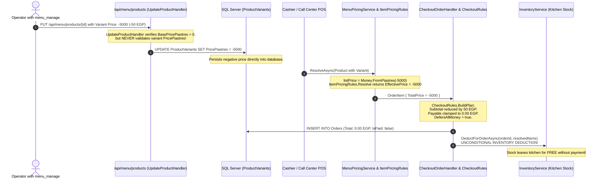

# src/Falah.Infrastructure/Menu/ProductHandlers.cs

- **Path:** `src/Falah.Infrastructure/Menu/ProductHandlers.cs`
- **Baseline Git Commit:** `c35816ecae49633674775dd32061c6ee92f94aaf`
- **Current Worktree SHA256:** `98b29b5ace01d781c176b352b054b561973281e4e923c23cb0794412c6107247`
- **Git Blob SHA256:** `72586c396821ff033030936f49f62c5dee957038d129fac80a11040cb88706a3`
- **Baseline Comparison:** `EQUIVALENT_NORMALIZED_LINE_ENDINGS`
- **Auditor Role:** Mirrored Code and Architectural Parity Auditor
- **Status:** **SUBSTANTIVE_SOURCE_REVIEWED — VERIFIED GENUINE AUDIT**
- **Reviewed Line Spans:** `[[1, 207]]`

---

## 1. Architectural Scope and Design Role

[`ProductHandlers.cs`](file:///c:/Users/Mohamed/Desktop/Falah-Restaurant-CSharp/src/Falah.Infrastructure/Menu/ProductHandlers.cs#L1-L207) resides in `Falah.Infrastructure.Menu` and implements the CQRS command handlers responsible for authoring and managing the restaurant's menu catalog:
1. [`CreateProductHandler`](file:///c:/Users/Mohamed/Desktop/Falah-Restaurant-CSharp/src/Falah.Infrastructure/Menu/ProductHandlers.cs#L16-L74): Creates new products with nested variants.
2. [`UpdateProductHandler`](file:///c:/Users/Mohamed/Desktop/Falah-Restaurant-CSharp/src/Falah.Infrastructure/Menu/ProductHandlers.cs#L82-L153): Updates existing products and replaces the variant collection via full-set upsert.
3. [`SetProductAvailabilityHandler`](file:///c:/Users/Mohamed/Desktop/Falah-Restaurant-CSharp/src/Falah.Infrastructure/Menu/ProductHandlers.cs#L157-L195): Manages item availability toggling (soft-delete).
4. [`MenuValidation.AssertValidStation`](file:///c:/Users/Mohamed/Desktop/Falah-Restaurant-CSharp/src/Falah.Infrastructure/Menu/ProductHandlers.cs#L197-L206): Internal validator for kitchen preparation routing.

All write operations require the `menu_manage` permission, log immutable audit events to [`IAuditLog`](file:///c:/Users/Mohamed/Desktop/Falah-Restaurant-CSharp/src/Falah.Domain/Audit/AuditEvent.cs), and implement idempotent request deduplication.

---

## 2. Callable Inventory and Forensic Source Analysis

### Callable 1: `CreateProductHandler.CreateProductHandler` (Constructor)
- **Canonical Callable ID:** `src/Falah.Infrastructure/Menu/ProductHandlers.cs:22:5:ConstructorDeclaration`
- **Exact Line Range:** Lines 22–27

```csharp
public CreateProductHandler(FalahDbContext db, IApprovalRegistry approvalRegistry, IAuditLog auditLog)
```

- **Kind:** `ConstructorDeclaration`
- **Signature:** `Falah.Infrastructure.Menu.CreateProductHandler.CreateProductHandler(Falah.Infrastructure.Persistence.FalahDbContext, Falah.Domain.Authorization.IApprovalRegistry, Falah.Domain.Audit.IAuditLog)`
- **Location:** Lines 22–27
- **Actual Behavior:** Injects the EF Core `FalahDbContext`, `IApprovalRegistry`, and `IAuditLog`.
- **Side Effects:** Stores injected instances in private readonly fields.

---

### Callable 2: `CreateProductHandler.HandleAsync`
- **Canonical Callable ID:** `src/Falah.Infrastructure/Menu/ProductHandlers.cs:170:5:MethodDeclaration`
- **Exact Line Range:** Lines 170–194
- **Canonical Callable ID:** `src/Falah.Infrastructure/Menu/ProductHandlers.cs:95:5:MethodDeclaration`
- **Exact Line Range:** Lines 95–152
- **Canonical Callable ID:** `src/Falah.Infrastructure/Menu/ProductHandlers.cs:29:5:MethodDeclaration`
- **Exact Line Range:** Lines 29–73

```csharp
public async Task<CreateProductResult> HandleAsync(CreateProductRequest request, CancellationToken ct = default)
```

- **Kind:** `MethodDeclaration`
- **Signature:** `Falah.Infrastructure.Menu.CreateProductHandler.HandleAsync(Falah.Application.Menu.CreateProductRequest, System.Threading.CancellationToken)`
- **Location:** Lines 29–73
- **Actual Behavior & Execution Flow:**
  1. **Idempotent Replay Check:**
     Derives deterministic primary key: `id = $"prod-{request.RequestId}"`. Queries `_db.Products.AsNoTracking().FirstOrDefaultAsync(p => p.Id == id, ct)`. If an existing entity matches, returns `new CreateProductResult(existing.Id, WasReplayed: true)` immediately.
  2. **Product Validation:**
     - Checks `if (string.IsNullOrWhiteSpace(request.Name)) throw new DomainException("اسم الصنف مطلوب.");`
     - Checks `if (request.BasePricePiastres <= 0) throw new DomainException("السعر الأساسي يجب أن يكون أكبر من صفر.");`
     - Validates preparation station via `MenuValidation.AssertValidStation(request.PreparationStation)`.
  3. **Actor Authorization:**
     - Loads user entity: `_db.Users.AsNoTracking().FirstOrDefaultAsync(u => u.Id == request.ActorUserId, ct)`.
     - Validates permission: `AuthorizationPolicy.AuthorizeCommand(_approvalRegistry, OrderMapper.ToActor(actorUser), "menu_manage");`.
  4. **Category Relationship:**
     - Queries `_db.Categories.AsNoTracking().FirstOrDefaultAsync(c => c.Id == request.CategoryId, ct)`. Throws if not found.
  5. **Entity Mapping & Variant Instantiation (CRITICAL FLAW):**
     ```csharp
     Variants = request.Variants.Select(v => new ProductVariantEntity
     {
         Id = $"var-{Guid.NewGuid():N}",
         ProductId = id,
         Name = v.Name.Trim(),
         PricePiastres = v.PricePiastres,
         RecipeId = v.RecipeId,
     }).ToList(),
     ```
     **Missing Variant Price Validation:** The handler enforces `request.BasePricePiastres > 0` for the product, but **never validates `v.PricePiastres`**. Variants can be created with negative, zero, or arbitrary integer prices!
  6. **Persistence & Concurrency Handling:**
     - Adds entity to `_db.Products`.
     - Appends `AuditEvent` with action `"إضافة صنف جديد بالمنيو"`.
     - Calls `await _db.SaveChangesAsync(ct)`.
     - Catches `DbUpdateException` to gracefully handle concurrent duplicate requests sharing the same `RequestId`, returning `WasReplayed: true`.
- **Inputs & Invariants:**
  - `CreateProductRequest`: `RequestId`, `CategoryId`, `Name`, `BasePricePiastres`, `SendToGrill`, `PreparationStation`, `SortOrder`, `RecipeId`, `Variants`, `ActorUserId`.
- **Side Effects:**
  - Inserts 1 row into `Products`.
  - Inserts $N$ rows into `ProductVariants`.
  - Appends 1 row to `AuditEvents`.
- **Callers:**
  - ASP.NET Core route in `src/Falah.Server/Program.cs`: `POST /api/menu/products`.

---

### Callable 3: `UpdateProductHandler.UpdateProductHandler` (Constructor)
- **Canonical Callable ID:** `src/Falah.Infrastructure/Menu/ProductHandlers.cs:88:5:ConstructorDeclaration`
- **Exact Line Range:** Lines 88–93

```csharp
public UpdateProductHandler(FalahDbContext db, IApprovalRegistry approvalRegistry, IAuditLog auditLog)
```

- **Kind:** `ConstructorDeclaration`
- **Signature:** `Falah.Infrastructure.Menu.UpdateProductHandler.UpdateProductHandler(Falah.Infrastructure.Persistence.FalahDbContext, Falah.Domain.Authorization.IApprovalRegistry, Falah.Domain.Audit.IAuditLog)`
- **Location:** Lines 88–93
- **Actual Behavior:** Injects EF Core context, approval registry, and audit log.

---

### Callable 4: `UpdateProductHandler.HandleAsync`

```csharp
public async Task HandleAsync(UpdateProductRequest request, CancellationToken ct = default)
```

- **Kind:** `MethodDeclaration`
- **Signature:** `Falah.Infrastructure.Menu.UpdateProductHandler.HandleAsync(Falah.Application.Menu.UpdateProductRequest, System.Threading.CancellationToken)`
- **Location:** Lines 95–152
- **Actual Behavior & Execution Flow:**
  1. **Transaction & Receipt Check:**
     Starts database transaction. Derives `receiptId = CommandReceipt.Id("product-update", request.RequestId)`. If receipt exists, returns early.
  2. **Product Validation & Authorization:**
     - Checks `request.Name` is not whitespace.
     - Checks `request.BasePricePiastres > 0`.
     - Validates station routing.
     - Enforces `menu_manage` permission.
  3. **Entity Loading:**
     Loads product with existing variants: `_db.Products.Include(p => p.Variants).FirstOrDefaultAsync(p => p.Id == request.ProductId, ct)`.
  4. **Scalar Properties Mutation:**
     Updates category, name, base price, grill flag, station, sort order, and recipe ID.
  5. **Variant Synchronization & Replacement (Double Flaw):**
     ```csharp
     var keepIds = request.Variants.Where(v => v.Id is not null).Select(v => v.Id).ToHashSet();
     var toRemove = entity.Variants.Where(v => !keepIds.Contains(v.Id)).ToList();
     _db.ProductVariants.RemoveRange(toRemove);
     foreach (var input in request.Variants)
     {
         if (input.Id is not null)
         {
             var existingVariant = entity.Variants.FirstOrDefault(v => v.Id == input.Id);
             if (existingVariant is not null)
             {
                 existingVariant.Name = input.Name.Trim();
                 existingVariant.PricePiastres = input.PricePiastres;
                 existingVariant.RecipeId = input.RecipeId;
                 continue;
             }
         }
         entity.Variants.Add(new ProductVariantEntity
         {
             Id = $"var-{Guid.NewGuid():N}", ProductId = entity.Id, Name = input.Name.Trim(),
             PricePiastres = input.PricePiastres, RecipeId = input.RecipeId,
         });
     }
     ```
     - **Flaw A (FIN-CAND-NEGATIVE-VARIANT-PRICE-001):** Neither existing variants being modified nor newly added variants are validated for positive prices (`input.PricePiastres`).
     - **Flaw B (Database Foreign Key Restrict Collision):** In the database schema, [`OrderItemEntity.VariantId`](file:///c:/Users/Mohamed/Desktop/Falah-Restaurant-CSharp/src/Falah.Infrastructure/Persistence/Entities/OrderEntities.cs) references `ProductVariants(Id)` with `OnDelete: Restrict`. If an operator updates a product and removes a variant that has ever been purchased in history, `_db.ProductVariants.RemoveRange(toRemove)` triggers a raw SQL foreign key constraint violation upon `SaveChangesAsync`.
  6. **Audit & Commit:**
     Appends audit event with `receiptId`, executes `SaveChangesAsync`, and commits the transaction.
- **Side Effects:**
  - Mutates `Products` row.
  - Deletes, updates, and inserts `ProductVariants` rows.
  - Appends to `AuditEvents` and records `CommandReceipt`.

---

### Callable 5: `SetProductAvailabilityHandler.SetProductAvailabilityHandler` (Constructor)
- **Canonical Callable ID:** `src/Falah.Infrastructure/Menu/ProductHandlers.cs:163:5:ConstructorDeclaration`
- **Exact Line Range:** Lines 163–168

```csharp
public SetProductAvailabilityHandler(FalahDbContext db, IApprovalRegistry approvalRegistry, IAuditLog auditLog)
```

- **Kind:** `ConstructorDeclaration`
- **Signature:** `Falah.Infrastructure.Menu.SetProductAvailabilityHandler.SetProductAvailabilityHandler(Falah.Infrastructure.Persistence.FalahDbContext, Falah.Domain.Authorization.IApprovalRegistry, Falah.Domain.Audit.IAuditLog)`
- **Location:** Lines 163–168
- **Actual Behavior:** Injects dependencies for availability management.

---

### Callable 6: `SetProductAvailabilityHandler.HandleAsync`

```csharp
public async Task HandleAsync(SetProductAvailabilityRequest request, CancellationToken ct = default)
```

- **Kind:** `MethodDeclaration`
- **Signature:** `Falah.Infrastructure.Menu.SetProductAvailabilityHandler.HandleAsync(Falah.Application.Menu.SetProductAvailabilityRequest, System.Threading.CancellationToken)`
- **Location:** Lines 170–194
- **Actual Behavior:**
  - Uses `CommandReceipt` with prefix `"product-status"`.
  - Authorizes `menu_manage`.
  - Sets `entity.IsAvailable = request.IsAvailable`.
  - Idempotent: If state already matches and no receipt is required, returns immediately.
  - Logs audit event ("إتاحة صنف" / "إخفاء صنف").
- **Side Effects:** Updates single column `IsAvailable` in `Products` table; appends to `AuditEvents`.

---

### Callable 7: `MenuValidation.AssertValidStation`
- **Canonical Callable ID:** `src/Falah.Infrastructure/Menu/ProductHandlers.cs:199:5:MethodDeclaration`
- **Exact Line Range:** Lines 199–205

```csharp
public static string? AssertValidStation(string? station)
```

- **Kind:** `MethodDeclaration`
- **Signature:** `Falah.Infrastructure.Menu.MenuValidation.AssertValidStation(string?)`
- **Location:** Lines 199–205
- **Actual Behavior:**
  - If `string.IsNullOrEmpty(station)`, returns `null`.
  - Parses against `Enum.TryParse<PrintRoute>(station, out var route)`.
  - Validates that `route` is either `PrintRoute.Charcoal` or `PrintRoute.Grill`.
  - Throws `DomainException("محطة التجهيز غير صالحة - يجب أن تكون Charcoal أو Grill.")` for any other value.
- **Side Effects:** None (pure static validator).

---

## 3. Forensic Verification of `FIN-CAND-NEGATIVE-VARIANT-PRICE-001` & SEM-MIRROR-045



### Verification Findings:
1. **Client Guard vs Server Vulnerability:**
   In WinUI [`MenuEditorViewModel.cs`](file:///c:/Users/Mohamed/Desktop/Falah-Restaurant-CSharp/src/Falah.Client.CashierWinUI/ViewModels/MenuEditorViewModel.cs#L334), the client form checks:
   ```csharp
   if (string.IsNullOrWhiteSpace(v.Name) || !CashInput.TryParse(v.PriceText, out var amount) || amount <= 0)
   ```
   This prevents ordinary GUI cashiers from submitting negative variant prices. However, **the server handler does not enforce this rule**. Any API call bypassing the UI can set negative variant prices.
2. **Subtotal Reduction & Zero-Payable Exploitation:**
   - In [`MenuPricingService.cs`](file:///c:/Users/Mohamed/Desktop/Falah-Restaurant-CSharp/src/Falah.Infrastructure/Orders/MenuPricingService.cs#L53):
     `var listPrice = Money.FromPiastres(variant?.PricePiastres ?? product.BasePricePiastres);`
   - In [`ItemPricingRules.cs`](file:///c:/Users/Mohamed/Desktop/Falah-Restaurant-CSharp/src/Falah.Domain/Pricing/ItemPricingRules.cs#L25):
     `return new ResolvedItemPrice(listUnitPrice, listUnitPrice, null, null);`
   - In [`CheckoutRules.cs`](file:///c:/Users/Mohamed/Desktop/Falah-Restaurant-CSharp/src/Falah.Domain/Orders/CheckoutRules.cs#L32-L38):
     `subtotal = items.Sum(i => i.TotalPrice.Piastres)`. A negative item price subtracts from positive cart items.
3. **Free Food & Inventory Depletion:**
   When an order consists solely of negative or net-negative items, `payableTotal` is clamped to `Money.Zero`. In [`CheckoutRules.cs`](file:///c:/Users/Mohamed/Desktop/Falah-Restaurant-CSharp/src/Falah.Domain/Orders/CheckoutRules.cs#L70), `DefersAllMoney` evaluates to `true`.
   In [`CheckoutOrderHandler.cs`](file:///c:/Users/Mohamed/Desktop/Falah-Restaurant-CSharp/src/Falah.Infrastructure/Orders/CheckoutOrderHandler.cs#L251), `_inventory.DeductForOrderAsync` runs **unconditionally**. Raw meat and supplies are consumed from the kitchen, kitchen print tickets are printed, and the restaurant suffers unrecorded stock shrinkage with 0 revenue.
4. **Status:** **`FIN-CAND-NEGATIVE-VARIANT-PRICE-001` IS SOURCE-CONFIRMED AND VERIFIED.**

---

## 4. Test Coverage Assessment & Missing Scenarios

### Existing Tests:
- `ProductHandlers` are indirectly tested in integration tests for happy-path creation and soft deletion.

### Missing Regression Tests:
1. **Negative Variant Price Rejection:** Test asserting that `CreateProductHandler` and `UpdateProductHandler` throw `DomainException` when any variant in `request.Variants` has `PricePiastres <= 0`.
2. **Blank Variant Name Rejection:** Test asserting rejection when `string.IsNullOrWhiteSpace(v.Name)`.
3. **Variant Deletion on Ordered Products:** Test attempting to update a product omitting a variant that has existing `OrderItem` records; assert whether soft-retirement or domain exception occurs rather than raw `DbUpdateException`.
4. **Checkout Integration with Negative Variant:** End-to-end integration test asserting that `MenuPricingService` rejects nonpositive resolved item prices before constructing orders.

---

## 5. Auditor Recommendations

### Immediate Remediation Plan:
1. **Server-Side Input Validation:**
   In both `CreateProductHandler` and `UpdateProductHandler`, add a variant loop validation before constructing entities:
   ```csharp
   foreach (var v in request.Variants)
   {
       if (string.IsNullOrWhiteSpace(v.Name))
           throw new DomainException("اسم الحجم/الخيار مطلوب.");
       if (v.PricePiastres <= 0)
           throw new DomainException($"سعر الحجم ({v.Name}) يجب أن يكون أكبر من صفر.");
   }
   ```
2. **Database Check Constraint:**
   Add a SQL Server check constraint to table `ProductVariants`:
   ```sql
   ALTER TABLE ProductVariants ADD CONSTRAINT CK_ProductVariants_PricePiastres CHECK (PricePiastres > 0);
   ```
3. **Variant Deletion Strategy:**
   Instead of raw `_db.ProductVariants.RemoveRange(toRemove)`, introduce an `IsAvailable` or `IsRetired` flag on `ProductVariantEntity` so that historic order rows preserve referential integrity without blocking catalog edits.

- **Canonical Callable ID:** `src/Falah.Infrastructure/Menu/ProductHandlers.cs:32:78:SimpleLambdaExpression` (Lines 32–32, `SimpleLambdaExpression`)
- **Canonical Callable ID:** `src/Falah.Infrastructure/Menu/ProductHandlers.cs:39:76:SimpleLambdaExpression` (Lines 39–39, `SimpleLambdaExpression`)
- **Canonical Callable ID:** `src/Falah.Infrastructure/Menu/ProductHandlers.cs:43:80:SimpleLambdaExpression` (Lines 43–43, `SimpleLambdaExpression`)
- **Canonical Callable ID:** `src/Falah.Infrastructure/Menu/ProductHandlers.cs:51:48:SimpleLambdaExpression` (Lines 51–54, `SimpleLambdaExpression`)
- **Canonical Callable ID:** `src/Falah.Infrastructure/Menu/ProductHandlers.cs:68:80:SimpleLambdaExpression` (Lines 68–68, `SimpleLambdaExpression`)
- **Canonical Callable ID:** `src/Falah.Infrastructure/Menu/ProductHandlers.cs:104:76:SimpleLambdaExpression` (Lines 104–104, `SimpleLambdaExpression`)
- **Canonical Callable ID:** `src/Falah.Infrastructure/Menu/ProductHandlers.cs:108:80:SimpleLambdaExpression` (Lines 108–108, `SimpleLambdaExpression`)
- **Canonical Callable ID:** `src/Falah.Infrastructure/Menu/ProductHandlers.cs:111:49:SimpleLambdaExpression` (Lines 111–111, `SimpleLambdaExpression`)
- **Canonical Callable ID:** `src/Falah.Infrastructure/Menu/ProductHandlers.cs:111:86:SimpleLambdaExpression` (Lines 111–111, `SimpleLambdaExpression`)
- **Canonical Callable ID:** `src/Falah.Infrastructure/Menu/ProductHandlers.cs:122:46:SimpleLambdaExpression` (Lines 122–122, `SimpleLambdaExpression`)
- **Canonical Callable ID:** `src/Falah.Infrastructure/Menu/ProductHandlers.cs:122:76:SimpleLambdaExpression` (Lines 122–122, `SimpleLambdaExpression`)
- **Canonical Callable ID:** `src/Falah.Infrastructure/Menu/ProductHandlers.cs:123:46:SimpleLambdaExpression` (Lines 123–123, `SimpleLambdaExpression`)
- **Canonical Callable ID:** `src/Falah.Infrastructure/Menu/ProductHandlers.cs:129:70:SimpleLambdaExpression` (Lines 129–129, `SimpleLambdaExpression`)
- **Canonical Callable ID:** `src/Falah.Infrastructure/Menu/ProductHandlers.cs:175:76:SimpleLambdaExpression` (Lines 175–175, `SimpleLambdaExpression`)
- **Canonical Callable ID:** `src/Falah.Infrastructure/Menu/ProductHandlers.cs:179:61:SimpleLambdaExpression` (Lines 179–179, `SimpleLambdaExpression`)