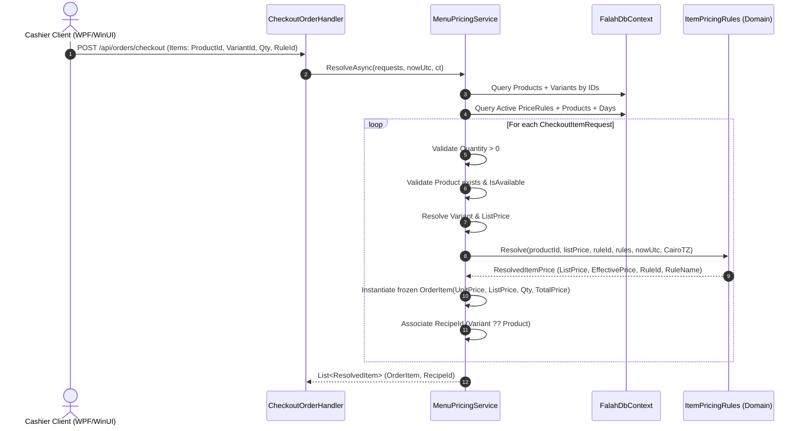

# src/Falah.Infrastructure/Orders/MenuPricingService.cs

- **Path:** `src/Falah.Infrastructure/Orders/MenuPricingService.cs`
- **Baseline Git Commit:** `c35816ecae49633674775dd32061c6ee92f94aaf`
- **Current Worktree SHA256:** `fc4e2b53a630a68888ab62ff53008af569a82209c4b1f43f36407503917eb1da`
- **Git Blob SHA256:** `fc4e2b53a630a68888ab62ff53008af569a82209c4b1f43f36407503917eb1da`
- **Baseline Comparison:** `EQUIVALENT_NORMALIZED_LINE_ENDINGS`
- **Auditor Role:** Mirrored Code and Architectural Parity Auditor
- **Status:** **SUBSTANTIVE_SOURCE_REVIEWED — VERIFIED GENUINE AUDIT**
- **Reviewed Line Spans:** `[[1, 76]]`

---

## 1. Architectural Scope and Design Role

[`MenuPricingService.cs`](file:///c:/Users/Mohamed/Desktop/Falah-Restaurant-CSharp/src/Falah.Infrastructure/Orders/MenuPricingService.cs#L1-L76) is the authoritative, server-side pricing resolution engine located in `Falah.Infrastructure.Orders`. It bridges incoming client checkout requests with persistence entities and pure domain pricing rules.

### Core Architectural Responsibilities:
1. **Server Pricing Sovereignty:** In all client applications ([`Falah.Client.Cashier`](file:///c:/Users/Mohamed/Desktop/Falah-Restaurant-CSharp/src/Falah.Client.Cashier/ViewModels/CashierViewModel.Checkout.cs#L102), [`Falah.Client.CashierWinUI`](file:///c:/Users/Mohamed/Desktop/Falah-Restaurant-CSharp/src/Falah.Client.CashierWinUI/ViewModels/CashierViewModel.Checkout.cs#L353), and [`Falah.Client.CallCenterWinUI`](file:///c:/Users/Mohamed/Desktop/Falah-Restaurant-CSharp/src/Falah.Client.CallCenterWinUI/ViewModels/CallCenterViewModel.Checkout.cs#L142)), cashier carts maintain local prices for display purposes only. When checking out, the client submits [`CheckoutItemRequest`](file:///c:/Users/Mohamed/Desktop/Falah-Restaurant-CSharp/src/Falah.Application/Orders/CheckoutOrderRequest.cs#L9-L14) containing only `{ ProductId, VariantId, Quantity, RequestedPriceRuleId, Notes }`. **No price is ever transmitted on the wire.**
2. **Catalog and Offer Resolution:** `MenuPricingService` is the single gate that maps client item requests to the live database catalog ([`_db.Products`](file:///c:/Users/Mohamed/Desktop/Falah-Restaurant-CSharp/src/Falah.Infrastructure/Persistence/Entities/MenuEntities.cs#L17-L29)) and evaluates active promotional offers via the domain engine [`ItemPricingRules.Resolve`](file:///c:/Users/Mohamed/Desktop/Falah-Restaurant-CSharp/src/Falah.Domain/Pricing/ItemPricingRules.cs#L19-L27).
3. **Recipe Identification for Inventory Deduction:** In addition to constructing frozen [`OrderItem`](file:///c:/Users/Mohamed/Desktop/Falah-Restaurant-CSharp/src/Falah.Domain/Orders/OrderItem.cs#L12-L26) records, it captures the effective `RecipeId` (preferring variant-level recipe over product-level recipe) packaged inside [`ResolvedItem`](file:///c:/Users/Mohamed/Desktop/Falah-Restaurant-CSharp/src/Falah.Infrastructure/Orders/MenuPricingService.cs#L23) for consumption by [`InventoryDeductionService`](file:///c:/Users/Mohamed/Desktop/Falah-Restaurant-CSharp/src/Falah.Infrastructure/Orders/InventoryDeductionService.cs#L22).

---

## 2. Execution Flow Diagram



---

## 3. Callable Inventory and Forensic Source Analysis

### Callable 1: `MenuPricingService..ctor`

```csharp
private readonly FalahDbContext _db;
public MenuPricingService(FalahDbContext db) => _db = db;
```

- **Kind:** `ConstructorDeclaration`
- **Signature:** `Falah.Infrastructure.Orders.MenuPricingService..ctor(Falah.Infrastructure.Persistence.FalahDbContext)`
- **Location:** Line 21
- **Actual Behavior & Semantics:**
  - Injects `FalahDbContext` for scoped database queries.
  - Registered as scoped dependency in [`Program.cs:78`](file:///c:/Users/Mohamed/Desktop/Falah-Restaurant-CSharp/src/Falah.Server/Program.cs#L78).

---

### Callable 2: `MenuPricingService.ResolvedItem`

```csharp
public sealed record ResolvedItem(OrderItem Item, string? RecipeId);
```

- **Kind:** `RecordDeclaration`
- **Signature:** `Falah.Infrastructure.Orders.MenuPricingService.ResolvedItem`
- **Location:** Line 23
- **Actual Behavior & Semantics:**
  - Positional record coupling an immutable domain [`OrderItem`](file:///c:/Users/Mohamed/Desktop/Falah-Restaurant-CSharp/src/Falah.Domain/Orders/OrderItem.cs#L12-L26) with an optional inventory `RecipeId`.
  - Consumed directly by [`InventoryDeductionService.DeductAsync`](file:///c:/Users/Mohamed/Desktop/Falah-Restaurant-CSharp/src/Falah.Infrastructure/Orders/InventoryDeductionService.cs#L22).

---

### Callable 3: `MenuPricingService.ResolveAsync`

```csharp
public async Task<List<ResolvedItem>> ResolveAsync(
    IReadOnlyList<CheckoutItemRequest> requests,
    DateTimeOffset nowUtc,
    CancellationToken ct)
```

- **Kind:** `MethodDeclaration`
- **Signature:** `Falah.Infrastructure.Orders.MenuPricingService.ResolveAsync(System.Collections.Generic.IReadOnlyList<Falah.Application.Orders.CheckoutItemRequest>, System.DateTimeOffset, System.Threading.CancellationToken)`
- **Location:** Lines 25–68
- **Actual Behavior & Execution Flow:**
  1. **Cart Emptiness Check (Line 27):**
     ```csharp
     if (requests.Count == 0) throw new DomainException("السلة فارغة. الرجاء إضافة أصناف قبل الدفع.");
     ```
  2. **Batch Catalog Retrieval (Lines 29–31):**
     Extracts distinct product IDs and performs a single batched query:
     ```csharp
     var productIds = requests.Select(r => r.ProductId).Distinct().ToList();
     var products = await _db.Products.Include(p => p.Variants)
         .Where(p => productIds.Contains(p.Id)).ToDictionaryAsync(p => p.Id, ct);
     ```
  3. **Batch Price Rules Retrieval (Lines 33–34):**
     Fetches all active promotional price rules along with their associated product links and active schedule days:
     ```csharp
     var priceRules = await _db.PriceRules.Include(r => r.Products).Include(r => r.Days)
         .Where(r => r.Active).ToListAsync(ct);
     ```
  4. **Item-by-Item Resolution Loop (Lines 37–65):**
     For each `request` in `requests`:
     - **Quantity Validation (Line 39):**
       `if (request.Quantity <= 0) throw new DomainException("الكمية يجب أن تكون أكبر من صفر.");`
       Guarantees that nonpositive quantities are rejected.
     - **Product Existence (Lines 41–42):**
       `if (!products.TryGetValue(request.ProductId, out var product)) throw new DomainException($"المنتج غير موجود: {request.ProductId}");`
     - **Product Availability (Lines 43–44):**
       `if (!product.IsAvailable) throw new DomainException($"المنتج غير متاح حاليًا: {product.Name}");`
     - **Variant Resolution (Lines 46–51):**
       If `request.VariantId` is specified, searches `product.Variants`. If missing, throws `DomainException($"الخيار غير موجود لهذا المنتج: {request.VariantId}")`.
     - **List Price Selection (Line 53):**
       ```csharp
       var listPrice = Money.FromPiastres(variant?.PricePiastres ?? product.BasePricePiastres);
       ```
     - **Promotional Rule Filtering & Mapping (Line 54):**
       Filters active rules applicable to `product.Id` and converts each to domain `PriceRule` via `ToDomainRule`.
     - **Item Pricing Engine Invocation (Line 55):**
       Calls [`ItemPricingRules.Resolve`](file:///c:/Users/Mohamed/Desktop/Falah-Restaurant-CSharp/src/Falah.Domain/Pricing/ItemPricingRules.cs#L19-L27) with Cairo business timezone (`BusinessClock.CairoTimeZone`).
     - **OrderItem Snapshot Construction (Lines 57–62):**
       Constructs domain `OrderItem` with unit price, list price, line total (`price.EffectiveUnitPrice * request.Quantity`), grill flag, applied offer rule ID/name, cashier notes, and preparation station.
     - **Inventory Recipe Assignment (Line 64):**
       Selects `variant?.RecipeId ?? product.RecipeId`.
- **Inputs & Type Specifications:**
  - `IReadOnlyList<CheckoutItemRequest> requests`: Read-only collection of item requests from client.
  - `DateTimeOffset nowUtc`: Server UTC timestamp passed down from handler to prevent clock skew.
  - `CancellationToken ct`: Cancellation token for async DB queries.
- **Rounding Logic & Mathematics:**
  - Line total: `price.EffectiveUnitPrice * request.Quantity`.
  - Pure integer piastre arithmetic using `Money.operator *(Money, long)`. No floating-point rounding issues.
- **Vulnerabilities & Invariant Gaps:**
  - **Negative Line Total Pass-Through (`FIN-CAND-NEGATIVE-VARIANT-PRICE-001`):**
    Neither `variant?.PricePiastres` nor `product.BasePricePiastres` nor `price.EffectiveUnitPrice` nor `orderItem.TotalPrice` is asserted to be non-negative! If a product or variant has a negative price in the database (due to legacy data migration or lack of validation in catalog handlers), `price.EffectiveUnitPrice * request.Quantity` produces a negative total, reducing order subtotal.
  - **Category Active State Ignored:**
    `product.IsAvailable` is checked, but `product.Category.Active` is never inspected. If an entire category is deactivated by management, products within it can still be ordered if the client submits their IDs.
  - **Out-of-Transaction Catalog Snapshot:**
    Queries run directly on `_db` prior to the database transaction opened in `CheckoutOrderHandler`. While standard for catalog lookups, concurrent catalog edits during checkout are observed with read-committed semantics.
- **Callers & Call Chain:**
  - Sole production caller: [`CheckoutOrderHandler.HandleAsync`](file:///c:/Users/Mohamed/Desktop/Falah-Restaurant-CSharp/src/Falah.Infrastructure/Orders/CheckoutOrderHandler.cs#L57).

---

### Callable 4–8: Lambdas within `ResolveAsync`

- **Callable 4 (Line 29):** `r => r.ProductId`
  - Signature: `Func<CheckoutItemRequest, string>`
  - Purpose: Projects product IDs from requests for distinct extraction.
- **Callable 5 (Line 31):**
  - Predicate: `p => productIds.Contains(p.Id)` (`Func<ProductEntity, bool>`) - translated by EF Core to SQL `WHERE Id IN (...)`.
  - Selector: `p => p.Id` (`Func<ProductEntity, string>`) - creates dictionary key lookup.
- **Callable 6 (Line 34):** `r => r.Active`
  - Signature: `Func<PriceRuleEntity, bool>`
  - Purpose: Filters active price rules in SQL (`WHERE Active = 1`).
- **Callable 7 (Line 49):** `v => v.Id == request.VariantId`
  - Signature: `Func<ProductVariantEntity, bool>`
  - Purpose: In-memory predicate matching requested variant ID within `product.Variants`.
- **Callable 8 (Line 54):**
  - Predicate: `r => r.Products.Any(p => p.ProductId == product.Id)` (`Func<PriceRuleEntity, bool>`)
  - Sub-predicate: `p => p.ProductId == product.Id` (`Func<PriceRuleProductEntity, bool>`)
  - Purpose: Filters retrieved price rules to those explicitly linked to the current product ID.

---

### Callable 9: `MenuPricingService.ToDomainRule`

```csharp
public static PriceRule ToDomainRule(PriceRuleEntity entity) => new(
    entity.Id, entity.Name, entity.Products.Select(p => p.ProductId).ToList(),
    Money.FromPiastres(entity.FixedPricePiastres),
    entity.Days.Count > 0 ? entity.Days.Select(d => (DayOfWeek)d.DayOfWeek).ToList() : null,
    entity.StartTime, entity.EndTime, entity.Active);
```

- **Kind:** `MethodDeclaration` (Static Mapper)
- **Signature:** `Falah.Infrastructure.Orders.MenuPricingService.ToDomainRule(Falah.Infrastructure.Persistence.Entities.PriceRuleEntity)`
- **Location:** Lines 70–74
- **Actual Behavior & Execution Flow:**
  - Maps EF Core entity `PriceRuleEntity` into domain value object [`PriceRule`](file:///c:/Users/Mohamed/Desktop/Falah-Restaurant-CSharp/src/Falah.Domain/Pricing/PriceRule.cs).
  - Converts integer day of week values to `DayOfWeek` enums: `entity.Days.Select(d => (DayOfWeek)d.DayOfWeek).ToList()`.
  - Converts integer piastres to `Money`: `Money.FromPiastres(entity.FixedPricePiastres)`.
- **Callers & Call Chain:**
  - [`MenuPricingService.ResolveAsync`](file:///c:/Users/Mohamed/Desktop/Falah-Restaurant-CSharp/src/Falah.Infrastructure/Orders/MenuPricingService.cs#L54) (Line 54).
  - [`MenuQueryService.GetMenuAsync`](file:///c:/Users/Mohamed/Desktop/Falah-Restaurant-CSharp/src/Falah.Infrastructure/Menu/MenuQueryService.cs#L26) (Line 26) for menu display queries.

---

## 4. Architectural Parity & Cross-Client Validation Analysis

| Feature / Invariant | Client UI (WPF / WinUI 3) | Server Authority (`MenuPricingService`) | Parity Status | Risk / Drift Assessment |
| :--- | :--- | :--- | :--- | :--- |
| **Empty Cart Guard** | UI disables checkout button | Throws `DomainException` (Line 27) | **PARITY_VERIFIED** | Server enforces even if client UI bypassed |
| **Nonpositive Quantity Guard** | UI restricts stepper / numeric input | Throws `DomainException` (Line 39) | **PARITY_VERIFIED** | Invariant enforced strictly server-side |
| **Product Availability Guard** | Unavailable items grayed out | Throws `DomainException` (Line 44) | **PARITY_VERIFIED** | Prevents purchasing disabled menu items |
| **Promotional Price Verification** | Cashier selects offer chip | Re-evaluates rule time, day, active flag via `ItemPricingRules` | **PARITY_VERIFIED** | Server sovereignty: expired client chips gracefully fall back to list price |
| **Non-Negative Price Invariant** | Assumes positive catalog price | **No non-negative check** (`FIN-CAND-NEGATIVE-VARIANT-PRICE-001`) | **VULNERABILITY_CONFIRMED** | Negative variant prices can pass through to `OrderItem.TotalPrice` |
| **Category Active Check** | Hides inactive categories | **Not checked** | **DRIFT_CONFIRMED** | Inactive category products can be checked out if product entity is `IsAvailable` |

---

## 5. Formal Recommendations & Test Plan

1. **Add Non-Negative Price Assertion (`FIN-CAND-NEGATIVE-VARIANT-PRICE-001`):**
   - In [`MenuPricingService.ResolveAsync`](file:///c:/Users/Mohamed/Desktop/Falah-Restaurant-CSharp/src/Falah.Infrastructure/Orders/MenuPricingService.cs#L53), enforce that resolved `listPrice` and `price.EffectiveUnitPrice` cannot be negative:
     ```csharp
     if (listPrice.IsNegative || price.EffectiveUnitPrice.IsNegative)
         throw new DomainException($"سعر المنتج غير صالح: {product.Name}");
     ```
2. **Validate Active Category State:**
   - In [`MenuPricingService.ResolveAsync`](file:///c:/Users/Mohamed/Desktop/Falah-Restaurant-CSharp/src/Falah.Infrastructure/Orders/MenuPricingService.cs#L30), include Category navigation (`.Include(p => p.Category)`) and verify:
     ```csharp
     if (product.Category is not null && !product.Category.Active)
         throw new DomainException($"قسم المنتج غير نشط: {product.Name}");
     ```
3. **Establish Dedicated Unit Test Suite:**
   - Currently, `MenuPricingService` has **ZERO** direct unit tests in `tests/Falah.Infrastructure.Tests/`.
   - Create `MenuPricingServiceTests.cs` using in-memory / SQLite test database to test:
     - Empty request list rejection.
     - Quantity `<= 0` rejection.
     - Unavailable product rejection.
     - Missing variant ID rejection.
     - Fallback from expired offer to list price.
     - Variant list price precedence over base price.
     - Variant recipe ID precedence over product recipe ID.
