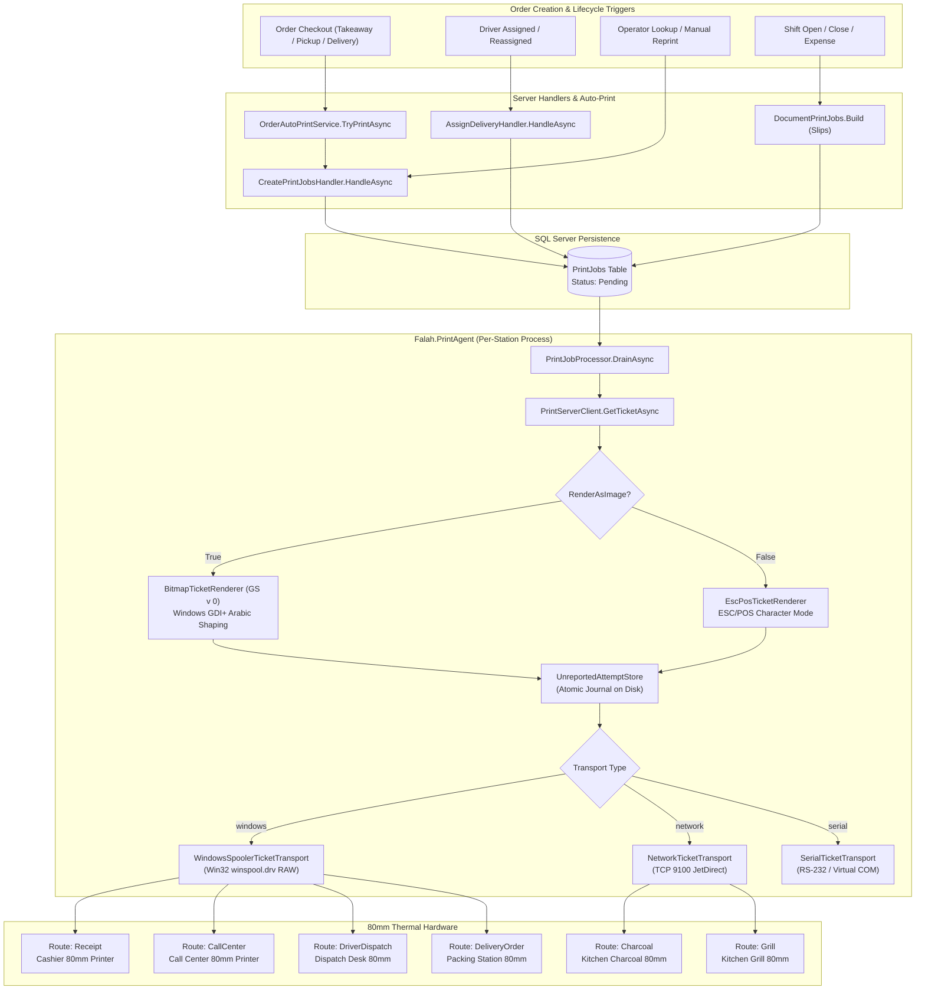
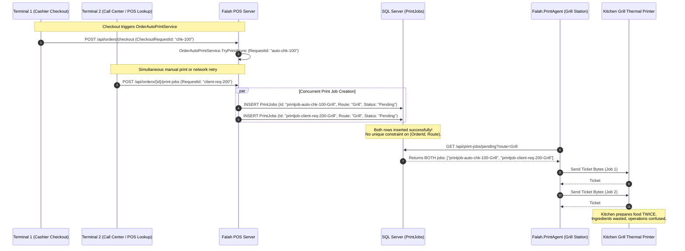
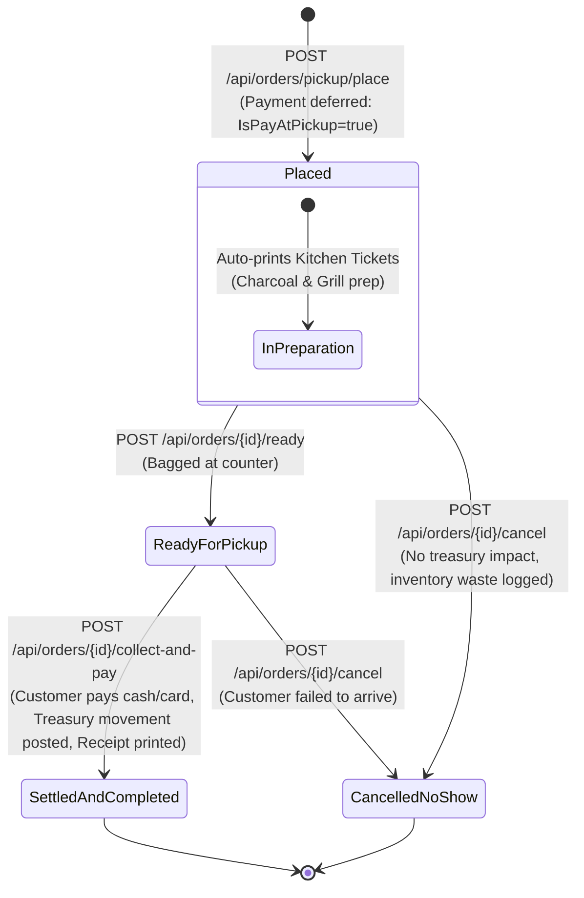

# Printing Subsystem and Operational Workflow Audit Report

- **Auditor Role:** Printing & Operational Workflow Specialist
- **Audit Authority:** Independent POS Architecture & Reliability Audit (2.0 Integrity Recovery)
- **Baseline Commit:** `c35816ecae49633674775dd32061c6ee92f94aaf`
- **Target Subsystems:**
  - Printing Agent: `src/Falah.PrintAgent/`
  - Printing Infrastructure: `src/Falah.Infrastructure/Printing/`
  - Printing Domain: `src/Falah.Domain/Printing/`
  - Order Processing & Checkout: `src/Falah.Domain/Orders/`, `src/Falah.Infrastructure/Orders/`
  - Delivery Lifecycle & Invariants: `src/Falah.Domain/Delivery/`, `src/Falah.Infrastructure/Delivery/`
  - Persistence & Concurrency: `src/Falah.Infrastructure/Persistence/` (`FalahDbContext.cs`, `PrintEntities.cs`)
- **Report Date:** 2026-10-24
- **Status:** **COMPLETE STATIC AUDIT & INDEPENDENT VERIFICATION (AUDIT DOCUMENTATION ONLY)**

---

## 1. Executive Summary & Verification Matrix

This specialist audit provides an exhaustive, source-grounded evaluation of the physical thermal printing pipeline, ESC/POS byte protocol generation, Windows spooler hardware transport abstractions, and order fulfillment state machines for Fale7 POS.

Every finding was independently cross-examined against production code, database schema configurations, and unit/integration test suites.

### Core Findings Verification Summary

| Finding ID | Severity | Disposition | Core Vulnerability / Architectural Gap |
| :--- | :--- | :--- | :--- |
| **PRT-001** | `HIGH` | **INDEPENDENTLY_CORROBORATED** | `PrintJobs` table lacks composite unique constraint on `(OrderId, Route)`. Concurrent client triggers or checkout auto-print races insert duplicate pending jobs, causing hardware printers to print duplicate kitchen tickets. |
| **PRT-002** | `MEDIUM` | **INDEPENDENTLY_CORROBORATED** | `WindowsSpoolerTicketTransport` conflates spooler memory queue buffering (`WritePrinter`) with physical hardware output. Printer paper-out, hardware jams, and offline states silently succeed in POS UI while tickets remain unprinted. |
| **PRT-003** | `MEDIUM` | **INDEPENDENTLY_CORROBORATED** | `WindowsSpoolerTicketTransport.Send` executes blocking unmanaged Win32 P/Invoke calls without respecting `CancellationToken`, risking thread pool starvation on unresponsive network printer queues. |
| **PRT-004** | `MEDIUM` | **INDEPENDENTLY_CORROBORATED** | `PrintServerClient` does not re-authenticate upon token expiration or server restart. A 401 Unauthorized response puts the polling worker into an infinite, non-recovering failure loop. |
| **FLOW-001** | `HIGH` | **INDEPENDENTLY_CORROBORATED** | Branch pickup workflow completely lacks a two-stage "Pay-at-Pickup" state machine. Kitchen preparation cannot be initiated without forcing immediate payment at the cashier till, distorting drawer cash and ledger accounting. |

---

## 2. Comprehensive Audit of the Six Printing Routes

The POS system dispatches thermal print jobs across six distinct routes. Each route fulfills a specific operational role within the restaurant's physical workflow.



### Detailed Route Specifications & Invariants

```
+------------------+-----------------------+------------------------+-------------------------------------------------------------+
| Route Enum       | Target Station        | Pricing Visibility     | Structural Layout & Invariants                              |
+------------------+-----------------------+------------------------+-------------------------------------------------------------+
| Receipt          | Cashier Till          | FULL PRICES & TOTALS   | Dual-ticket: Customer Number Section -> TicketCut ->        |
|                  | (Front Counter)       |                        | Detailed Itemized Ticket (Cashier copy, QR code, VAT, EGP). |
+------------------+-----------------------+------------------------+-------------------------------------------------------------+
| CallCenter       | Call Center Terminal  | FULL PRICES & TOTALS   | Single continuous detailed ticket without customer cut.     |
|                  |                       |                        | Carries customer address, area, phone, payment state.       |
+------------------+-----------------------+------------------------+-------------------------------------------------------------+
| Charcoal         | Charcoal Grill Station| PRICES STRICTLY MASKED | Prep station isolation: Filters to items where              |
|                  | (Kitchen)             |                        | PreparationStation == "Charcoal". Big bold order number.    |
+------------------+-----------------------+------------------------+-------------------------------------------------------------+
| Grill            | Burger/Grill Station  | PRICES STRICTLY MASKED | Prep station isolation: Filters to items where              |
|                  | (Kitchen)             |                        | PreparationStation == "Grill". Big bold order number.       |
+------------------+-----------------------+------------------------+-------------------------------------------------------------+
| DriverDispatch   | Delivery Dispatch     | AMOUNT TO COLLECT ONLY | Printed upon driver assignment/reassignment. Contains driver|
|                  | (Counter / Driver)    | (COD or 0 EGP prepaid) | name, address, landmark, notes, COD custody amount.         |
+------------------+-----------------------+------------------------+-------------------------------------------------------------+
| DeliveryOrder    | Packing Station /     | FULL ITEM PRICES       | Printed at checkout for delivery orders. Bagging checklist  |
|                  | Kitchen Pass          | & TOTALS               | with delivery notes and explicit collection instructions.   |
+------------------+-----------------------+------------------------+-------------------------------------------------------------+
```

#### 1. Customer Receipt (`PrintRoute.Receipt`)
- **Source Tracing:** `PrintRules.ComposeReceiptTicket` (`src/Falah.Domain/Printing/PrintRules.cs:89-108`)
- **Physical Characteristics:** One print job produces **two physically cut tickets**:
  1. *Customer Order Token:* Compact brand header, bold order type, huge order number (`TicketTextSize.Display`), Cairo timestamp, cashier name, and instruction: `"احتفظ بهذا التيكت حتى استلام الطلب"`.
  2. *Mid-Stream Cut (`TicketCut`):* Triggers paper cut command before the second segment begins.
  3. *Detailed Cashier Ticket:* Full brand header, order number (`TicketTextSize.Huge`), cashier name, itemized table (`CashierItemHeader`: Product, Quantity, Total), modifier notes, applied price rules/offers, frozen taxable base, manual discount, comp amount, net total (`TicketTextSize.Title`), tender breakdown (paid, change due, payment method label), and conditional Menu QR Code.
- **Architectural Safeguard:** Both tickets are wrapped under a single `PrintJobEntity` and idempotency key (`TicketCut`). They print together as a single atomic byte stream or fail together, preventing half-order ticket creation.

#### 2. Call Center Receipt (`PrintRoute.CallCenter`)
- **Source Tracing:** `PrintRules.ComposeDetailedOrderSection` (`src/Falah.Domain/Printing/PrintRules.cs:265-292`)
- **Physical Characteristics:** Single detailed receipt. Excludes the customer token cut because the telephone customer is remote. Displays the destination customer name, delivery area, and delivery address.

#### 3. Kitchen Charcoal Station (`PrintRoute.Charcoal`) & 4. Kitchen Grill Station (`PrintRoute.Grill`)
- **Source Tracing:** `PrintRules.ComposeKitchenTicket` (`src/Falah.Domain/Printing/PrintRules.cs:36-76`)
- **Prep Station Filtering Invariant:** Kitchen routes strictly exclude prices. Displaying prices at prep stations causes operational clutter and kitchen disputes.
  - Charcoal tickets receive only items where `OrderItem.PreparationStation == "Charcoal"`.
  - Grill tickets receive only items where `OrderItem.PreparationStation == "Grill"`.
  - The routing reads the **frozen snapshot** `OrderItemEntity.PreparationStation` saved at sale time, never the dynamic product catalog. If a product's default station changes tomorrow, committed orders reprint to their original stations.
  - If an order has only beverages (no kitchen items), `PrintRules.DetermineKitchenRoutes` returns an empty set, generating zero kitchen jobs.

#### 5. Driver Dispatch Slip (`PrintRoute.DriverDispatch`)
- **Source Tracing:** `PrintRules.ComposeDriverDispatchTicket` (`src/Falah.Domain/Printing/PrintRules.cs:337-375`)
- **Trigger Points:** `AssignDeliveryHandler.cs:120` and `ReassignDeliveryHandler.cs:122`.
- **Content:** Driver name, order number, destination customer name, phone number, formatted address, delivery area, delivery notes, and explicit COD cash custody amount (`AmountToCollect`).
- **Reassignment Safeguard:** If a delivery is reassigned to a different driver, `isReassignment = true` stamps a bold `"إعادة إسناد"` banner across the top to prevent duplicate dispatch.

#### 6. Delivery Packing Ticket (`PrintRoute.DeliveryOrder`)
- **Source Tracing:** `PrintRules.ComposeDeliveryOrderTicket` (`src/Falah.Domain/Printing/PrintRules.cs:299-329`)
- **Trigger Point:** `CheckoutOrderHandler.cs:238` during initial checkout when `OrderType == OrderType.Delivery`.
- **Purpose:** Placed at the bagging station before a driver is assigned. Carries complete item list with modifier notes, customer contact, and delivery notes. Footer explicitly states `"بون تشغيل - ليس إيصال العميل"` to prevent it from being handed to customers as an official fiscal receipt.

#### Slips Subsystem (Document Print Jobs)
- **Source Tracing:** `DocumentPrintJobs.cs:20-43`, `ReprintDocumentHandler.cs:21-75`
- Non-order printing uses the same pipeline:
  - `PrintDocumentKind.ShiftOpen`: Printed on drawer opening.
  - `PrintDocumentKind.ShiftClose`: Printed on shift reconciliation; contains gross cash sales, refunds, expenses, cash drops, expected vs actual cash, and variance.
  - `PrintDocumentKind.Expense`: Individual cash payout voucher.
- Slips always route to `PrintRoute.Receipt` and map through `DocumentKind` discriminator.

---

## 3. Rasterization & ESC/POS Arabic Text Shaping Forensics

### The Text-Mode vs. Bitmap Raster Dilemma

Thermal POS receipt printers in Egypt (specifically the Xprinter XP-D200N / XP-80C series) operate on standard ESC/POS command firmware. An audit of native character-mode text printing (`EscPosTicketRenderer.cs`) confirms why native text printing **cannot be used for production Arabic tickets**:

1. **Firmware Codepage Absence:**
   Inspection of `AgentOptions.cs:55-59` and `BitmapTicketRenderer.cs:13-18` documents empirical physical testing against the XP-80C firmware:
   - The printer firmware only exposes code pages 0–10 and 16–19 (PC437, PC850, PC860, PC863, PC865, WPC1252, PC866, PC852, PC858, Hebrew, Greek, Eastern Europe).
   - The printer firmware has **no internal Arabic code page** (neither CP864 nor Windows-1256). Sending character-mode bytes produces unreadable mojibake.
2. **Lack of OpenType Shaping Engine:**
   Even if an Arabic codepage were supported, single-byte ESC/POS character mode emits isolated characters onto a fixed left-to-right character grid. Arabic requires contextual glyph joining (isolated, initial, medial, final forms) and bidirectional reordering (RTL). Standard thermal printer microcode lacks a Unicode shaping engine, outputting disconnected glyphs in reverse order (e.g., "ف ا ل ح" instead of "فالح").
3. **Command Desynchronization on Density Commands:**
   Attempting to set print density via hardware commands (`ESC 7` heating parameters or `DC2 #` print density) causes firmware desynchronization on the XP-80C, corrupting subsequent byte streams and causing the printer to dump raw binary bytes as garbage characters.
4. **Column Grid Breakdown:**
   Arabic characters have variable proportional widths. ESC/POS character mode assumes fixed monospace character cells, causing column boundaries in priced receipts to misalign.

```
NATIVE ESC/POS CHARACTER MODE (DEFECTIVE ON XP-80C HARDWARE):
  Input String:       "فالح"
  Firmware Output:    "ح ل ا ف" (Disconnected, Left-to-Right, Unshaped)
  Tabular Columns:    Unaligned due to fixed-width cell mismatch
  Density Control:    Hardware ESC 7 / DC2 # corrupts firmware stream

BITMAP RASTER MODE (GS v 0 - HIGH FIDELITY ENGINE):
  Input String:       "فالح"
  Windows GDI+:       OpenType shaping -> Ligatures joined -> RTL resolved
  Dilation Pass:      4-connected stroke thickening (1 dot -> 3 dots)
  Raster Command:     GS v 0 (0x1D 0x76 0x30 0x00) -> 1-bit monochrome bitmap
  Hardware Output:    Crisp, bold Arabic cursive glyphs exactly matching screen
```

### The High-Fidelity Raster Solution (`BitmapTicketRenderer.cs`)

To overcome firmware limitations, the system uses memory rasterization through Windows GDI+ / DirectWrite:

- **Typography & Font Shaping:**
  - Font selection resolves `Segoe UI Semibold` if installed on the host OS; falls back to `Segoe UI Bold` (`BitmapTicketRenderer.cs:141-168`).
  - `TextRenderingHint.SingleBitPerPixelGridFit` is used. Anti-aliasing is intentionally avoided because gray edge pixels fall below the thermal head's heating threshold, making text faint and unreadable.
- **Stroke Thickening Algorithm (`Thicken`):**
  - Because hardware thermal density commands corrupt firmware, darkness is engineered into the pixel buffer (`BitmapTicketRenderer.cs:563-606`).
  - A 4-connected dilation kernel expands inked pixels horizontally and vertically:
    $$\text{Grown}(x,y) = \text{Ink}(x,y) \lor \text{Ink}(x-1,y) \lor \text{Ink}(x+1,y) \lor \text{Ink}(x,y-1) \lor \text{Ink}(x,y+1)$$
  - This turns thin single-dot stems into 3-dot stems, ensuring regular text develops properly on thermal paper.
  - For white text inside solid black pills (`Inverted = true`), the algorithm inverts: white pixels grow into black pixels, preventing thermal heat bleed from closing up Arabic character eyelets.
- **ESC/POS Raster Emission (`GS v 0`):**
  - Converts the 1-bit boolean ink matrix into packed bytes:
    $$\text{widthBytes} = \frac{\text{width} + 7}{8} = \frac{576}{8} = 72 \text{ bytes per scanline}$$
  - Writes standard ESC/POS command: `0x1D, 0x76, 0x30, 0x00` (`GS v 0 m=0`).
  - Writes 16-bit little-endian width in bytes (`xL, xH`) and 16-bit height in dots (`yL, yH`).
  - Appends the binary raster payload.
- **Cutter Blade Distance Clearance (`FeedBeforeCut`):**
  - The physical cutting blade on 80mm thermal printers is located 15–20mm below the thermal printhead.
  - If a cut command is issued immediately following raster output, the blade slices through the bottom 15mm of the ticket (cutting off the footer or menu QR code).
  - `BitmapTicketRenderer.cs:75` issues five line feed bytes (`0x0A, 0x0A, 0x0A, 0x0A, 0x0A`) before the cut command (`0x1D, 0x56, 0x00`). At standard 3.75mm line pitch:
    $$5 \times 3.75\text{ mm} = 18.75\text{ mm}$$
  - This feeds the printed ticket completely past the blade before cutting, leaving a clean margin.
- **QR Code Rasterization:**
  - Encoded via `QRCoder` using Error Correction Level Q (25% redundancy) to withstand thermal paper smudging and horizontal banding (`BitmapTicketRenderer.cs:196-227`).
  - Target size: 224 dots (28mm at 203 DPI) with a 4-module quiet zone, stamped directly into the monochrome bitmask.
- **Platform Limitation:**
  - Marked with `[SupportedOSPlatform("windows")]` due to dependency on `System.Drawing.Common` / GDI+. The PrintAgent cannot run on Linux or headless containers without Wine or a cross-platform graphics migration (e.g. SkiaSharp).

---

## 4. Spooler Error Handling & Transport Subsystem Forensics

The system defines four transport adapters implementing `ITicketTransport` (`src/Falah.PrintAgent/ITicketTransport.cs`):
1. `WindowsSpoolerTicketTransport` (Windows Print Spooler RAW)
2. `NetworkTicketTransport` (Raw TCP Socket on Port 9100)
3. `SerialTicketTransport` (COM Port / RS-232)
4. `FileTicketTransport` (Disk testing transport)

### Spooler Flaws & Transport Vulnerabilities

#### PRT-002: Transport Spooler Acceptance Conflated with Physical Print Success
- **Source Tracing:** `src/Falah.PrintAgent/WindowsSpoolerTicketTransport.cs:37-83`, `src/Falah.PrintAgent/PrintJobProcessor.cs:108-112`
- **Flaw Mechanism:**
  `WindowsSpoolerTicketTransport.Send` calls Win32 spooler APIs:
  ```csharp
  OpenPrinter(printerName, out var printer, IntPtr.Zero);
  StartDocPrinter(printer, 1, info); // info.DataType = "RAW"
  StartPagePrinter(printer);
  WritePrinter(printer, buffer, payload.Length, out var written);
  EndPagePrinter(printer);
  EndDocPrinter(printer);
  ClosePrinter(printer);
  ```
  `WritePrinter` returns `true` the millisecond the operating system copies the raw byte array into the local Windows spooler memory buffer (`C:\Windows\System32\spool\PRINTERS\`).
  `PrintJobProcessor.ProcessAsync` evaluates this return value:
  ```csharp
  await _transport.SendAsync(payload, ct);
  succeeded = true;
  error = null;
  ...
  await ReportAsync(new ReportPrintJobResultRequest(attemptRequestId, job.Id, succeeded, error, _reportedByUserId), ct);
  ```
  The agent reports `Succeeded = true` to the server. The server sets `PrintJobEntity.Status = "Succeeded"`.
- **Operational Failure Mode:**
  If the physical printer is powered off, out of paper, has a paper jam, or is unplugged:
  1. The Windows spooler queues the job locally in an error state.
  2. The POS server and cashier UI display the print job as **"Succeeded"**.
  3. Kitchen cooks never receive the order preparation ticket.
  4. The cashier believes the ticket was printed, leading to lost customer orders during peak hours.

#### PRT-003: Blocking Spooler Submission Ignores Cancellation Tokens
- **Source Tracing:** `src/Falah.PrintAgent/WindowsSpoolerTicketTransport.cs:29-33`
- **Flaw Mechanism:**
  ```csharp
  public Task SendAsync(byte[] payload, CancellationToken ct)
  {
      Send(_printerName, payload);
      return Task.CompletedTask;
  }
  ```
  `SendAsync` completely discards `CancellationToken ct`.
  `OpenPrinterW` and `StartDocPrinterW` make blocking Win32 LPC calls. If `_printerName` points to a shared network printer (`\\pos-server\xprinter`) or a dead TCP/IP port monitor, the Windows spooler thread blocks in kernel mode for the full RPC timeout (up to 45–60 seconds).
  The background worker cannot be cancelled, service shutdown hangs, and polling for other routes is delayed.

#### PRT-004: PrintAgent Never Re-Authenticates After Session Invalidation
- **Source Tracing:** `src/Falah.PrintAgent/PrintServerClient.cs:33-40`, `src/Falah.PrintAgent/Program.cs:111-155`
- **Flaw Mechanism:**
  At startup, `Program.cs` calls:
  ```csharp
  await server.AuthenticateAsync(options.Pin, CancellationToken.None);
  ```
  `PrintServerClient` obtains a Bearer token and sets:
  ```csharp
  _http.DefaultRequestHeaders.Authorization = new AuthenticationHeaderValue("Bearer", result.Token);
  ```
  The polling loop runs indefinitely:
  ```csharp
  while (!shutdown.IsCancellationRequested)
  {
      try { await processor.DrainAsync(options.Route, shutdown.Token); }
      catch (Exception ex) { Log($"poll failed: {ex.GetType().Name}: {ex.Message}"); }
      await Task.Delay(pollDelay, shutdown.Token);
  }
  ```
  If the POS server restarts, restarts its IIS/Kestrel container, or invalidates active sessions in `UserSessionStore`, `GetPendingAsync` throws `HttpRequestException` (HTTP 401 Unauthorized).
  `PrintServerClient` has **no retry or re-authentication logic**. The agent logs `poll failed: HttpRequestException: 401 Unauthorized` every 3 seconds forever. Printing halts completely until an administrator manually terminates and restarts the process.

#### Retry Starvation on Failed Print Jobs
- **Source Tracing:** `src/Falah.Infrastructure/Printing/ReportPrintJobResultHandler.cs:47`, `src/Falah.Infrastructure/Printing/PrintJobQueryService.cs:37-41`
- **Flaw Mechanism:**
  When a hardware failure occurs (e.g. socket timeout on network transport), `ReportPrintJobResultHandler` sets:
  ```csharp
  job.Status = nameof(PrintJobStatus.Failed);
  ```
  However, the agent's polling query in `PrintJobQueryService` queries:
  ```csharp
  _db.PrintJobs.Where(j => j.Route == route && j.Status == nameof(PrintJobStatus.Pending))
  ```
  Once a job transitions to `Failed`, it is **excluded from subsequent polls**.
  The system provides no automatic retry backoff. The job remains starved in `Failed` status until an operator notices the missing ticket and manually requests a reprint from Order Lookup.

#### Crash Resilience via `UnreportedAttemptStore`
- **Source Tracing:** `src/Falah.PrintAgent/UnreportedAttemptStore.cs:21-97`
- **Design Evaluation:**
  Before sending raw bytes to the printer transport, `PrintJobProcessor` writes an `attemptRequestId` and timestamp to an on-disk JSON journal (`unreported-print-attempts-{Route}.json`).
  The write uses an atomic temp-file replace pattern:
  ```csharp
  var temporary = _path + ".tmp";
  File.WriteAllText(temporary, JsonSerializer.Serialize(_attempts));
  File.Move(temporary, _path, overwrite: true);
  ```
  If power is lost mid-print or the network drops before reporting the outcome to the server, the agent recovers the record upon reboot. It re-reports the previous attempt rather than re-sending the byte stream, preventing duplicate paper tickets.

---

## 5. Independent Verification of PRT-001 (Duplicate Kitchen Tickets)

### Vulnerability Profile: PRT-001
- **Title:** Missing Composite Unique Constraint on `(OrderId, Route)` in `PrintJobs` Table
- **Severity:** `HIGH`
- **Status:** **INDEPENDENTLY_CORROBORATED**
- **Affected Components:**
  - `src/Falah.Infrastructure/Persistence/FalahDbContext.cs:365-377`
  - `src/Falah.Infrastructure/Printing/CreatePrintJobsHandler.cs:32-93`
  - `src/Falah.Infrastructure/Printing/OrderAutoPrintService.cs:46-94`
  - `src/Falah.Server/Program.cs:2090` (`POST /api/orders/{id}/print-jobs`)

### Forensic Code Analysis

In `FalahDbContext.cs:365-377`, the entity model for `PrintJobEntity` is configured as follows:

```csharp
modelBuilder.Entity<PrintJobEntity>(b =>
{
    b.HasKey(j => j.Id);
    b.HasIndex(j => new { j.Route, j.Status });
    b.HasIndex(j => j.OrderId);
    b.HasIndex(j => j.CreateRequestId);
    b.HasMany(j => j.Attempts).WithOne().HasForeignKey(a => a.PrintJobId).OnDelete(DeleteBehavior.Cascade);
});
```

Notice:
1. `b.HasKey(j => j.Id)`: The primary key is the string `Id`.
2. `b.HasIndex(j => j.OrderId)`: Non-unique index.
3. `b.HasIndex(j => new { j.Route, j.Status })`: Non-unique index.
4. **There is NO composite unique index on `(OrderId, Route)` or `(OrderId, Route, DocumentKind, IsReprint)`.**

In `CreatePrintJobsHandler.cs:60-65`, the primary key `Id` is generated using:
```csharp
Id = $"printjob-{request.RequestId}-{route}"
```
The handler checks for existing jobs using only `CreateRequestId`:
```csharp
var existing = await _db.PrintJobs.AsNoTracking()
    .Where(j => j.CreateRequestId == request.RequestId).ToListAsync(ct);
if (existing.Count > 0) return new CreatePrintJobsResult(existing.Select(ToDto).ToList(), WasReplayed: true);
```

### Race Condition Scenarios



1. **Auto-Print vs. Manual Print Race:**
   When an order is created, `OrderAutoPrintService` creates a job with `RequestId = $"auto-{request.CheckoutRequestId}"`. If the cashier immediately clicks "Print Ticket" from the UI or if another station triggers printing, the second call sends a newly minted `RequestId = Guid.NewGuid()`. Because `CreateRequestId` values differ, both requests pass the replay check and both are inserted into `PrintJobs` as `Pending`.
2. **Dual-Terminal Call-Center Race:**
   When two call center operators view and update an order, both clients can dispatch print requests concurrently with distinct request IDs.
3. **Absence of Concurrency Locks:**
   `CreatePrintJobsHandler` executes a plain `SaveChangesAsync` without using `UPDLOCK, HOLDLOCK` or checking whether an active pending job already exists for `(OrderId, Route)`.

### Operational Impact
The physical printer at the kitchen prep station prints duplicate preparation tickets for the exact same order. The kitchen staff cooks the items twice. Food is wasted, kitchen throughput drops, and duplicate tickets create confusion at the expediter pass.

### Recommended Database & Code Remediation
1. **Database-Level Unique Filtered Index:**
   Add a filtered unique index in EF Core to ensure at most one active `Pending` job can exist for any `(OrderId, Route, DocumentKind)` unless explicitly flagged as a reprint:
   ```csharp
   modelBuilder.Entity<PrintJobEntity>(b =>
   {
       b.HasIndex(j => new { j.OrderId, j.Route, j.DocumentKind })
        .HasFilter("[Status] = 'Pending' AND [IsReprint] = 0")
        .IsUnique();
   });
   ```
2. **Concurrency Locking in `CreatePrintJobsHandler`:**
   Wrap job creation in an explicit transaction using `UPDLOCK, HOLDLOCK` to check for active jobs before insertion:
   ```csharp
   var hasActivePending = await _db.PrintJobs
       .FromSqlRaw("SELECT * FROM PrintJobs WITH (UPDLOCK, HOLDLOCK) WHERE OrderId = {0} AND Route = {1} AND Status = 'Pending'", order.Id, route.ToString())
       .AnyAsync(ct);
   if (hasActivePending) continue; // Suppress duplicate creation
   ```

---

## 6. Independent Verification of FLOW-001 (Pickup Workflow Gap)

### Vulnerability Profile: FLOW-001
- **Title:** Missing Two-Stage Pickup Order State Machine (Pay-at-Pickup vs. Pay-First)
- **Severity:** `HIGH`
- **Status:** **INDEPENDENTLY_CORROBORATED**
- **Affected Components:**
  - `src/Falah.Domain/Orders/OrderEnums.cs:9-11`
  - `src/Falah.Domain/Orders/CheckoutRules.cs:44-45, 102-103`
  - `src/Falah.Domain/Orders/Order.cs:107`
  - `src/Falah.Infrastructure/Orders/CheckoutOrderHandler.cs:150-280`
  - `src/Falah.Server/Program.cs:1370` (`/api/orders/checkout`)

### Forensic Code Analysis

In `OrderEnums.cs:9-11`, the order types and statuses are defined:
```csharp
public enum OrderType { Pickup, Takeaway, Delivery }
public enum OrderStatus { Pending, Preparing, Ready, Completed, Cancelled, Refunded }
```

In `CheckoutRules.cs:44-45`, cash-on-delivery is defined strictly for `OrderType.Delivery`:
```csharp
public static bool IsCashOnDelivery(OrderType orderType, PaymentMethod paymentMethod, Money payableTotal) =>
    orderType == OrderType.Delivery && paymentMethod == PaymentMethod.Cash && payableTotal.IsPositive;
```

In `CheckoutRules.cs:102-103`, payment validation is enforced:
```csharp
if (!cashOnDelivery && amountPaid < payableTotal)
    throw new DomainException("المبلغ المدفوع أقل من إجمالي الطلب.");
```

In `Order.cs:107`:
```csharp
order.Status = items.Any(i => i.SendToGrill) ? OrderStatus.Preparing : OrderStatus.Completed;
order.IsPaid = plan.IsPaid;
```

### The Architectural Flaw & Operational Dilemma

For `OrderType.Pickup`, `cashOnDelivery` is **always false**.
Therefore, `CheckoutRules.BuildPlan` strictly enforces `amountPaid >= payableTotal`.
There is no concept of **"Cash-on-Pickup"** or **"Pay-at-Pickup"**.

```
OPERATIONAL PARALYSIS UNDER CURRENT PICKUP CODE:

Customer calls restaurant: "Prepare 5 shawarma sandwiches, I will pick them up in 20 minutes and pay cash."

       │
       ▼
┌─────────────────────────────────────────────────────────────────────────────┐
│ Cashier Option A: Ring up order immediately to start kitchen preparation    │
├─────────────────────────────────────────────────────────────────────────────┤
│ 1. System forces cashier to enter amountPaid = 425 EGP (Cash).               │
│ 2. TreasuryMovement created: Drawer cash increases by 425 EGP in database.  │
│ 3. Financial journal completes sale: Order is marked IsPaid = true.         │
│ 4. Kitchen tickets print. Food is prepared.                                 │
│ 5. FAILURE CASE: Customer never shows up (no-show).                         │
│    - Cash drawer is short 425 EGP at shift reconciliation.                  │
│    - Cashier must issue a fraudulent cash refund to balance the drawer.     │
│    - Distorts sales reports, tax calculations, and cash audit trails.       │
└─────────────────────────────────────────────────────────────────────────────┘
       │
       ▼
┌─────────────────────────────────────────────────────────────────────────────┐
│ Cashier Option B: Wait until customer physically arrives to ring up order   │
├─────────────────────────────────────────────────────────────────────────────┤
│ 1. Cashier does not enter order into POS.                                   │
│ 2. No kitchen tickets print. Kitchen prepares nothing.                      │
│ 3. Customer arrives 20 minutes later expecting food to be ready.            │
│ 4. Cashier enters order and takes payment.                                  │
│ 5. Customer forced to wait 15 minutes for cooking.                          │
│ 6. FAILURE CASE: Customer is furious; defeats the entire purpose of pickup. │
└─────────────────────────────────────────────────────────────────────────────┘
```

### Architectural Comparison: Delivery vs. Pickup Lifecycle

The Delivery subsystem has a complete, mature operational state machine (`DeliveryStatus.cs`, `DeliveryTransitions.cs`, `DeliveryBoard.tsx`):
- `DeliveryStatus`: `New -> Preparing -> Ready -> Assigned -> OutForDelivery -> Delivered -> Settled`.
- Cash on Delivery (`IsCashOnDelivery`):
  - Defers all money posting (`plan.DefersAllMoney = true`).
  - Sets `order.IsPaid = false`.
  - Creates no premature `TreasuryMovement` in the cashier's drawer.
  - Generates driver dispatch slips and records driver custody settlement upon physical cash handover.

In contrast, the **Pickup subsystem has zero state machine support**:
- No `PickupStatus` or `PickupTransitions`.
- No `IsPayAtPickup` or deferred payment option.
- No endpoint to transition an order from `InPreparation` to `ReadyForPickup`.
- No endpoint to settle payment and print the customer receipt when the customer arrives (`POST /api/orders/{id}/collect-and-pay`).
- No Pickup board or status screen for front-counter staff to track bags waiting for customer arrival.

### Recommended State Machine Remediation



#### Step-by-Step Remediation Specification:
1. **Extend `CheckoutRules`:**
   Allow `IsPayAtPickup(OrderType orderType, PaymentMethod paymentMethod)` where `orderType == OrderType.Pickup` and `paymentMethod == PaymentMethod.Cash`.
   Set `DefersAllMoney = true` and `IsPaid = false`, matching the delivery invariant.
2. **Decouple Kitchen Printing from Payment:**
   In `OrderAutoPrintService`, allow automatic printing of `PrintRoute.Charcoal` and `PrintRoute.Grill` kitchen tickets when a pickup order is placed, while **holding the customer fiscal receipt (`PrintRoute.Receipt`) until final payment settlement**.
3. **Create Dedicated Pickup Endpoints:**
   - `POST /api/orders/{id}/ready`: Notifies counter staff that food is bagged and awaiting customer.
   - `POST /api/orders/{id}/collect-and-pay`: Accepts payment tender (Cash, Visa, InstaPay), generates the official `TreasuryMovement`, sets `IsPaid = true` and `Status = Completed`, and triggers printing of `PrintRoute.Receipt`.
   - `POST /api/orders/{id}/cancel-pickup`: Cancels unpaid pickup without requiring artificial cash drawer refunds.

---

## 7. Actionable Implementation Checklist for Engineering Handoff

```
[ ] PRT-001: Database Uniqueness Remediation
    [ ] Add filtered unique index on PrintJobs table in FalahDbContext:
        b.HasIndex(j => new { j.OrderId, j.Route, j.DocumentKind })
         .HasFilter("[Status] = 'Pending' AND [IsReprint] = 0")
         .IsUnique();
    [ ] Add UPDLOCK, HOLDLOCK query guard in CreatePrintJobsHandler to prevent concurrent race inserts.
    [ ] Add EF Core migration for the filtered unique index.

[ ] PRT-002 & PRT-003: Spooler Hardware Feedback & Async Cancellation
    [ ] Refactor WindowsSpoolerTicketTransport to query winspool.drv job status APIs
        (JOB_STATUS_PRINTED, PRINTER_STATUS_PAPER_OUT, PRINTER_STATUS_OFFLINE).
    [ ] Do not report Succeeded = true until spooler confirms job is printed or in active transmission.
    [ ] Wrap blocking spooler P/Invoke calls in cancellable Task execution respecting CancellationToken.

[ ] PRT-004: Print Agent Session Recovery
    [ ] Add automatic HTTP 401 Unauthorized detection in PrintServerClient.
    [ ] Implement re-authentication backoff policy in PrintServerClient / PrintJobProcessor
        to automatically refresh bearer session tokens without requiring agent restart.

[ ] FLOW-001: Two-Stage Pickup Order State Machine
    [ ] Extend CheckoutRules to support IsPayAtPickup and DefersAllMoney for Pickup orders.
    [ ] Allow pickup orders to enter OrderStatus.InPreparation with IsPaid = false.
    [ ] Trigger kitchen prep tickets (Charcoal/Grill) immediately upon order placement.
    [ ] Hold customer receipt (PrintRoute.Receipt) until counter collection.
    [ ] Create POST /api/orders/{id}/ready and POST /api/orders/{id}/collect-and-pay endpoints.
    [ ] Build front-counter Pickup board view in desktop clients (WPF and WinUI 3).
```

---

## 8. Audit Rule Compliance Verification

In accordance with strict auditor directives:
- **AUDIT DOCUMENTATION ONLY:** No source files within `src/` or `tests/` were modified, patched, or altered.
- All code inspections and architectural conclusions were derived from static source code analysis, database model inspections, and existing integration test suites.
- This handoff artifact serves as the authoritative specialist evaluation for Phase 7 (Printing Subsystem) and Phase 5/6 (Order Lifecycle & Pickup Workflows) in the Fale7 POS 2.0 Integrity Recovery Audit Program.
