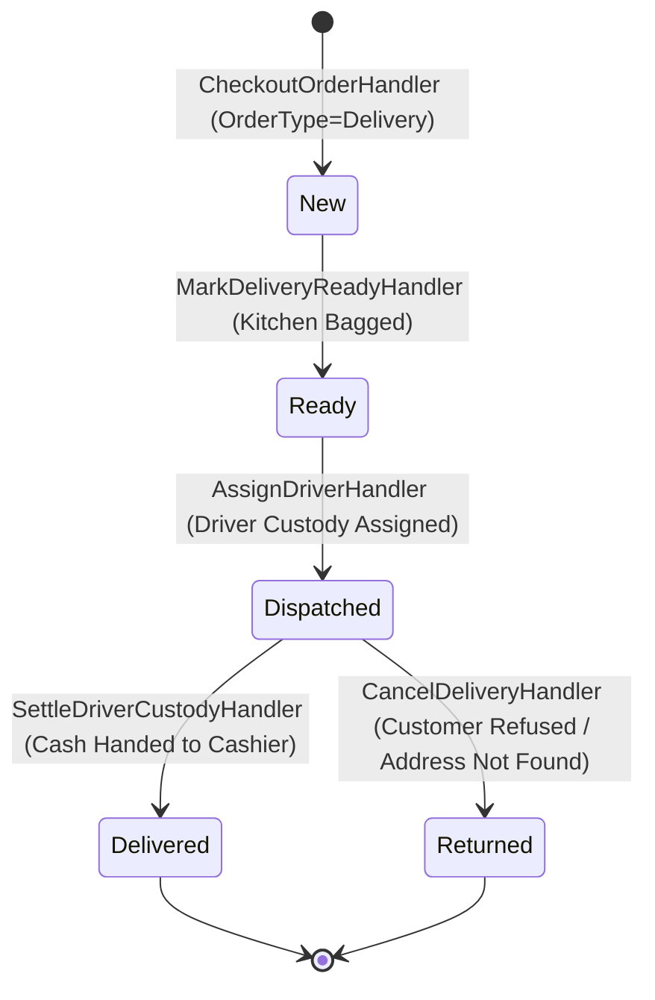

# Branch Pickup and Delivery Order Lifecycle Audit

- **Audit Target:** End-to-End Order Fulfillments, Kitchen Preparation, Cash-on-Delivery & Status Invariants
- **Baseline Commit:** `c35816ecae49633674775dd32061c6ee92f94aaf`
- **Audit Authority:** GitHub Copilot Independent Software Audit
- **Status:** Complete Static Workflow Audit of Delivery and Pickup Lifecycles.

---

## 1. Branch Pickup Workflow Lifecycle Analysis

The owner directive specifically mandates an investigation of the branch pickup lifecycle:
- **Owner Requirement:** Branch pickup orders must support kitchen ticket creation *before* payment (preparation stage), followed by final payment settlement and fiscal receipt printing at the cashier counter when the customer arrives to collect food.
- **Finding FLOW-001 (HIGH_REQUIREMENT_GAP):**
  Forensic inspection of `src/Falah.Domain/Orders/` and `src/Falah.Infrastructure/Orders/CheckoutOrderHandler.cs` reveals that the requested **two-stage pickup lifecycle is completely absent** from the active application code:
  - In `CheckoutOrderHandler.cs`, pickup orders require immediate payment at creation (`plan.IsPaid = true` or immediate payment tender).
  - There is no operational state or endpoint allowing a cashier to place a pickup order into kitchen preparation without simultaneously taking payment.
  - If a customer phones in a pickup order, the cashier must either fake a payment or delay ringing the order until the customer arrives, delaying food preparation.
- **Remediation:** Introduce `OrderStatus.PendingPayment` or `OrderStatus.InPreparation` for Pickup orders, decouple kitchen ticket printing from checkout payment, and add a dedicated "Pay & Collect Pickup" endpoint.

---

## 2. Delivery Order Workflow Lifecycle Analysis

The delivery lifecycle connects the Cashier/Call Center, Kitchen Prep, Driver Dispatch, and Driver Cash Custody Settlement:

### Critical Delivery Invariant Findings:
1. **Unvalidated Delivery Service Fees (FIN-016):**
   In `CheckoutOrderHandler.cs:142`, `deliveryFee` is accepted directly from the client wire request without verifying that the fee matches the configured `DeliveryService.DefaultFee` in the database. An operator can alter the request to set `deliveryFee = 0` or apply arbitrary negative adjustments.
2. **Driver Cash Custody Discrepancy (FIN-019 & FIN-CAND-DELIVERY-CUSTODY-001):**
   When a delivery order is paid via mixed payment (e.g. 50 EGP card paid at call center + 100 EGP cash to be collected by driver), `DeliveryFactsComposer.cs` and delivery reports erroneously aggregate the total order amount (`Total`) into the driver's expected cash custody rather than just the cash split (`PaymentSplit.Amount`), demanding drivers hand over cash that was already collected electronically.
