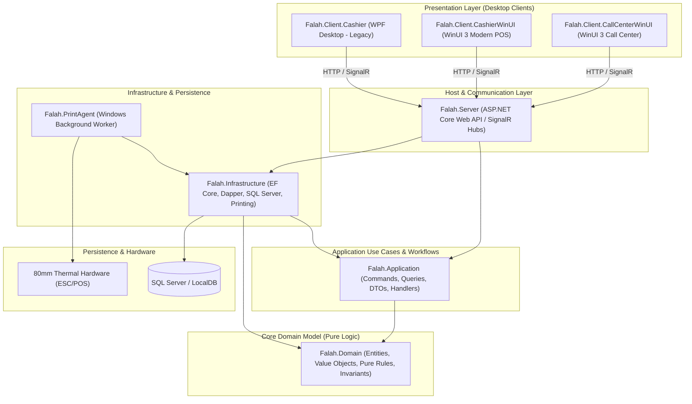

# Verified System Architecture and Repository Source Map

- **Audit Target:** Fale7 POS Architecture, Component Dependency Graph & Source Catalog
- **Baseline Commit:** `c35816ecae49633674775dd32061c6ee92f94aaf`
- **Audit Authority:** GitHub Copilot Independent Software Audit

---

## 1. System Architecture Diagram

---

## 2. Project Directory & Responsibility Catalog

| Project | File Count | Lines of Code | Key Responsibilities |
| :--- | :--- | :--- | :--- |
| **`src/Falah.Domain`** | 35 | ~4,200 | Pure business rules, `Money` value object, order aggregates, tax engine, attendance/payroll rules, printing layouts. |
| **`src/Falah.Application`** | 28 | ~2,800 | DTO definitions, CQRS requests/results, command validators, business exceptions. |
| **`src/Falah.Infrastructure`** | 185 | ~22,500 | `FalahDbContext`, entity models, SQL Server migrations, repository implementations, Dapper query services, ESC/POS rendering. |
| **`src/Falah.Server`** | 18 | ~2,100 | ASP.NET Core host, Minimal API route registrations, JWT/Session middleware, `OrderHub`, Swagger OpenAPI setup. |
| **`src/Falah.Client.Cashier`** | 86 | ~8,900 | Legacy WPF cashier touch-screen interface, XAML views, ViewModels, print coordinator. |
| **`src/Falah.Client.CashierWinUI`** | 134 | ~16,400 | Modern WinUI 3 cashier interface, Fluent controls, custom dialogs, multi-currency tender calculators. |
| **`src/Falah.Client.CallCenterWinUI`** | 68 | ~7,200 | WinUI 3 call center interface, multi-branch order routing, customer phone lookup, dispatch management. |
| **`src/Falah.PrintAgent`** | 12 | ~1,500 | Windows background worker, polling loop for pending print jobs, Windows Spooler P/Invoke wrapper (`RawPrinterHelper`). |
| **`tests/Falah.Domain.Tests`** | 18 | ~2,400 | Domain rule unit tests (`MoneyTests`, `CheckoutRulesTests`, `PayrollRulesTests`). |
| **`tests/Falah.Server.IntegrationTests`** | 62 | ~9,800 | Vertical slice integration tests using `WebApplicationFactory` and SQL Server LocalDB. |
| **`tests/Falah.Client.Tests`** | 16 | ~1,900 | Client ViewModel and cart state transition unit tests. |
| **`docs/` & `tools/`** | 28 | ~3,500 | Original developer specifications, receipt preview utility, and automation scripts. |

---

Complete file list available in: [`01-Source-Baseline/VERIFIED_FILE_INVENTORY.csv`](01-Source-Baseline/VERIFIED_FILE_INVENTORY.csv)
