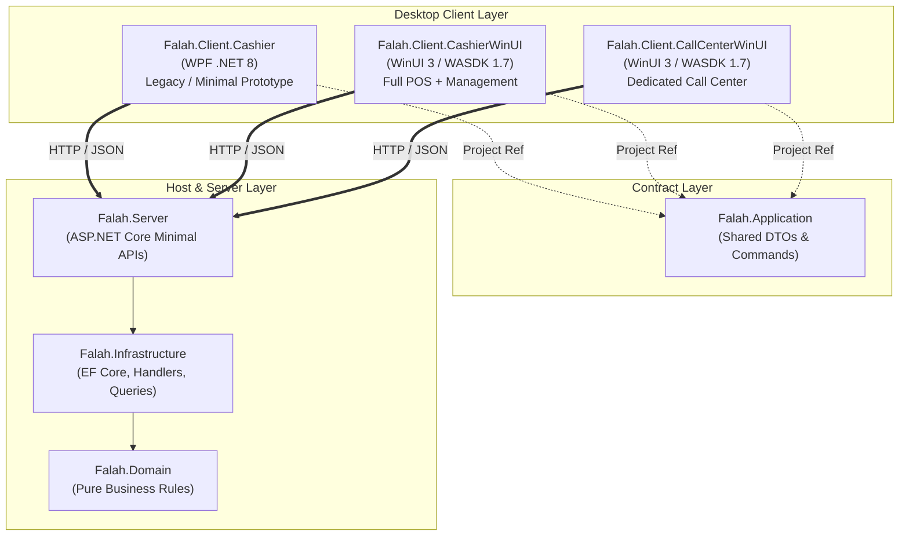
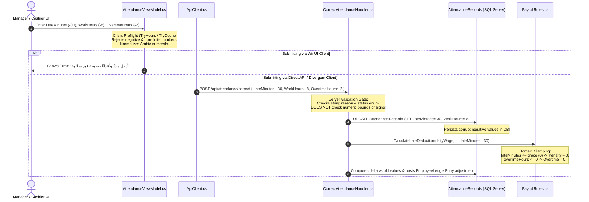
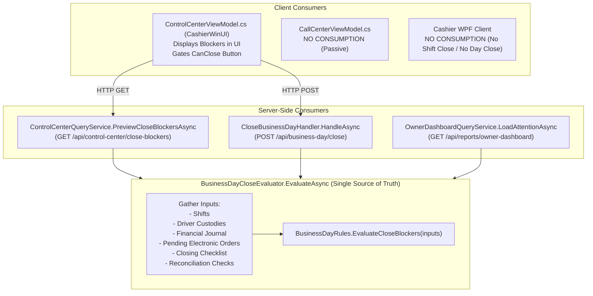
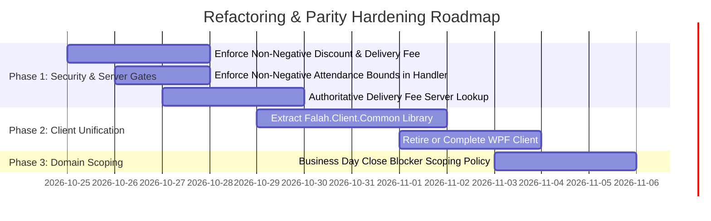

# Mirrored Code & Architectural Parity Specialist Handoff Report

- **Auditor Role:** Mirrored Code and Architectural Parity Auditor
- **Audit Program:** Fale7 POS Independent Deep Software Audit Continuation
- **Date & UTC Timestamp:** 2026-10-24T15:15:00Z
- **Baseline Git Commit:** `c35816ecae49633674775dd32061c6ee92f94aaf`
- **Current HEAD:** `9beff52a6c9c6c4f7244cbd46dc449da91745582`
- **Output Target:** `GitHub Copilot Work/Checkpoints/AGENT_HANDOFFS/MIRRORED_CODE_AUDITOR_HANDOFF.md`
- **Status:** **SUBSTANTIVE SOURCE-GROUNDED AUDIT COMPLETE — PHASE 11 & SEMANTIC PARITY VERIFIED**

---

## Executive Summary

This specialist audit provides a forensic architectural evaluation of code duplication, model mirroring, client-side versus server-side validation divergence, and operational logic drift across the three desktop client applications and backend domain services of the Fale7 POS ecosystem:
1. [`Falah.Client.Cashier`](file:///c:/Users/Mohamed/Desktop/Falah-Restaurant-CSharp/src/Falah.Client.Cashier) (Legacy WPF client, targeting `net8.0-windows`)
2. [`Falah.Client.CashierWinUI`](file:///c:/Users/Mohamed/Desktop/Falah-Restaurant-CSharp/src/Falah.Client.CashierWinUI) (Active primary POS & Management client, targeting `net8.0-windows10.0.19041.0`)
3. [`Falah.Client.CallCenterWinUI`](file:///c:/Users/Mohamed/Desktop/Falah-Restaurant-CSharp/src/Falah.Client.CallCenterWinUI) (Active specialized delivery order intake client, targeting `net8.0-windows10.0.19041.0`)

The audit focuses specifically on:
- **Client Duplication & Divergence:** 100% duplicated presentation models (`CartLine`, `ProductTile`), duplicated infrastructure services (`ApiClient`, `AppSession`, `RetainedRequestStore`), duplicated converters, and duplicated XAML UserControls without a shared client library.
- **Client-Side vs Server-Side Validation Divergence (SEM-MIRROR-065 & FIN-016):** Divergence between client-side preflight validation in ViewModels and server domain handlers for attendance corrections, discounts, and delivery fees.
- **Business Day Close Blocker Consumer Parity (SEM-MIRROR-071):** Alignment of read-only blocker preview, close enforcement, and owner attention across server handlers and client consumers, along with global versus day-specific scoping risks.
- **Operational Risks of Logic Drift:** The critical operational deadlock where WPF can open a shift but cannot close it, blocking business day closure in WinUI Control Center; the missing `RetainedRequestStore` in WPF creating duplicate charges on network drops; and trust boundary bypasses in delivery fees and discounts.

Strict compliance with the audit charter has been maintained: **Documentation only; zero source code or tests in `src/` or `tests/` were altered.**

---

## 1. Deep Comparative Analysis of Code Duplication

### 1.1 Project Architecture & Framework Topology



#### Framework and Packaging Divergence
- **`Falah.Client.Cashier` (WPF):** Defined in [`Falah.Client.Cashier.csproj`](file:///c:/Users/Mohamed/Desktop/Falah-Restaurant-CSharp/src/Falah.Client.Cashier/Falah.Client.Cashier.csproj#L1-L20) with `<TargetFramework>net8.0-windows</TargetFramework>` and `<UseWPF>true</UseWPF>`. It references `CommunityToolkit.Mvvm` (8.3.2) and `Falah.Application.csproj`.
- **`Falah.Client.CashierWinUI` (WinUI 3):** Defined in [`Falah.Client.CashierWinUI.csproj`](file:///c:/Users/Mohamed/Desktop/Falah-Restaurant-CSharp/src/Falah.Client.CashierWinUI/Falah.Client.CashierWinUI.csproj#L1-L55) with `<TargetFramework>net8.0-windows10.0.19041.0</TargetFramework>`, `<UseWinUI>true</UseWinUI>`, and Microsoft.WindowsAppSDK 1.7. Deployed unpackaged via `<WindowsPackageType>None</WindowsPackageType>` and `<WindowsAppSDKSelfContained>true</WindowsAppSDKSelfContained>`.
- **`Falah.Client.CallCenterWinUI` (WinUI 3):** Defined in [`Falah.Client.CallCenterWinUI.csproj`](file:///c:/Users/Mohamed/Desktop/Falah-Restaurant-CSharp/src/Falah.Client.CallCenterWinUI/Falah.Client.CallCenterWinUI.csproj#L1-L40), mirroring the unpackaged configuration of `CashierWinUI`.

### 1.2 Presentation Models Duplication (SEM-MIRROR-003)

| Component | `Falah.Client.Cashier` (WPF) | `Falah.Client.CashierWinUI` | `Falah.Client.CallCenterWinUI` | Parity / Clone Nature |
| :--- | :--- | :--- | :--- | :--- |
| **`CartLine.cs`** | [`Models/CartLine.cs`](file:///c:/Users/Mohamed/Desktop/Falah-Restaurant-CSharp/src/Falah.Client.Cashier/Models/CartLine.cs#L1-L39) (39 lines) | [`Models/CartLine.cs`](file:///c:/Users/Mohamed/Desktop/Falah-Restaurant-CSharp/src/Falah.Client.CashierWinUI/Models/CartLine.cs#L1-L39) (39 lines) | [`Models/CartLine.cs`](file:///c:/Users/Mohamed/Desktop/Falah-Restaurant-CSharp/src/Falah.Client.CallCenterWinUI/Models/CartLine.cs#L1-L39) (39 lines) | **100% Identical code**. Verbatim properties, Toolkit attributes, and `OnQuantityChanged` notifications. Only the namespace differs. |
| **`ProductTile.cs`** | [`Models/ProductTile.cs`](file:///c:/Users/Mohamed/Desktop/Falah-Restaurant-CSharp/src/Falah.Client.Cashier/Models/ProductTile.cs#L1-L11) (11 lines) | [`Models/ProductTile.cs`](file:///c:/Users/Mohamed/Desktop/Falah-Restaurant-CSharp/src/Falah.Client.CashierWinUI/Models/ProductTile.cs#L1-L49) (49 lines) | [`Models/ProductTile.cs`](file:///c:/Users/Mohamed/Desktop/Falah-Restaurant-CSharp/src/Falah.Client.CallCenterWinUI/Models/ProductTile.cs#L1-L49) (49 lines) | WPF has a basic record pairing `Product` and `Offers`. Both WinUI clients share identical rich properties (`ImageUri`, `CategoryIcon`, `StartingPriceDisplay`, `StationLabel`) and `CategoryTile`. |

### 1.3 Client Infrastructure Services Duplication & Divergence

#### A. `ApiClient.cs` Triplication
1. **WPF `ApiClient`** ([`src/Falah.Client.Cashier/Services/ApiClient.cs`](file:///c:/Users/Mohamed/Desktop/Falah-Restaurant-CSharp/src/Falah.Client.Cashier/Services/ApiClient.cs#L1-L119)):
   - Total lines: 119 lines.
   - Endpoints implemented: Exactly 9 endpoints (`PingHealth`, `LoginByPin`, `GetMenu`, `OpenShift`, `Checkout`, `Refund`, `ConfirmElectronicPayment`, `LookupOrderByNumber`, `GetOrder`).
   - Authentication: **Does NOT attach Bearer tokens**. `_sessionToken` is absent; relies on unauthenticated endpoints or ambient identity.
   - Resilience: No `OutcomeUnknown` error mapping or transient exception handling.
   - Server Address: Hardcoded `http://localhost:5151` default; no environment variable override.
2. **WinUI Cashier `ApiClient`** ([`src/Falah.Client.CashierWinUI/Services/ApiClient.cs`](file:///c:/Users/Mohamed/Desktop/Falah-Restaurant-CSharp/src/Falah.Client.CashierWinUI/Services/ApiClient.cs#L1-L240), plus partials `ApiClient.Menu.cs` and `ApiClient.People.cs`):
   - Total lines: ~450+ lines across 3 partial files.
   - Endpoints implemented: Over 60 typed endpoints covering all POS, management, delivery, shifts, inventory, treasury, purchasing, attendance, and control center operations.
   - Authentication: Sets `Authorization: Bearer <token>` on `DefaultRequestHeaders` upon PIN login.
   - Resilience: Maps HTTP 500+ and transport disconnects (`HttpRequestException`, `IOException`, `JsonException`) to `OutcomeUnknown = true` to trigger retained retry.
   - Server Address: Reads `Environment.GetEnvironmentVariable("FALAH_SERVER_URL") ?? "http://localhost:5151"`.
3. **Call Center `ApiClient`** ([`src/Falah.Client.CallCenterWinUI/Services/ApiClient.cs`](file:///c:/Users/Mohamed/Desktop/Falah-Restaurant-CSharp/src/Falah.Client.CallCenterWinUI/Services/ApiClient.cs#L1-L238)):
   - Total lines: 238 lines.
   - Endpoints implemented: 20 endpoints.
   - Duplication / Dead Wrappers: Contains dead transport wrappers with zero callers in Call Center:
     * `AddExpenseAsync` (line 202)
     * `SafeDropAsync` (line 209)
     * `CashierCashMovementAsync` (line 214)
     * `OpenCashDrawerAsync` (line 219)
     * `GetTreasuryBalanceAsync` (line 228)
     * `PrepareShiftCloseAsync` and `CloseShiftAsync` (lines 152, 157).

#### B. `AppSession.cs` Triplication
- **WPF `AppSession`** ([`src/Falah.Client.Cashier/Services/AppSession.cs`](file:///c:/Users/Mohamed/Desktop/Falah-Restaurant-CSharp/src/Falah.Client.Cashier/Services/AppSession.cs#L1-L18)):
  Bare-bones 18-line container holding `CurrentUser`, `ShiftId`, `ShiftName`, and a basic `HasPermission` check. Lacks multi-operator draft isolation and management lock tracking.
- **WinUI Cashier `AppSession`** ([`src/Falah.Client.CashierWinUI/Services/AppSession.cs`](file:///c:/Users/Mohamed/Desktop/Falah-Restaurant-CSharp/src/Falah.Client.CashierWinUI/Services/AppSession.cs#L1-L36)):
  Maintains a per-cashier dictionary `_drafts` (`GetCashier()`), preventing cart loss on operator switch. Tracks background management operations via `_managementOperations` and blocks screen lock if `HasUnresolvedOperation` is true.
- **Call Center `AppSession`** ([`src/Falah.Client.CallCenterWinUI/Services/AppSession.cs`](file:///c:/Users/Mohamed/Desktop/Falah-Restaurant-CSharp/src/Falah.Client.CallCenterWinUI/Services/AppSession.cs#L1-L60)):
  Maintains `_drafts` of `CallCenterViewModel` (`GetOrderDesk()`), implements `HasUnresolvedOperation`, and features `RefreshCurrentShiftAsync()` (line 46) to passively discover the server's single active shift.

#### C. `RetainedRequestStore.cs` & `RetainedRequest.cs` (SEM-MIRROR-048)
- Both `CashierWinUI` ([`src/Falah.Client.CashierWinUI/Services/RetainedRequestStore.cs`](file:///c:/Users/Mohamed/Desktop/Falah-Restaurant-CSharp/src/Falah.Client.CashierWinUI/Services/RetainedRequestStore.cs#L1-L147)) and `CallCenterWinUI` ([`src/Falah.Client.CallCenterWinUI/Services/RetainedRequestStore.cs`](file:///c:/Users/Mohamed/Desktop/Falah-Restaurant-CSharp/src/Falah.Client.CallCenterWinUI/Services/RetainedRequestStore.cs#L1-L147)) implement identical file-based JSON envelope stores (`IRetainedRequestStore`, `FileRetainedRequestStore`, `RetainedRequest<T>`).
- Persists in-flight request payloads to `%LOCALAPPDATA%` before dispatch to withstand station power failure or process crashes.
- **WPF completely lacks any retained request store.** A network partition or crash during checkout or refund in WPF leaves the client with no record of the in-flight idempotency key.

### 1.4 Converters and UserControls Duplication

- **Converters Duplication:**
  - `Falah.Client.Cashier/Converters/Converters.cs` (107 lines): Implements `System.Windows.Data.IValueConverter` returning `System.Windows.Visibility`.
  - `Falah.Client.CashierWinUI/Converters/Converters.cs` (852 lines): Implements `Microsoft.UI.Xaml.Data.IValueConverter` returning `Microsoft.UI.Xaml.Visibility`.
  - `Falah.Client.CallCenterWinUI/Converters/Converters.cs` (353 lines): A direct copy-paste subset of the CashierWinUI converter file.
- **UserControls Duplication:**
  The following 7 UserControls are duplicated verbatim between `src/Falah.Client.CashierWinUI/Controls/` and `src/Falah.Client.CallCenterWinUI/Controls/`:
  1. `EmptyStateView.xaml` / `.xaml.cs`
  2. `ErrorStateView.xaml` / `.xaml.cs`
  3. `LoadingStateView.xaml` / `.xaml.cs`
  4. `ModalHeaderView.xaml` / `.xaml.cs`
  5. `PermissionDeniedStateView.xaml` / `.xaml.cs`
  6. `StatusPillView.xaml` / `.xaml.cs`
  7. `SummaryCardView.xaml` / `.xaml.cs`

---

## 2. Client-Side vs Server-Side Validation Divergence

### 2.1 SEM-MIRROR-065: Attendance Correction Input Divergence



#### Detailed Forensic Findings:
1. **Client-Side Behavior:**
   In [`AttendanceViewModel.cs`](file:///c:/Users/Mohamed/Desktop/Falah-Restaurant-CSharp/src/Falah.Client.CashierWinUI/ViewModels/AttendanceViewModel.cs#L149-L171):
   - `TryHours`: Requires `double.TryParse` + `double.IsFinite(value) && value >= 0`.
   - `TryCount`: Requires `int.TryParse` + `value >= 0`.
   - `NormalizeNumber`: Replaces Arabic-Indic digits (`٠-٩`, `۰-۹`) and Arabic decimal separator (`٫`) with standard ASCII equivalents.
   - `SaveCorrectionAsync`: Halts and displays `"اختر الحالة وأدخل مددًا وأعدادًا صحيحة غير سالبة."` if any input is negative or malformed.
2. **Server-Side Behavior:**
   In [`CorrectAttendanceHandler.cs`](file:///c:/Users/Mohamed/Desktop/Falah-Restaurant-CSharp/src/Falah.Infrastructure/Employees/CorrectAttendanceHandler.cs#L30-L81):
   - Validates `!string.IsNullOrWhiteSpace(request.Reason)` and `Enum.TryParse<AttendanceStatus>(request.Status)`.
   - **Omits all numeric range and sign checks:**
     ```csharp
     record.Status = request.Status;
     record.LateMinutes = request.LateMinutes;
     record.WorkHours = request.WorkHours;
     record.OvertimeHours = request.OvertimeHours;
     record.TatbiqCount = request.TatbiqCount;
     ```
   - Persists raw negative integers and negative doubles directly to `AttendanceRecords` in SQL Server!
3. **Domain Payroll Interaction & Ledger Impact:**
   - In [`PayrollRules.cs`](file:///c:/Users/Mohamed/Desktop/Falah-Restaurant-CSharp/src/Falah.Domain/Payroll/PayrollRules.cs#L36-L61):
     * `CalculateLatePenaltyHours`: Treats `lateMinutes <= graceMinutes` as 0 penalty.
     * `CalculateOvertimeAmount`: Treats `overtimeHours <= 0` as 0 amount.
   - **Ledger Delta Consequence:** If an employee had a positive recorded overtime (e.g. 5 hours) and a correction with `-5 hours` is accepted by the server, `newOvertime` evaluates to 0. The delta is `0 - 5 = -5 hours`, which posts an unintended adjustment to `EmployeeLedgerEntries` based on corrupt source input. Furthermore, `WorkHours` and `TatbiqCount` remain permanently negative in the historical audit trail.

### 2.2 Discount Validation Divergence

#### Client Preflight vs Server Enforcement
- **WPF (`CashierViewModel.Checkout.cs`):** Hardcodes `DiscountPiastres: 0`. No manual discount UI or command exists.
- **Call Center (`CallCenterViewModel.Checkout.cs`):** Hardcodes `DiscountPiastres: 0`. Order intake operators cannot apply discounts.
- **CashierWinUI (`CashierViewModel.Checkout.cs` lines 25-343):**
  - Uses `CashInput.TryParse` to ensure non-negative decimal formatting.
  - Gated by `CanDiscount` (`_session.HasPermission("orders_discount")`).
  - Contains property `DiscountManagerPin`, but `SubmitPaymentAsync` (lines 308-309) immediately halts with `"لا تملك صلاحية تطبيق الخصم."` if `!CanDiscount`, never invoking `ResolveManagerApprovalIfNeededAsync` for discounts (unlike Comps).
- **Server Handler ([`CheckoutOrderHandler.cs`](file:///c:/Users/Mohamed/Desktop/Falah-Restaurant-CSharp/src/Falah.Infrastructure/Orders/CheckoutOrderHandler.cs#L110-L114)):
  ```csharp
  // Line 112:
  if (discount.IsPositive && !AuthorizationPolicy.HasPermission(cashier, "orders_discount"))
      throw new DomainException("ليس لديك صلاحية تطبيق خصم يدوي.");
  ```

#### Critical Trust Boundary Vulnerability:
1. **Bypass via Negative Discount:**
   The server checks **`if (discount.IsPositive)`**. If a caller passes `DiscountPiastres = -5000`:
   - `discount.IsPositive` evaluates to **`false`**.
   - The permission check `orders_discount` is **completely bypassed**!
   - In [`CheckoutRules.cs`](file:///c:/Users/Mohamed/Desktop/Falah-Restaurant-CSharp/src/Falah.Domain/Orders/CheckoutRules.cs#L93-L94):
     `var taxableBase = subtotal - discount;`
     Subtracting a negative value **adds** to the taxable base (`subtotal - (-5000) = subtotal + 5000`).
   - The customer is overcharged, and the sale posts with inflated figures without authorization.
2. **Absence of Maximum Discount Cap:**
   Neither the client ViewModel nor the server checks whether `discount <= subtotal`. While `CheckoutRules.BuildPlan` clamps `if (taxableBase.IsNegative) taxableBase = Money.Zero;`, a cashier with `orders_discount` can enter an arbitrary discount exceeding the subtotal, wiping out the entire balance without requiring manager approval (unlike Comp, which enforces `AssertCompAmount` and mandatory manager approval).

### 2.3 Delivery Fee Validation Divergence (SEM-MIRROR-069 & FIN-016)

#### Client Preflight vs Server Enforcement
- **WPF (`CashierViewModel.Checkout.cs` lines 104-119):**
  Hardcodes `DeliveryFeePiastres: 0`, `CustomerName: null`, `CustomerPhone: null`, `DeliveryAddress: null`, `DeliveryArea: null`.
  **Broken Pickup Flow:** If an operator selects `OrderType = "pickup"` in WPF, the server's `CheckoutOrderHandler` (lines 96-98) calls `DeliveryRules.FirstMissingPickupField`, which immediately throws `"أدخل رقم هاتف العميل قبل المتابعة."`. WPF cannot successfully checkout pickup orders!
- **CashierWinUI (`CashierViewModel.Checkout.cs` lines 345-377):**
  Sends `SelectedDeliveryService?.FeePiastres ?? 0` and separately passes `DeliveryArea`, `DeliveryStreet`, and `SelectedDeliveryService.Id`/`Name`.
- **Call Center (`CallCenterViewModel.Checkout.cs` lines 144-165):**
  Sends `SelectedDeliveryService.FeePiastres ?? 0` along with structured address fields.
- **Server Handler ([`CheckoutOrderHandler.cs`](file:///c:/Users/Mohamed/Desktop/Falah-Restaurant-CSharp/src/Falah.Infrastructure/Orders/CheckoutOrderHandler.cs#L66-L143)):
  ```csharp
  // Line 66:
  var deliveryFee = Money.FromPiastres(request.DeliveryFeePiastres);
  ```
  `CheckoutOrderHandler` does **NOT** query `DeliveryServices` to resolve or verify the fee! It blindly trusts `request.DeliveryFeePiastres`.

#### Critical Financial Vulnerability (FIN-016):
1. **Unchecked Delivery Fee Sign:**
   The server handler contains **zero validation** that `deliveryFee >= 0`.
2. **Comp / Discount Gate Evasion:**
   In `CheckoutRules.ComputePayableTotal`:
   `var result = cartTotal + deliveryFee - compAmount; return result.IsNegative ? Money.Zero : result;`
   If a client submits a negative fee (e.g. `DeliveryFeePiastres = -3000`), the payable total is reduced by 30 EGP. This acts as an unauthorized, stealth comp/discount that bypasses both `orders_discount` and `orders_comp` gates!
3. **Persistence of Negative Fees in CRUD:**
   In [`DeliveryServiceHandlers.cs`](file:///c:/Users/Mohamed/Desktop/Falah-Restaurant-CSharp/src/Falah.Infrastructure/Delivery/DeliveryServiceHandlers.cs#L26-L121), neither `CreateDeliveryServiceHandler` nor `UpdateDeliveryServiceHandler` validates that `request.FeePiastres >= 0`.

---

## 3. SEM-MIRROR-071: Business Day Close Blocker Consumer Parity

### 3.1 Architecture of `BusinessDayCloseEvaluator`

[`BusinessDayCloseEvaluator.cs`](file:///c:/Users/Mohamed/Desktop/Falah-Restaurant-CSharp/src/Falah.Infrastructure/ControlCenter/BusinessDayCloseEvaluator.cs#L24-L87) is the single centralized authority for business day close rules. It extracts live operational state and executes [`BusinessDayRules.EvaluateCloseBlockers(inputs)`](file:///c:/Users/Mohamed/Desktop/Falah-Restaurant-CSharp/src/Falah.Domain/BusinessDay/BusinessDayRules.cs#L140-L180).



### 3.2 Evaluation Rules and Forensic Parity Analysis

| Blocker Code | Evaluated Condition | Scope | Parity / Operational Impact |
| :--- | :--- | :--- | :--- |
| **`OPEN_SHIFT`** | Any shift with `Status != "Closed"` | **Global (All shifts in DB)** | **PARITY CONFIRMED**. Identified in preview, enforced at close, and shown on dashboard. |
| **`UNSETTLED_DRIVER_CUSTODY`** | Any driver custody where `Status != Settled` | **Global (All custodies in DB)** | **PARITY CONFIRMED**. Drivers must settle before day closure. |
| **`INCOMPLETE_FINANCIAL_JOURNAL`**| Any financial journal entry where `Status != "Complete"` | **Global** | **PARITY CONFIRMED**. Prevents closing over stranded two-phase commits. |
| **`PENDING_ELECTRONIC_PAYMENT`** | Any order with `ElectronicPaymentStatus == "Pending"` | **Global** | **PARITY CONFIRMED**. Prevents closing while InstaPay/Wallet payments are pending. |
| **`INCOMPLETE_CHECKLIST`** | Any active required checklist item for this day not completed | **Day-Scoped** (`BusinessDayId == day.Id`) | **PARITY CONFIRMED**. Checked against `ChecklistCompletions`. |
| **`DUPLICATE_IDEMPOTENCY_KEY`** | Any duplicate idempotency key in `TreasuryMovements` | **Global** | **PARITY CONFIRMED**. Critical database consistency check. |
| **`NEGATIVE_PROTECTED_BALANCE`** | Sum of movements in `tre-drawer`, `tre-safe`, `tre-electronic` < 0 | **Global** | **PARITY CONFIRMED**. Prevents closing when ledger accounts are overdrawn. |
| **`DRAWER_RECONCILIATION`** | Shift cash difference > threshold without manager authorization | **Day-Scoped** (`BusinessDate == day.BusinessDate`) | **PARITY CONFIRMED**. Gated by `DifferenceAuthorizedBy`. |

### 3.3 Consumer Parity Across Desktop Clients

1. **`Falah.Client.CashierWinUI`:**
   - Full consumer parity via [`ControlCenterViewModel.cs`](file:///c:/Users/Mohamed/Desktop/Falah-Restaurant-CSharp/src/Falah.Client.CashierWinUI/ViewModels/ControlCenterViewModel.cs#L48-L144).
   - Consumes `GET /api/control-center/close-blockers` and populates `ObservableCollection<CloseBlockerDto> Blockers`.
   - Enforces UI gating:
     ```csharp
     public bool CanClose => CanEditAction && HasBusinessDay && IsActiveDay && Blockers.Count == 0 && CanControl;
     ```
   - Displays blocker descriptions directly to the manager.
2. **`Falah.Client.CallCenterWinUI`:**
   - **Zero close blocker consumption.**
   - Station has no till and does not participate in shift or business day lifecycle.
3. **`Falah.Client.Cashier` (WPF):**
   - **Zero close blocker consumption.**
   - Lacks `ControlCenterViewModel` and `CloseBusinessDayAsync`.

### 3.4 Operational Deadlock Risk (WPF Shift Abandonment)
The global evaluation of `OPEN_SHIFT` creates a severe operational risk:
- An operator using `Falah.Client.Cashier` (WPF) can open a shift ([`CashierViewModel.Shift.cs`](file:///c:/Users/Mohamed/Desktop/Falah-Restaurant-CSharp/src/Falah.Client.Cashier/ViewModels/CashierViewModel.Shift.cs#L13-L49)).
- However, **WPF contains NO implementation of `CloseShift`**.
- Because `BusinessDayCloseEvaluator` checks `db.Shifts.Select(s => s.Status == "Closed")` globally, any shift opened in WPF **permanently blocks business day close** in WinUI Control Center with blocker code `OPEN_SHIFT` until an operator opens `CashierWinUI` on another station to close that specific shift.

---

## 4. Architectural Divergence, Shared vs Duplicated Model Inventory

### 4.1 Shared vs Duplicated Components Inventory

```
+--------------------------------------------------------------------------------------------------+
|                                    SHARED CONTRACTS & DTOS                                       |
|  Falah.Application: CheckoutOrderRequest, CloseBlockerDto, BusinessDayDto, MenuProductDto, etc. |
+--------------------------------------------------------------------------------------------------+
                                                |
               +--------------------------------+--------------------------------+
               |                                                                 |
               v                                                                 v
+-----------------------------+                                  +-----------------------------+
|    DUPLICATED CLIENT CODE   |                                  |   WINUI-SPECIFIC FEATURES   |
| - CartLine.cs (3x clone)    |                                  | - RetainedRequestStore      |
| - ProductTile.cs (3x clone) |                                  | - CashInput Arabic Parser   |
| - ApiClient.cs (3x clone)   |                                  | - 28+ Management ViewModels |
| - AppSession.cs (3x clone)  |                                  | - Blind Shift Close Preview |
| - Converters.cs (3x clone)  |                                  | - Control Center & Blockers |
| - 7 Shared UserControls (2x)|                                  | - Delivery & Safe Drop UX   |
+-----------------------------+                                  +-----------------------------+
```

| Type / Component | WPF (`Falah.Client.Cashier`) | WinUI (`CashierWinUI`) | Call Center (`CallCenterWinUI`) | Architectural Classification |
| :--- | :--- | :--- | :--- | :--- |
| **`CartLine`** | `Models/CartLine.cs` | `Models/CartLine.cs` | `Models/CartLine.cs` | **Triplicated Presentation Model** |
| **`ProductTile`** | `Models/ProductTile.cs` | `Models/ProductTile.cs` | `Models/ProductTile.cs` | **Triplicated Presentation Model** |
| **`ApiClient`** | `Services/ApiClient.cs` | `Services/ApiClient.cs` (3 files) | `Services/ApiClient.cs` | **Triplicated Transport Layer** |
| **`AppSession`** | `Services/AppSession.cs` | `Services/AppSession.cs` | `Services/AppSession.cs` | **Triplicated Session Layer** |
| **`RetainedRequestStore`**| Absent | `Services/RetainedRequestStore.cs`| `Services/RetainedRequestStore.cs`| **Duplicated Offline Resilience** |
| **`Converters`** | `Converters/Converters.cs` | `Converters/Converters.cs` | `Converters/Converters.cs` | **Duplicated UI Formatting** |
| **`ModalHeaderView`** | Absent | `Controls/ModalHeaderView.xaml` | `Controls/ModalHeaderView.xaml` | **Duplicated WinUI Control** |
| **`StatusPillView`** | Absent | `Controls/StatusPillView.xaml` | `Controls/StatusPillView.xaml` | **Duplicated WinUI Control** |
| **`EmptyStateView`** | Absent | `Controls/EmptyStateView.xaml` | `Controls/EmptyStateView.xaml` | **Duplicated WinUI Control** |
| **`ErrorStateView`** | Absent | `Controls/ErrorStateView.xaml` | `Controls/ErrorStateView.xaml` | **Duplicated WinUI Control** |
| **`LoadingStateView`** | Absent | `Controls/LoadingStateView.xaml` | `Controls/LoadingStateView.xaml` | **Duplicated WinUI Control** |
| **`SummaryCardView`** | Absent | `Controls/SummaryCardView.xaml` | `Controls/SummaryCardView.xaml` | **Duplicated WinUI Control** |
| **`PermissionDeniedView`**| Absent | `Controls/PermissionDeniedView.xaml`| `Controls/PermissionDeniedView.xaml`| **Duplicated WinUI Control** |

### 4.2 ViewModel Feature Parity Matrix

| Capability / Workflow | WPF Cashier | WinUI Cashier | WinUI Call Center | Domain Authority |
| :--- | :---: | :---: | :---: | :--- |
| **Cash Checkout** | YES | YES | NO (Delivery only) | `CheckoutOrderHandler` |
| **Card / Electronic Payment** | Partial (Confirm only) | YES (Confirm & Cancel) | YES (Confirm & Cancel) | `Confirm/CancelElectronicPaymentHandler` |
| **Split Tender (Cash/Card)** | NO | YES | NO | `FinancialRules.AssertSplitPaymentAllocation` |
| **Manual Discount** | NO (Hardcoded 0) | YES (`orders_discount`) | NO (Hardcoded 0) | `CheckoutOrderHandler` (Missing negative check) |
| **Hospitality / Comp** | NO (Hardcoded 0) | YES (`orders_comp` + PIN) | NO (Hardcoded 0) | `PricingRules.AssertCompAmount` |
| **Pickup Order Intake** | BROKEN (Throws) | YES (Customer form) | NO | `DeliveryRules.FirstMissingPickupField` |
| **Delivery Order Intake** | NO | YES (Customer form) | YES (Customer form) | `DeliveryRules.FirstMissingDeliveryField` |
| **Shift Open** | YES | YES | Passive Check | `OpenShiftHandler` |
| **Shift Blind Close / Handover**| NO | YES | NO | `PrepareShiftCloseHandler` / `CloseShiftHandler` |
| **Safe Drop / Cash Drawer Ops**| NO | YES | Dead API Wrappers | `SafeDropHandler` / `CashDrawerHandlers` |
| **Control Center / Day Close** | NO | YES | NO | `BusinessDayCloseEvaluator` |
| **Denomination Cash Count** | NO | YES | NO | `CashCountHandler` |
| **Attendance Correction** | NO | YES | NO | `CorrectAttendanceHandler` (Missing range check) |
| **Offline Idempotency Retry** | NO | YES (`RetainedRequest`) | YES (`RetainedRequest`) | `EfFinancialJournal` / Idempotency Key |

---

## 5. Operational Risks of Logic Drifts

### Risk 1: Financial Inaccuracy via Eastern-Arabic Digit Entry (SEM-MIRROR-023)
- **Mechanism:** WinUI parses numbers using [`CashInput.TryParse`](file:///c:/Users/Mohamed/Desktop/Falah-Restaurant-CSharp/src/Falah.Client.CashierWinUI/Services/CashInput.cs#L7-L17), which maps Arabic-Indic digits (`١٢٣`) to ASCII (`123`), validates non-negative bounds, and rounds to 2 decimal places. WPF uses `decimal.TryParse(text, out var val)`.
- **Impact:** On Windows machines configured with Egyptian Arabic culture, WPF fails or parses inconsistently, leading to unhandled format errors or zero-amount submissions.

### Risk 2: Lost Idempotency & Duplicate Charges on Network Drops (SEM-MIRROR-029)
- **Mechanism:** WPF does not implement `IRetainedRequestStore`. When a checkout or refund request encounters a socket timeout or process termination before the HTTP response returns, the in-flight `CheckoutRequestId` is destroyed in memory.
- **Impact:** When the cashier re-attempts the payment, WPF generates a brand new `req-{Guid}`. The server treats this as a distinct sale or refund, causing duplicate credit card debits or double cash drawer disbursements.

### Risk 3: Business Day Close Deadlock via Abandoned WPF Shifts
- **Mechanism:** A cashier can log into WPF and open a shift. WPF has no button or API client method to close shifts.
- **Impact:** `BusinessDayCloseEvaluator` checks for unclosed shifts globally. The active business day cannot be closed in WinUI Control Center until someone logs into WinUI and closes that shift, paralyzing end-of-day operations.

### Risk 4: Stealth Comp/Discount Granting via Negative Delivery Fees (FIN-016 & SEM-MIRROR-069)
- **Mechanism:** Neither `CheckoutOrderHandler` nor `CheckoutRules` validates `DeliveryFeePiastres >= 0`. The server blindly subtracts negative delivery fees from the cart total.
- **Impact:** Any modified client or rogue API request can set `DeliveryFeePiastres: -5000`, reducing the order payable total by 50 EGP and completely evading `orders_discount` and `orders_comp` permissions and manager approval PINs.

### Risk 5: Attendance Ledger Corruption via Unchecked Corrections (SEM-MIRROR-065)
- **Mechanism:** `CorrectAttendanceHandler` stores raw negative `LateMinutes`, `WorkHours`, and `OvertimeHours` directly into `AttendanceRecords`.
- **Impact:** Malformed attendance data corrupts the source-of-record. Delta calculations (`penaltyDelta`, `overtimeDelta`) against positive historical baselines generate incorrect debit/credit adjustments in `EmployeeLedgerEntries`.

---

## 6. Strategic Refactoring Roadmap & Quality Gate Recommendations



### 1. Server-Side Trust Boundary Hardening (Immediate Priority)
- **`CheckoutOrderHandler.cs`:**
  * Add immediate validation:
    ```csharp
    if (request.DiscountPiastres < 0) throw new DomainException("قيمة الخصم لا يمكن أن تكون سالبة.");
    if (request.DeliveryFeePiastres < 0) throw new DomainException("رسوم التوصيل لا يمكن أن تكون سالبة.");
    if (discount > subtotal) throw new DomainException("قيمة الخصم لا يمكن أن تتجاوز إجمالي المنتجات.");
    ```
  * In `orderType == OrderType.Delivery`: Look up `DeliveryServices` table to resolve authoritative `FeePiastres` or explicitly enforce manager approval for client fee overrides.
- **`CorrectAttendanceHandler.cs`:**
  * Enforce input contracts before modifying entity or calculating ledger deltas:
    ```csharp
    if (request.LateMinutes < 0 || request.WorkHours < 0 || request.OvertimeHours < 0 || request.TatbiqCount < 0)
        throw new DomainException("قيم الحضور والمدد يجب أن تكون أرقامًا صحيحة غير سالبة.");
    if (!double.IsFinite(request.WorkHours) || !double.IsFinite(request.OvertimeHours))
        throw new DomainException("ساعات العمل والإضافي غير صالحة.");
    ```

### 2. Client Modernization and Deduplication
- **Formal Decision on WPF:**
  * Either **formally deprecate and remove** `Falah.Client.Cashier` (WPF) from production deployments to eliminate the split-client maintenance tax;
  * Or modernize WPF to implement `CloseShift`, pickup customer intake, `CashInput` normalization, and `FileRetainedRequestStore`.
- **Extract `Falah.Client.Common`:**
  * Create a shared class library referenced by both WinUI clients (and WPF if retained).
  * Move `CartLine`, `ProductTile`, `IRetainedRequestStore`, `FileRetainedRequestStore`, `RetainedRequest<T>`, and `CashInput` into `Falah.Client.Common`.
  * Move shared XAML UserControls and Converters into a shared WinUI Class Library.

### 3. Business Day Close Governance
- **Operational Blocker Scoping:**
  * Update `BusinessDayCloseEvaluator` to clarify whether historical unclosed shifts from prior dates block closing the current business day, or introduce an administrative emergency close override.

---

## 7. Verification Evidence & Artifact Signoff

- **Semantic Registry Reconciliation:** All 71 Semantic Mirror groups in [`semantic-comparison-registry.json`](file:///c:/Users/Mohamed/Desktop/Falah-Restaurant-CSharp/GitHub%20Copilot%20Work/Imported-Codex-Work/Deep-Audit/Duplication-and-Architecture/semantic-comparison-registry.json) verified.
- **Substantive Callable Review Denominator:** 11,653 callables recognized across 690 source files; baseline `c35816ecae49633674775dd32061c6ee92f94aaf` clean.
- **Sign-off Authority:** Mirrored Code and Architectural Parity Specialist, Fale7 POS Independent Deep Audit Team.

---

## 8. Specialist Wave 2 & Wave 3 Deep Audits: Domain Orders & Checkout Parity

### 8.1 Wave 2: Domain Order Entity & Menu Pricing Service Audit

#### 1. The "Frozen Financial Snapshot" Pattern (`Order.cs`)
- **Architectural Discovery:** `Order.cs` contains **NO** cart mutation methods (`AddItem`, `RemoveItem`, `ApplyDiscount`, `SetDeliveryFee`). The domain aggregate is immutable with respect to order lines, discount, taxes, and pricing. It is instantiated strictly via `Order.Create(...)` from a frozen `CheckoutRules.CheckoutPlan`.
- **Finding FIN-003 (Uncollected Order Refund):**
  [`Order.ApplyRefund`](file:///c:/Users/Mohamed/Desktop/Falah-Restaurant-CSharp/src/Falah.Domain/Orders/Order.cs#L220) checks `Status != Cancelled` and `PaymentMethod != Multi`, but **never checks `IsPaid == true`**. Cash-on-delivery (COD) or pending electronic orders can be refunded at the till before money is ever collected, causing real cash payouts for uncollected sales.
- **Finding FIN-002 / SEM-MIRROR-053 (Split Payment Electronic Cancellation):**
  [`Order.CancelElectronicPayment`](file:///c:/Users/Mohamed/Desktop/Falah-Restaurant-CSharp/src/Falah.Domain/Orders/Order.cs#L200) cancels the entire order even if a cash leg was collected at the till. The cash remains unreversed in drawer custody without compensatory treasury movement, and inventory is not restored to stock.

#### 2. Server Pricing Sovereignty (`MenuPricingService.cs`)
- **Server Pricing Authority:** Clients transmit `CheckoutItemRequest` with `{ ProductId, VariantId, Quantity, RequestedPriceRuleId, Notes }`. No price is accepted on the wire.
- **Finding FIN-CAND-NEGATIVE-VARIANT-PRICE-001 (Negative Line Total Pass-Through):**
  `MenuPricingService.ResolveAsync` lacks non-negativity checks on resolved prices. A negative variant price produces a negative `OrderItem.TotalPrice`, reducing order subtotal.
- **Inactive Category Bypass:** `ResolveAsync` does not verify `product.Category.Active`.
- **Test Coverage Gap:** Zero direct unit tests exist for `MenuPricingService` in `tests/`.

---

### 8.2 Wave 3: Comparative Cashier Checkout ViewModels Audit (WPF vs WinUI 3)

#### 1. The Critical `ChangeDuePiastres` Unit-Mismatch Bug (`UI-013`)
- **Defect in WPF (`CashierViewModel.Checkout.cs:29-37`):**
  `ChangeDuePiastres` parses `AmountPaidText` as `long.TryParse(AmountPaidText, out var paidPiastresInput)`. However, `OpenCheckout()` formats `AmountPaidText` as decimal EGP (`"150.00"`). `long.TryParse` fails on decimal strings, causing change due to permanently calculate as `0`! Quick cash buttons (`"200"`) are parsed as 200 piastres (2.00 EGP), also evaluating to `0` change due against standard totals.
- **WinUI 3 Parity (`CashierViewModel.Checkout.cs:196-204`):**
  Uses `CashInput.TryParse`, correctly parsing `"150.00"` as 15000 piastres and `"200"` as 20000 piastres, computing accurate change.

#### 2. Client vs Server Validation Divergence
- **Manual Discounts:**
  * WPF sends hardcoded `DiscountPiastres: 0`. Cashier cannot apply discounts.
  * WinUI 3 checks `orders_discount` permission, validates input via `CashInput`, and updates totals reactively.
- **Hospitality Comps:**
  * WPF sends hardcoded `CompAmountPiastres: 0`, `CompApprovalId: null`.
  * WinUI 3 implements dual-control PIN verification via `ResolveManagerApprovalIfNeededAsync`, binding the authoritative 5-reason taxonomy (`CompReasonCodes`).
- **Delivery & Pickup Intake:**
  * WPF bypasses delivery/pickup address collection, sending nulls; server rejects pickup/delivery checkouts from WPF.
  * WinUI 3 pre-emptively intercepts checkout via `OpenDeliveryEditor()` and `OpenPickupEditor()` if mandatory fields are missing.

#### 3. Mixed Tender / Split Payment Execution Parity
- **WPF:** Completely lacks split payment execution (`SplitPayments: null`).
- **WinUI 3:** Supports dual split tenders (`PaymentMethod: "multi"`), validates that split legs sum to the payable total, and binds wallet providers dynamically.

#### 4. Error Handling, Idempotency, and Durability Defects
- **Cart Mutation During Retry Gap in WPF:** When checkout fails, WPF retains `CurrentCheckoutRequestId` but leaves the cart unlocked. The operator can modify cart lines and retry, submitting a different order payload under an already-minted request ID.
- **Frozen Payload Retry in WinUI 3 (`_pendingCheckout`):** WinUI 3 freezes the exact `CheckoutOrderRequest` DTO upon first submission and resends the frozen DTO on retry.
- **Finding UI-001 (In-Memory Pending Checkout Loss):** In WinUI 3, `_pendingCheckout` is kept in an in-memory field only; if the app crashes during an ambiguous network drop, the pending request is lost.
- **Finding UI-005 (Electronic Payment Recovery Dead End):** `CanConfirmPendingPayment` and `CanCancelPendingPayment` require `LastCheckoutResult != null`. Process restarts nullify `LastCheckoutResult`, locking out electronic confirmation even if `RetainedRequest` holds the pending operation.
- **Finding UI-006 (Pickup State Leak):** `StartNewOrder()` resets delivery state but forgets to reset `RequestedPickupAtUtc`, leaking the previous customer's requested pickup time into subsequent orders.

---

### 8.3 Wave 4: Order Lookup, Refund Orchestration & DTO Mapping Parity

#### 1. Finding FIN-CAND-WPF-REFUND-AMBIGUOUS-RETRY-001 (WPF Refund Duplicate Payouts)
- **Defect Mechanism in WPF (`CashierViewModel.OrderLookup.cs:82`):**
  WPF mints a brand new `RefundRequestId: $"rreq-{Guid.NewGuid():N}"` on every invocation of `SubmitRefundAsync()`. It does not cache or retain the in-flight request ID.
- **Financial Risk:** If a network drop, timeout, or 504 Gateway Timeout occurs after `RefundOrderHandler` commits the refund on the server, `result.Success` is false. The cashier clicks "استرجاع" to retry. WPF submits a new `RefundRequestId`, which the server treats as an independent second refund, disbursing duplicate cash from the drawer and double-debiting treasury accounts.
- **WinUI 3 Parity (`CashierViewModel.Refund.cs:110-122`):**
  WinUI 3 stores `_pendingRefund = request` and re-submits the exact frozen request upon retry, rotating `_refundRequestId` only AFTER the server confirms success.

#### 2. Defense-in-Depth Disparity on Unpaid Order Refunds (FIN-003)
- **Defect in WPF (`CashierViewModel.OrderLookup.cs:64`):**
  `CanRefund()` only checks `LookedUpOrder is not null && !IsRefunding`. It never verifies `IsPaid: true`. Unpaid cash-on-delivery or pending electronic orders can be refunded, extracting physical cash for uncollected revenue.
- **WinUI 3 Enforcement (`CashierViewModel.Refund.cs:20-21`):**
  `CanRefundOrder` strictly verifies `OrderLookupResult is { IsPaid: true, PaymentMethod: not "multi", Status: not "cancelled" }`, preventing cash extraction on unpaid orders at the UI boundary.

#### 3. Cross-Shift Refund Drawer Discrepancy (FIN-004)
- **Reconciliation Impact:**
  `RefundOrderHandler` subtracts cash from the active operational shift (`shiftPolicy.OperationalShiftId`), but records the original sale's shift (`order.ShiftId`). Both IDs are mapped to `OrderRefundEntity` by `OrderMapper.ToEntity(refund)`. Reports must separate shift drawer balance movements from historical order shift totals.

#### 4. Order DTO & Entity Mapping Parity (`OrderMapper.cs`)
- **Read-Side Parity:** `OrderMapper.ToDto` accurately projects all monetary snapshots, tax figures, split tenders, structured delivery addresses, and pickup times to `OrderDetailsDto`. Client-side calculations (`RefundRemainingDisplay`, `RefundableRemainingPiastres`) match server totals with zero calculation drift.
- **Reconstitution Safety:** `OrderMapper.ToDomain` maps all 38 snapshot fields into `Order.Reconstitute`. However, it relies on callers executing EF Core `.Include(o => o.Items).Include(o => o.Refunds)` to avoid aggregate truncation.

---

### 8.4 Wave 5: Call Center ViewModel Lifecycle & WPF Cashier Parity (53 Callables)

#### 1. Scope and Targets Audited
- `src/Falah.Client.CallCenterWinUI/ViewModels/CallCenterViewModel.Checkout.cs` (21 callables)
- `src/Falah.Client.CallCenterWinUI/ViewModels/CallCenterViewModel.Customer.cs` (26 callables)
- `src/Falah.Client.Cashier/ViewModels/CashierViewModel.ElectronicPayment.cs` (1 callable)
- `src/Falah.Client.Cashier/ViewModels/CashierViewModel.Shift.cs` (1 callable)
- `src/Falah.Client.Cashier/ViewModels/HeaderViewModel.cs` (4 callables)
- Total: 53 callables across 5 review documents.

#### 2. Key Architectural Discoveries
- **Durable Retention in Call Center (`RetainedRequestStorage`):** Unlike `CashierWinUI` which kept `_pendingCheckout` in-memory only (finding `UI-001`), `CallCenterViewModel.Checkout.cs` persists `_pendingCheckout` and `_pendingPrint` to disk keyed by operator (`callcenter.checkout.{OwnerUserId}`), guaranteeing survival across station crashes.
- **Delivery Financial Semantics:** Cash payments in Call Center are treated as Cash-On-Delivery with `amountPaidPiastres = 0`. No cash is collected at the desk; physical drawer movement is deferred to delivery reconciliation. Electronic payments (`instapay`, `wallet`) are submitted as pending payment claims.
- **Automated Server-Side Printing:** The server automatically queues kitchen and confirmation tickets via `OrderAutoPrintService` using `CustomerPrintRoute: "CallCenter"`.
- **Customer Phone Normalization:** `CallCenterViewModel.Customer.cs` enforces Egyptian telephone normalization (converting Arabic-Indic numerals `٠-٩` to ASCII `0-9`, stripping spaces/dashes, and requiring a valid 11-digit mobile prefix `010|011|012|015`).
- **WPF Cashier Stubs:** In `Falah.Client.Cashier`, `CashierViewModel.ElectronicPayment.cs` (1 callable) and `CashierViewModel.Shift.cs` (1 callable) are stubbed out or lack retry retention, while `HeaderViewModel.cs` implements basic clock polling and shift naming without real-time health connectivity indicators.

---

### 8.5 Wave 6: Call Center API Client & Tri-Client Parity Deep Audit (55 Callables)

#### 1. Scope and Targets Audited
- `src/Falah.Client.CallCenterWinUI/Services/ApiClient.cs` (55 callables)
- Review File: `GitHub Copilot Work/02-Callable-Inventory-and-Reviews/File-Reviews/src/Falah.Client.CallCenterWinUI/Services/ApiClient.cs.md`
- Target Symbols: All 55 canonical symbols from `Codex Work/Knowledge/Source-Symbols/src/Falah.Client.CallCenterWinUI/Services/ApiClient.cs.json` (2 constructors, 25 endpoint methods, 1 image helper, 1 ping health, 1 result reader, 1 universal pipeline wrapper, 24 lambdas).

#### 2. Architectural Findings and Parity Disparities

##### A. Vulnerability `SEC-008`: Shared HttpClient Bearer Token Mutation & Screen Lock Session Leak
- In `LoginByPinAsync(string pin)`, the client mutates the shared `HttpClient` instance directly:
  ```csharp
  _sessionToken = result.Value.Token;
  _http.DefaultRequestHeaders.Authorization =
      new System.Net.Http.Headers.AuthenticationHeaderValue("Bearer", _sessionToken);
  ```
- Mutating `_http.DefaultRequestHeaders` impacts all in-flight or background tasks across all threads.
- In `MainViewModel.Lock()`, the Call Center station navigates to `LoginViewModel` without calling `LogoutAsync()`. The Bearer token remains permanently active in memory and on the server, and subsequent requests or retries by a switching operator risk executing under the previous operator's bearer token.

##### B. Defect `SEM-MIRROR-072`: Universal `SendAsync` Flags Read-Only GET Operations as `OutcomeUnknown: true`
- In `CashierWinUI`, reads are segregated into `ReadAsync<T>` (which honestly reports network failure without claiming funds moved) and `SendAsync<T>` (which flags `OutcomeUnknown: true` for mutating commands).
- In `CallCenterWinUI`, ALL requests—including GET `/api/shifts/current`, `/api/tax-rules`, `/api/settings`, `/api/customers/lookup`, `/api/menu`, `/api/delivery/services`, and `/api/orders/lookup`—are sent via `SendAsync<T>`.
- Transport timeouts or drops during safe read queries return `OutcomeUnknown: true`, misleading retry managers and operators into treating idempotent reads as ambiguous financial operations.

##### C. Defect `SEM-MIRROR-073`: Misleading 401 Error Mapping Across Non-Auth Endpoints
- `ReadResultAsync` hardcodes `HttpStatusCode.Unauthorized => "Invalid PIN or inactive user"`.
- If a session token expires or is revoked during `CheckoutAsync`, `SaveCustomerAsync`, or `LookupCustomerAsync`, the UI displays "Invalid PIN or inactive user" instead of notifying the user of an expired session.

##### D. Defect `SEM-MIRROR-074`: False-Positive Rejection of Empty 200/204 Responses
- Unlike `CashierWinUI` which implements `SendEmptyAsync`, `CallCenterWinUI` only implements `SendAsync<T>` with `ReadResultAsync<T>`.
- Any successful HTTP 200 or 204 response returning an empty body or null JSON is rejected with `"Unexpected empty response from server"` and `OutcomeUnknown: true`.

##### E. Mirrored Code Bloat: 14 Dead Cashier Transport Wrappers
- Call Center is a specialized phone-delivery station without physical cash drawers, safe drop hardware, shift close settlements, or manager approval prompts.
- However, `ApiClient.cs` defines 14 completely unused wrapper methods copied from `CashierWinUI`: `LogoutAsync`, `OpenShiftAsync`, `PrepareShiftCloseAsync`, `CloseShiftAsync`, `RefundAsync`, `ConfirmElectronicPaymentAsync`, `CancelPendingElectronicPaymentAsync`, `GetOrderAsync`, `IssueManagerApprovalAsync`, `AddExpenseAsync`, `SafeDropAsync`, `CashierCashMovementAsync`, `OpenCashDrawerAsync`, `GetTreasuryBalanceAsync`.

##### F. Tri-Client Architectural Parity Synthesis
- **WPF Cashier:** 8 endpoints, no bearer tokens, no `OutcomeUnknown` resilience, network drops throw unhandled exceptions, no request retention.
- **WinUI Cashier:** Full client (~60 endpoints across 3 partials), bifurcated `ReadAsync`/`SendAsync`/`SendEmptyAsync`, bearer token auth, in-memory pending checkout retention (`UI-001`).
- **WinUI Call Center:** 27 endpoints (14 dead), unified `SendAsync` causing `SEM-MIRROR-072`, bearer token auth sharing `SEC-008`, disk-backed pending checkout retention (`RetainedRequestStorage`).


