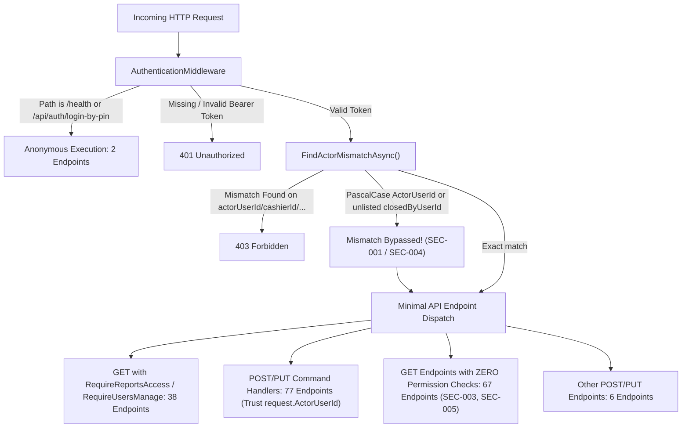

# Specialist Security and Authorization Audit Report

- **Subsystem Target:** Fale7 POS Authentication, Authorization, Session Management & Sensitive Data Exposure
- **Authority:** Security and Authorization Auditor
- **Date & UTC Timestamp:** 2026-10-24T18:15:00Z
- **Baseline Commit:** `c35816ecae49633674775dd32061c6ee92f94aaf`
- **Current HEAD:** `9beff52a6c9c6c4f7244cbd46dc449da91745582`
- **Scope:** 188 Minimal API endpoints in `src/Falah.Server/Program.cs`, `AuthenticationMiddleware.cs`, 53 command handlers and query services in `src/Falah.Infrastructure/`, client request retention in `src/Falah.Client.*`, and DTO definitions in `src/Falah.Application/`.
- **Status:** **EXHAUSTIVE AUDIT COMPLETE — CRITICAL DEFICIENCIES IDENTIFIED & REMEDIATION BLUEPRINT DOCUMENTED.**

---

## 1. Executive Summary

This security audit conducted a line-by-line inspection of all endpoints, authentication middleware, permission gates, and data exposure channels across the Fale7 POS system. 

### Key Audit Conclusions:
1. **Critical Architectural Disconnect:**
   The codebase contains an extension class `HttpContextActorExtensions` with methods `context.Actor()` and `context.ActorId()`, intended to enforce the rule that *"the token is the identity"* ([AuthenticationMiddleware.cs#L8-L16](file:///c:/Users/Mohamed/Desktop/Falah-Restaurant-CSharp/src/Falah.Server/AuthenticationMiddleware.cs#L8-L16)). **However, in reality, not a single endpoint in `src/Falah.Server/Program.cs` and not a single handler in `src/Falah.Infrastructure/` calls `context.Actor()` or `context.ActorId()`.**
2. **Fragile and Broken Defense Boundary:**
   Instead of extracting the caller identity from the authenticated session context, every command endpoint accepts an untrusted caller ID property (`ActorUserId`, `CashierId`, `CreatedByUserId`, `OpenedByUserId`, `ReportedByUserId`, or `ClosedByUserId`) in the JSON request body or query string. Handlers query `_db.Users` directly using this untrusted request parameter and perform authorization checks against the queried user record.
3. **Confirmed Privilege Escalation (SEC-001):**
   The middleware's only defense against identity spoofing—`AuthenticationMiddleware.FindActorMismatchAsync`—uses `System.Text.Json.JsonElement.TryGetProperty` with exact lowercase strings (`"actorUserId"`). Because `TryGetProperty` is strictly ordinal case-sensitive while ASP.NET Core Minimal API model binding is case-insensitive, any authenticated user can bypass mismatch detection by sending `"ActorUserId"` (PascalCase) or uppercase variations, allowing unprivileged accounts (such as a cashier or kitchen staff) to execute commands with administrator or owner privileges.
4. **Credential Leakage in Client Persistence (SEC-002):**
   `FileRetainedRequestStore` writes raw command objects to `%LOCALAPPDATA%\Falah\pending-operations\{station}\{ownerKey}.json` in plaintext. When users are created or PINs are updated, raw employee and manager PINs (`InitialPin`, `CurrentPin`, `NewPin`) reside unencrypted on the local filesystem.
5. **Widespread Sensitive Data Exposure (SEC-003, SEC-005):**
   A total of **67 GET endpoints** have zero permission checks. Any authenticated caller can view complete employee profiles (including National ID, monthly salary, daily wages, phone, address, and biometric fingerprint IDs via `GET /api/employees`), full payroll runs and employee payroll line breakdowns (`GET /api/payroll-runs`), all system database backups (`GET /api/backups`), treasury cash handovers (`GET /api/treasury/handovers`), and supplier debt/purchase payables aging (`GET /api/purchases/payables-aging`).
6. **New Discovery (SEC-004): Omission of `ClosedByUserId`:**
   `AuthenticationMiddleware.ActorFields` omits `"closedByUserId"`. Consequently, `POST /api/shifts/close` permits any user to close any shift under any cashier's identity without triggering mismatch detection even when sent in standard casing.

---

## 2. Exhaustive Endpoint Classification (`src/Falah.Server/Program.cs`)

A systematic automated and manual audit of all **188 endpoints** declared in `Program.cs` was performed.



### Detailed Endpoint Category Metrics

| Category | Endpoint Count | Security Mechanism | Integrity & Vulnerability Evaluation |
| :--- | :--- | :--- | :--- |
| **Anonymous Endpoints** | 2 | None (`AnonymousPaths` bypass) | Intended: `/health` (probe) and `/api/auth/login-by-pin` (rate-limited by IP). |
| **Query-Gated GET Endpoints** | 38 | Query `actorUserId` validated by `RequireReportsAccessAsync` (34) or `RequireUsersManageAsync` (4) | Middleware checks `context.Request.Query.TryGetValue`. In ASP.NET Core, `QueryCollection` is case-insensitive, so query spoofing is caught. However, `actorUserId` is passed as query string rather than read from `context.ActorId()`. |
| **Body Command POST/PUT Endpoints** | 77 | Deserializes DTO with `ActorUserId`, `CashierId`, `CreatedByUserId`, etc. | **CRITICALLY VULNERABLE:** Depends solely on `FindActorMismatchAsync`. Case-sensitivity bypass (SEC-001) allows arbitrary identity injection. |
| **Shift Close Endpoint** | 1 | `POST /api/shifts/close` deserializes `CloseShiftRequest.ClosedByUserId` | **CRITICALLY VULNERABLE (SEC-004):** `closedByUserId` is not in `ActorFields`. Any user can close shifts as any cashier. |
| **Unguarded Sensitive Read Endpoints** | 67 | Authenticated session token only; **zero permission checks** | **HIGH EXPOSURE (SEC-003, SEC-005):** Exposes salaries, National IDs, payroll lines, database backups, cash handovers, and supplier debts. |
| **Other Operational Endpoints** | 3 | Static assets, Swagger, internal diagnostics | Low risk. |
| **Total Mapped Endpoints** | **188** | — | — |

---

## 3. Handlers Referencing `ActorUserId` in `src/Falah.Infrastructure/`

Across `src/Falah.Infrastructure/`, **53 files** reference `ActorUserId` or `actorUserId`.

### The Systemic Architectural Anti-Pattern

In virtually all 53 handlers, the execution flow follows this exact flawed pattern:

```csharp
// Example from UpdateUserPermissionsHandler.cs (Lines 32-35)
var actorUser = await _db.Users.AsNoTracking().FirstOrDefaultAsync(u => u.Id == request.ActorUserId, ct)
    ?? throw new InvalidOperationException("المستخدم غير موجود.");
var actor = OrderMapper.ToActor(actorUser);
AuthorizationPolicy.AuthorizeCommand(_approvalRegistry, actor, "users_manage");
```

Rather than receiving an authorized `Actor` or `ActorId` from the cryptographically verified session in `HttpContext`, handlers receive an untrusted string property from the client-supplied DTO (`request.ActorUserId`), fetch that user from the database, and grant authorization based on the *queried* user's permissions.

### Inventory of All 53 Handlers / Services:

| Subsystem | File Path | Actor Property Used | Authorization & Audit Behavior |
| :--- | :--- | :--- | :--- |
| **Users** | [`UpdateUserPermissionsHandler.cs`](file:///c:/Users/Mohamed/Desktop/Falah-Restaurant-CSharp/src/Falah.Infrastructure/Users/UpdateUserPermissionsHandler.cs#L32) | `request.ActorUserId` | Authorizes `users_manage`, checks privilege escalation against `actor.Permissions`. Trusts request property. |
| **Users** | [`CreateUserHandler.cs`](file:///c:/Users/Mohamed/Desktop/Falah-Restaurant-CSharp/src/Falah.Infrastructure/Users/CreateUserHandler.cs#L48) | `request.ActorUserId` | Authorizes `users_manage`, checks escalation. Trusts request property. |
| **Users** | [`SetUserActiveHandler.cs`](file:///c:/Users/Mohamed/Desktop/Falah-Restaurant-CSharp/src/Falah.Infrastructure/Users/SetUserActiveHandler.cs#L31) | `request.ActorUserId` | Authorizes `users_manage`. Prevents self-deactivation based on `request.ActorUserId`. |
| **Users** | [`ChangePinHandler.cs`](file:///c:/Users/Mohamed/Desktop/Falah-Restaurant-CSharp/src/Falah.Infrastructure/Users/ChangePinHandler.cs#L36-L44) | `request.ActorUserId` | Self-service if `ActorUserId == UserId`; otherwise admin reset requiring `users_manage`. |
| **Shifts** | [`CloseShiftHandler.cs`](file:///c:/Users/Mohamed/Desktop/Falah-Restaurant-CSharp/src/Falah.Infrastructure/Shifts/CloseShiftHandler.cs#L52) | `request.ClosedByUserId` | Authorizes `shifts_blind_close` and `shifts_manage` for discrepancy. Trusts `ClosedByUserId`. |
| **Control Center** | [`CloseBusinessDayHandler.cs`](file:///c:/Users/Mohamed/Desktop/Falah-Restaurant-CSharp/src/Falah.Infrastructure/ControlCenter/CloseBusinessDayHandler.cs#L61) | `request.ActorUserId` | Authorizes `business_day_manage` and manager approval. |
| **Control Center** | [`ReopenBusinessDayHandler.cs`](file:///c:/Users/Mohamed/Desktop/Falah-Restaurant-CSharp/src/Falah.Infrastructure/ControlCenter/ReopenBusinessDayHandler.cs#L46) | `request.ActorUserId` | Authorizes `business_day_manage` and manager approval. |
| **Control Center** | [`CompleteChecklistItemHandler.cs`](file:///c:/Users/Mohamed/Desktop/Falah-Restaurant-CSharp/src/Falah.Infrastructure/ControlCenter/CompleteChecklistItemHandler.cs#L34) | `request.ActorUserId` | Authorizes `business_day_manage`. |
| **Control Center** | [`SaveCashCountHandler.cs`](file:///c:/Users/Mohamed/Desktop/Falah-Restaurant-CSharp/src/Falah.Infrastructure/ControlCenter/SaveCashCountHandler.cs#L36) | `request.ActorUserId` | Authorizes `cash_count_manage`. |
| **Control Center** | [`SetExceptionStatusHandler.cs`](file:///c:/Users/Mohamed/Desktop/Falah-Restaurant-CSharp/src/Falah.Infrastructure/ControlCenter/SetExceptionStatusHandler.cs#L39) | `request.ActorUserId` | Authorizes `business_day_manage` and manager approval. |
| **Cash Drawer** | [`CashDrawerHandlers.cs`](file:///c:/Users/Mohamed/Desktop/Falah-Restaurant-CSharp/src/Falah.Infrastructure/CashDrawer/CashDrawerHandlers.cs#L33) | `request.ActorUserId` | Authorizes `cash_drawer_open` with approval fallback. |
| **Cash Drawer** | [`CashierCashMovementHandler.cs`](file:///c:/Users/Mohamed/Desktop/Falah-Restaurant-CSharp/src/Falah.Infrastructure/CashDrawer/CashierCashMovementHandler.cs#L45) | `request.ActorUserId` | Authorizes drawer cash movements and manager approval. |
| **Treasury** | [`DepositHandler.cs`](file:///c:/Users/Mohamed/Desktop/Falah-Restaurant-CSharp/src/Falah.Infrastructure/Treasury/DepositHandler.cs#L45) | `request.CreatedByUserId` | Authorizes `treasury_manage`. |
| **Treasury** | [`WithdrawalHandler.cs`](file:///c:/Users/Mohamed/Desktop/Falah-Restaurant-CSharp/src/Falah.Infrastructure/Treasury/WithdrawalHandler.cs#L45) | `request.CreatedByUserId` | Authorizes `treasury_manage`. |
| **Treasury** | [`TransferHandler.cs`](file:///c:/Users/Mohamed/Desktop/Falah-Restaurant-CSharp/src/Falah.Infrastructure/Treasury/TransferHandler.cs#L48) | `request.CreatedByUserId` | Authorizes `treasury_manage`. |
| **Treasury** | [`SafeDropHandler.cs`](file:///c:/Users/Mohamed/Desktop/Falah-Restaurant-CSharp/src/Falah.Infrastructure/Treasury/SafeDropHandler.cs#L45) | `request.CreatedByUserId` | Authorizes `treasury_manage`. |
| **Expenses** | [`AddExpenseHandler.cs`](file:///c:/Users/Mohamed/Desktop/Falah-Restaurant-CSharp/src/Falah.Infrastructure/Expenses/AddExpenseHandler.cs#L46) | `request.CreatedByUserId` | Authorizes `expenses_add_drawer` or `expenses_main_treasury`. |
| **Expenses** | [`ExpenseQueryService.cs`](file:///c:/Users/Mohamed/Desktop/Falah-Restaurant-CSharp/src/Falah.Infrastructure/Expenses/ExpenseQueryService.cs#L22) | `actorUserId` | Resolves user to filter expense visibility. |
| **Employees** | [`CreatePayrollHandler.cs`](file:///c:/Users/Mohamed/Desktop/Falah-Restaurant-CSharp/src/Falah.Infrastructure/Employees/CreatePayrollHandler.cs#L38) | `request.ActorUserId` | Authorizes `payroll_manage`. |
| **Employees** | [`TransitionPayrollHandler.cs`](file:///c:/Users/Mohamed/Desktop/Falah-Restaurant-CSharp/src/Falah.Infrastructure/Employees/TransitionPayrollHandler.cs#L29) | `request.ActorUserId` | Authorizes `payroll_manage`. |
| **Employees** | [`PayPayrollHandler.cs`](file:///c:/Users/Mohamed/Desktop/Falah-Restaurant-CSharp/src/Falah.Infrastructure/Employees/PayPayrollHandler.cs#L58) | `request.ActorUserId` | Authorizes `payroll_pay`. |
| **Employees** | [`PayEmployeeHandler.cs`](file:///c:/Users/Mohamed/Desktop/Falah-Restaurant-CSharp/src/Falah.Infrastructure/Employees/PayEmployeeHandler.cs#L67) | `request.ActorUserId` | Authorizes `payroll_pay` and manager approval. |
| **Employees** | [`RecordEmployeeCashOutHandler.cs`](file:///c:/Users/Mohamed/Desktop/Falah-Restaurant-CSharp/src/Falah.Infrastructure/Employees/RecordEmployeeCashOutHandler.cs#L52) | `request.ActorUserId` | Authorizes cash out and manager approval. |
| **Employees** | [`RecordManualLedgerEntryHandler.cs`](file:///c:/Users/Mohamed/Desktop/Falah-Restaurant-CSharp/src/Falah.Infrastructure/Employees/RecordManualLedgerEntryHandler.cs#L42) | `request.ActorUserId` | Authorizes manual ledger adjustments. |
| **Employees** | [`RecordDailyWageHandlers.cs`](file:///c:/Users/Mohamed/Desktop/Falah-Restaurant-CSharp/src/Falah.Infrastructure/Employees/RecordDailyWageHandlers.cs#L35-L128) | `request.ActorUserId` | Authorizes daily wage, overtime, and extra shifts. |
| **Employees** | [`CorrectAttendanceHandler.cs`](file:///c:/Users/Mohamed/Desktop/Falah-Restaurant-CSharp/src/Falah.Infrastructure/Employees/CorrectAttendanceHandler.cs#L55) | `request.ActorUserId` | Authorizes attendance correction. |
| **Employees** | [`EmployeeManagementHandlers.cs`](file:///c:/Users/Mohamed/Desktop/Falah-Restaurant-CSharp/src/Falah.Infrastructure/Employees/EmployeeManagementHandlers.cs#L36-L85) | `request.ActorUserId` | Authorizes employee creation and updates. |
| **Inventory** | [`InventoryItemHandlers.cs`](file:///c:/Users/Mohamed/Desktop/Falah-Restaurant-CSharp/src/Falah.Infrastructure/Inventory/InventoryItemHandlers.cs#L33-L77) | `request.ActorUserId` | Authorizes inventory item management. |
| **Inventory** | [`StockMovementHandlers.cs`](file:///c:/Users/Mohamed/Desktop/Falah-Restaurant-CSharp/src/Falah.Infrastructure/Inventory/StockMovementHandlers.cs#L42-L117) | `request.ActorUserId` | Authorizes count adjustment and waste recording. |
| **Inventory** | [`SaveRecipeHandler.cs`](file:///c:/Users/Mohamed/Desktop/Falah-Restaurant-CSharp/src/Falah.Infrastructure/Inventory/SaveRecipeHandler.cs#L42) | `request.ActorUserId` | Authorizes recipe creation/editing. |
| **Inventory** | [`SavePrepRecipeHandler.cs`](file:///c:/Users/Mohamed/Desktop/Falah-Restaurant-CSharp/src/Falah.Infrastructure/Inventory/SavePrepRecipeHandler.cs#L32) | `request.ActorUserId` | Authorizes prep recipe creation/editing. |
| **Inventory** | [`SaveOrderPackagingRuleHandler.cs`](file:///c:/Users/Mohamed/Desktop/Falah-Restaurant-CSharp/src/Falah.Infrastructure/Inventory/SaveOrderPackagingRuleHandler.cs#L30) | `request.ActorUserId` | Authorizes packaging rule management. |
| **Inventory** | [`SetEstimatedCostHandler.cs`](file:///c:/Users/Mohamed/Desktop/Falah-Restaurant-CSharp/src/Falah.Infrastructure/Inventory/SetEstimatedCostHandler.cs#L45) | `request.ActorUserId` | Authorizes estimated cost updates. |
| **Menu** | [`CategoryHandlers.cs`](file:///c:/Users/Mohamed/Desktop/Falah-Restaurant-CSharp/src/Falah.Infrastructure/Menu/CategoryHandlers.cs#L37-L124) | `request.ActorUserId` | Authorizes category management and command receipts. |
| **Menu** | [`ProductHandlers.cs`](file:///c:/Users/Mohamed/Desktop/Falah-Restaurant-CSharp/src/Falah.Infrastructure/Menu/ProductHandlers.cs#L39-L175) | `request.ActorUserId` | Authorizes product management and availability toggles. |
| **Menu** | [`ProductImageHandlers.cs`](file:///c:/Users/Mohamed/Desktop/Falah-Restaurant-CSharp/src/Falah.Infrastructure/Menu/ProductImageHandlers.cs#L39-L93) | `request.ActorUserId` | Authorizes product image upload/removal. |
| **Pricing** | [`SavePriceRuleHandler.cs`](file:///c:/Users/Mohamed/Desktop/Falah-Restaurant-CSharp/src/Falah.Infrastructure/Pricing/SavePriceRuleHandler.cs#L42) | `request.ActorUserId` | Authorizes pricing rules. |
| **Pricing** | [`TaxRuleHandlers.cs`](file:///c:/Users/Mohamed/Desktop/Falah-Restaurant-CSharp/src/Falah.Infrastructure/Pricing/TaxRuleHandlers.cs#L38-L90) | `request.ActorUserId` | Authorizes tax rule creation/updates. |
| **Printing** | [`CreatePrintJobsHandler.cs`](file:///c:/Users/Mohamed/Desktop/Falah-Restaurant-CSharp/src/Falah.Infrastructure/Printing/CreatePrintJobsHandler.cs#L48) | `request.ActorUserId` | Attributed to print job entity. |
| **Printing** | [`ReprintDocumentHandler.cs`](file:///c:/Users/Mohamed/Desktop/Falah-Restaurant-CSharp/src/Falah.Infrastructure/Printing/ReprintDocumentHandler.cs#L37) | `request.ActorUserId` | Attributed to reprint audit. |
| **Printing** | [`SetProductStationHandler.cs`](file:///c:/Users/Mohamed/Desktop/Falah-Restaurant-CSharp/src/Falah.Infrastructure/Printing/SetProductStationHandler.cs#L37) | `request.ActorUserId` | Authorizes station routing configuration. |
| **Printing** | [`OrderAutoPrintService.cs`](file:///c:/Users/Mohamed/Desktop/Falah-Restaurant-CSharp/src/Falah.Infrastructure/Printing/OrderAutoPrintService.cs#L82) | `request.CashierId` | Passes cashier id to auto-print jobs. |
| **Purchasing** | [`AddSupplierHandler.cs`](file:///c:/Users/Mohamed/Desktop/Falah-Restaurant-CSharp/src/Falah.Infrastructure/Purchasing/AddSupplierHandler.cs#L33) | `request.ActorUserId` | Authorizes `suppliers_manage` or manager approval. |
| **Purchasing** | [`ReceivePurchaseHandler.cs`](file:///c:/Users/Mohamed/Desktop/Falah-Restaurant-CSharp/src/Falah.Infrastructure/Purchasing/ReceivePurchaseHandler.cs#L42) | `request.ActorUserId` | Authorizes `purchasing_manage`. |
| **Purchasing** | [`SetPurchaseDueDateHandler.cs`](file:///c:/Users/Mohamed/Desktop/Falah-Restaurant-CSharp/src/Falah.Infrastructure/Purchasing/SetPurchaseDueDateHandler.cs#L36) | `request.ActorUserId` | Authorizes `purchasing_manage`. |
| **Purchasing** | [`PayPurchaseHandler.cs`](file:///c:/Users/Mohamed/Desktop/Falah-Restaurant-CSharp/src/Falah.Infrastructure/Purchasing/PayPurchaseHandler.cs#L45) | `request.ActorUserId` | Authorizes `purchasing_pay` and manager approval. |
| **Delivery** | [`CreateDriverHandler.cs`](file:///c:/Users/Mohamed/Desktop/Falah-Restaurant-CSharp/src/Falah.Infrastructure/Delivery/CreateDriverHandler.cs#L73) | `request.CreatedByUserId` | Authorizes `delivery_manage`. |
| **Delivery** | [`AssignDeliveryHandler.cs`](file:///c:/Users/Mohamed/Desktop/Falah-Restaurant-CSharp/src/Falah.Infrastructure/Delivery/AssignDeliveryHandler.cs#L47) | `request.ActorUserId` | Authorizes `delivery_dispatch`. |
| **Delivery** | [`ReassignDeliveryHandler.cs`](file:///c:/Users/Mohamed/Desktop/Falah-Restaurant-CSharp/src/Falah.Infrastructure/Delivery/ReassignDeliveryHandler.cs#L45) | `request.ActorUserId` | Authorizes `delivery_dispatch`. |
| **Delivery** | [`MarkDeliveryReadyHandler.cs`](file:///c:/Users/Mohamed/Desktop/Falah-Restaurant-CSharp/src/Falah.Infrastructure/Delivery/MarkDeliveryReadyHandler.cs#L27) | `request.ActorUserId` | Authorizes `delivery_dispatch`. |
| **Delivery** | [`RecordDeliveryResultHandler.cs`](file:///c:/Users/Mohamed/Desktop/Falah-Restaurant-CSharp/src/Falah.Infrastructure/Delivery/RecordDeliveryResultHandler.cs#L60) | `request.ActorUserId` | Authorizes delivery completion/failure. |
| **Delivery** | [`SettleDriverCustodyHandler.cs`](file:///c:/Users/Mohamed/Desktop/Falah-Restaurant-CSharp/src/Falah.Infrastructure/Delivery/SettleDriverCustodyHandler.cs#L44) | `request.ActorUserId` | Authorizes custody settlement. |
| **Delivery** | [`DeliveryServiceHandlers.cs`](file:///c:/Users/Mohamed/Desktop/Falah-Restaurant-CSharp/src/Falah.Infrastructure/Delivery/DeliveryServiceHandlers.cs#L28-L91) | `request.ActorUserId` | Authorizes external delivery platform setup. |
| **Backup** | [`CreateBackupHandler.cs`](file:///c:/Users/Mohamed/Desktop/Falah-Restaurant-CSharp/src/Falah.Infrastructure/Backup/CreateBackupHandler.cs#L42) | `request.ActorUserId` | Authorizes `backups_manage`. |
| **Backup** | [`VerifyBackupHandler.cs`](file:///c:/Users/Mohamed/Desktop/Falah-Restaurant-CSharp/src/Falah.Infrastructure/Backup/VerifyBackupHandler.cs#L37) | `request.ActorUserId` | Authorizes `backups_manage`. |
| **Backup** | [`RestoreBackupHandler.cs`](file:///c:/Users/Mohamed/Desktop/Falah-Restaurant-CSharp/src/Falah.Infrastructure/Backup/RestoreBackupHandler.cs#L49) | `request.ActorUserId` | Authorizes `backups_restore` and manager approval. |
| **Settings** | [`UpdateSettingsHandler.cs`](file:///c:/Users/Mohamed/Desktop/Falah-Restaurant-CSharp/src/Falah.Infrastructure/Settings/UpdateSettingsHandler.cs#L47) | `request.ActorUserId` | Authorizes `settings_manage`. |
| **Orders** | [`CheckoutOrderHandler.cs`](file:///c:/Users/Mohamed/Desktop/Falah-Restaurant-CSharp/src/Falah.Infrastructure/Orders/CheckoutOrderHandler.cs#L48) | `request.CashierId` | Authorizes cashier shift and comp approval. |
| **Orders** | [`RefundOrderHandler.cs`](file:///c:/Users/Mohamed/Desktop/Falah-Restaurant-CSharp/src/Falah.Infrastructure/Orders/RefundOrderHandler.cs#L47) | `request.CashierId` | Authorizes `orders_refund` and manager approval. |
| **Orders** | [`ConfirmElectronicPaymentHandler.cs`](file:///c:/Users/Mohamed/Desktop/Falah-Restaurant-CSharp/src/Falah.Infrastructure/Orders/ConfirmElectronicPaymentHandler.cs#L38) | `request.CashierId` | Authorizes electronic payment confirmation. |
| **Orders** | [`CancelPendingElectronicPaymentHandler.cs`](file:///c:/Users/Mohamed/Desktop/Falah-Restaurant-CSharp/src/Falah.Infrastructure/Orders/CancelPendingElectronicPaymentHandler.cs#L37) | `request.CashierId` | Authorizes pending payment cancellation. |
| **Persistence** | [`CommandReceipt.cs`](file:///c:/Users/Mohamed/Desktop/Falah-Restaurant-CSharp/src/Falah.Infrastructure/Persistence/CommandReceipt.cs#L15) | `actorUserId` | Verifies idempotency receipt ownership. |
| **Auth** | [`SessionService.cs`](file:///c:/Users/Mohamed/Desktop/Falah-Restaurant-CSharp/src/Falah.Infrastructure/Authorization/SessionService.cs#L10) | `actorUserId` | Legacy documentation comment reference. |

---

## 4. Deep Forensic Verification of Key Vulnerabilities

### Finding SEC-001: JSON Actor Casing Mismatch Permits Arbitrary Privilege Escalation

- **Severity:** `CRITICAL` (CVSS v3.1: 9.8 - AV:N/AC:L/PR:L/UI:N/S:U/C:H/I:H/A:H)
- **Status:** **VERIFIED & INDEPENDENTLY CORROBORATED**
- **Affected Components:**
  - [`AuthenticationMiddleware.cs#L86-L133`](file:///c:/Users/Mohamed/Desktop/Falah-Restaurant-CSharp/src/Falah.Server/AuthenticationMiddleware.cs#L86-L133)
  - [`Program.cs#L1951-L1958`](file:///c:/Users/Mohamed/Desktop/Falah-Restaurant-CSharp/src/Falah.Server/Program.cs#L1951-L1958)
  - [`UpdateUserPermissionsHandler.cs#L32-L44`](file:///c:/Users/Mohamed/Desktop/Falah-Restaurant-CSharp/src/Falah.Infrastructure/Users/UpdateUserPermissionsHandler.cs#L32-L44)
  - All 77 command handlers accepting DTOs with actor properties.

#### Root Cause Analysis:
In `AuthenticationMiddleware.cs`:
```csharp
private static readonly string[] ActorFields =
{
    "actorUserId", "cashierId", "createdByUserId", "openedByUserId", "reportedByUserId",
};

// ... In FindActorMismatchAsync:
foreach (var field in ActorFields)
{
    if (document.RootElement.TryGetProperty(field, out var value)
        && value.ValueKind == System.Text.Json.JsonValueKind.String)
    {
        var claimed = value.GetString();
        if (!string.IsNullOrEmpty(claimed) && claimed != authenticatedUserId) return field;
    }
}
```
1. `System.Text.Json.JsonElement.TryGetProperty(string, out JsonElement)` performs a strictly **case-sensitive ordinal comparison**.
2. When a client submits `"ActorUserId"` (PascalCase), `"ACTORUSERID"`, or `"actor_user_id"`, `TryGetProperty("actorUserId", out _)` returns `false`.
3. `FindActorMismatchAsync` reaches the end of the method and returns `null` (no mismatch detected).
4. When execution reaches Minimal API model binding, ASP.NET Core deserializes JSON using `PropertyNameCaseInsensitive = true`. The incoming `"ActorUserId"` value binds cleanly into `UpdateUserPermissionsRequest.ActorUserId`.
5. In `UpdateUserPermissionsHandler.cs`:
   ```csharp
   var actorUser = await _db.Users.AsNoTracking().FirstOrDefaultAsync(u => u.Id == request.ActorUserId, ct)
       ?? throw new InvalidOperationException("المستخدم غير موجود.");
   var actor = OrderMapper.ToActor(actorUser);
   AuthorizationPolicy.AuthorizeCommand(_approvalRegistry, actor, "users_manage");
   // ...
   UserManagementRules.AssertNoPrivilegeEscalation(actor.Permissions, grant);
   ```
   The handler treats the caller as holding the full permissions of `request.ActorUserId`.
6. **Impact:** Any authenticated user holding a valid session token (including the lowest-privileged cashier or kitchen account) can grant themselves `all` or `users_manage` permissions by targeting their own account and supplying `"ActorUserId": "<owner-or-admin-id>"` in PascalCase.

---

### Finding SEC-002: Offline Retained Request Store Writes Plaintext PINs to Disk

- **Severity:** `HIGH` (CVSS v3.1: 7.1 - AV:L/AC:L/PR:L/UI:N/S:U/C:H/I:N/A:N)
- **Status:** **VERIFIED & INDEPENDENTLY CORROBORATED**
- **Affected Components:**
  - [`FileRetainedRequestStore.cs#L32-L75`](file:///c:/Users/Mohamed/Desktop/Falah-Restaurant-CSharp/src/Falah.Client.CashierWinUI/Services/RetainedRequestStore.cs#L32-L75)
  - [`UsersViewModel.Actions.cs#L13-L16`](file:///c:/Users/Mohamed/Desktop/Falah-Restaurant-CSharp/src/Falah.Client.CashierWinUI/ViewModels/UsersViewModel.Actions.cs#L13-L16)
  - [`UserManagementRequests.cs#L8-L23`](file:///c:/Users/Mohamed/Desktop/Falah-Restaurant-CSharp/src/Falah.Application/Users/UserManagementRequests.cs#L8-L23)

#### Root Cause Analysis:
1. `FileRetainedRequestStore.Save` persists command payloads to:
   `%LOCALAPPDATA%\Falah\pending-operations\{station}\{ownerKey}.json`
2. Serialization is executed via `File.WriteAllText(temp, JsonSerializer.Serialize(envelope, Options))` without OS-level DPAPI (`ProtectedData.Protect`) or symmetric encryption.
3. In `UsersViewModel.Actions.cs`:
   - `_pendingCreate = new RetainedRequest<CreateUserRequest>("users.create")`
   - `_pendingPin = new RetainedRequest<ChangePinRequest>("users.change-pin")`
4. In `UserManagementRequests.cs`:
   - `CreateUserRequest` contains `string InitialPin`.
   - `ChangePinRequest` contains `string? CurrentPin, string NewPin`.
5. **Impact:** Any process or standard user with access to the POS terminal's local user profile can inspect `%LOCALAPPDATA%\Falah\pending-operations` and harvest user and manager PINs in cleartext.

---

### Finding SEC-003: Unpermissioned Employee Read Endpoints Expose PII & Salaries

- **Severity:** `HIGH` (CVSS v3.1: 7.5 - AV:N/AC:L/PR:L/UI:N/S:U/C:H/I:N/A:N)
- **Status:** **VERIFIED & INDEPENDENTLY CORROBORATED**
- **Affected Components:**
  - [`Program.cs#L685-L697`](file:///c:/Users/Mohamed/Desktop/Falah-Restaurant-CSharp/src/Falah.Server/Program.cs#L685-L697)
  - [`EmployeeQueryService.cs#L61-L85`](file:///c:/Users/Mohamed/Desktop/Falah-Restaurant-CSharp/src/Falah.Infrastructure/Employees/EmployeeQueryService.cs#L61-L85)

#### Root Cause Analysis:
1. In `Program.cs`:
   ```csharp
   app.MapGet("/api/employees", async (EmployeeQueryService query, CancellationToken ct) => 
       Results.Ok(await query.ListAsync(ct)));

   app.MapGet("/api/employees/{employeeId}", async (string employeeId, EmployeeQueryService query, CancellationToken ct) =>
   {
       try { return Results.Ok(await query.GetAsync(employeeId, ct)); }
       catch (InvalidOperationException ex) { return Results.NotFound(new { error = ex.Message }); }
   });

   app.MapGet("/api/employees/{employeeId}/ledger", async (string employeeId, EmployeeQueryService query, CancellationToken ct) =>
       Results.Ok(await query.ListLedgerEntriesAsync(employeeId, ct)));

   app.MapGet("/api/employees/{employeeId}/balance", async (string employeeId, EmployeeQueryService query, CancellationToken ct) =>
       Results.Ok(new { employeeId, balancePiastres = await query.GetBalanceAsync(employeeId, ct) }));
   ```
2. While `GET /api/employees/financial-report` is guarded by `RequireReportsAccessAsync(db, actorUserId, ct)` ([Program.cs#L702-L706](file:///c:/Users/Mohamed/Desktop/Falah-Restaurant-CSharp/src/Falah.Server/Program.cs#L702-L706)), the primary employee list and detail routes enforce **zero permission checks**.
3. In `EmployeeQueryService.ToDto`:
   ```csharp
   internal static EmployeeDto ToDto(EmployeeEntity e) => new(
       e.Id, e.Name, e.EmployeeNumber, e.JobTitle, e.Phone, e.HireDate, e.CompensationType,
       e.DailyWagePiastres, e.ShiftValuePiastres, e.MonthlySalaryPiastres, e.UserId, e.CanDeliver,
       e.Role, e.IsActive, e.Notes, e.Address, e.NationalId, e.Department, e.EmploymentArrangement,
       e.FingerprintId, e.LifecycleStatus, e.OvertimeRatePiastres);
   ```
4. **Impact:** Any authenticated till operator (e.g., cashier or courier) can query all employees and obtain their National IDs, monthly salaries, shift wages, overtime rates, home addresses, phone numbers, and fingerprint IDs. Furthermore, `ListLedgerEntriesAsync` exposes line-by-line financial history (advances, deductions, bonuses).

---

### Finding SEC-004 (NEW): Shift Close Identity Spoofing via Unchecked `ClosedByUserId`

- **Severity:** `HIGH` (CVSS v3.1: 7.4 - AV:N/AC:L/PR:L/UI:N/S:U/C:N/I:H/A:N)
- **Status:** **NEWLY DISCOVERED & VERIFIED**
- **Affected Components:**
  - [`AuthenticationMiddleware.cs#L86-L90`](file:///c:/Users/Mohamed/Desktop/Falah-Restaurant-CSharp/src/Falah.Server/AuthenticationMiddleware.cs#L86-L90)
  - [`CloseShiftRequest.cs#L15-L17`](file:///c:/Users/Mohamed/Desktop/Falah-Restaurant-CSharp/src/Falah.Application/Shifts/CloseShiftRequest.cs#L15-L17)
  - [`CloseShiftHandler.cs#L52-L55`](file:///c:/Users/Mohamed/Desktop/Falah-Restaurant-CSharp/src/Falah.Infrastructure/Shifts/CloseShiftHandler.cs#L52-L55)

#### Root Cause Analysis:
1. `CloseShiftRequest` declares:
   ```csharp
   public sealed record CloseShiftRequest(
       string CloseRequestId, string ShiftId, string ClosedByUserId, long ActualCashCountedPiastres, string? Reason,
       string? ManagerApprovalId, string? ManagerApproverUserId);
   ```
2. In `AuthenticationMiddleware.cs`:
   ```csharp
   private static readonly string[] ActorFields =
   {
       "actorUserId", "cashierId", "createdByUserId", "openedByUserId", "reportedByUserId",
   };
   ```
3. The field `"closedByUserId"` is completely absent from `ActorFields`.
4. In `CloseShiftHandler.cs`:
   ```csharp
   var cashierUser = await _db.Users.AsNoTracking().FirstOrDefaultAsync(u => u.Id == request.ClosedByUserId, ct)
       ?? throw new InvalidOperationException("المستخدم غير موجود.");
   var actor = OrderMapper.ToActor(cashierUser);
   // ...
   AuthorizationPolicy.AuthorizeShiftClose(_approvalRegistry, actor, approval, blindResult.RequiresManagerApproval);
   ```
5. **Impact:** Even if sent in exact lowercase `closedByUserId`, the middleware performs no mismatch check. Any authenticated user can close another cashier's shift, attributing discrepancies, cash shortages/overages, and handovers to an innocent cashier.

---

### Finding SEC-005 (NEW): Unguarded Read Access to Payroll Runs, Backups, and Purchases

- **Severity:** `MEDIUM` (CVSS v3.1: 6.5 - AV:N/AC:L/PR:L/UI:N/S:U/C:H/I:N/A:N)
- **Status:** **NEWLY DISCOVERED & VERIFIED**
- **Affected Components:**
  - `GET /api/payroll-runs`, `/api/payroll-runs/{runId}`, `/api/payroll-runs/{runId}/lines` ([Program.cs#L819-L828](file:///c:/Users/Mohamed/Desktop/Falah-Restaurant-CSharp/src/Falah.Server/Program.cs#L819-L828))
  - `GET /api/backups`, `/api/backups/{id}` ([Program.cs#L862-L868](file:///c:/Users/Mohamed/Desktop/Falah-Restaurant-CSharp/src/Falah.Server/Program.cs#L862-L868))
  - `GET /api/treasury/handovers` ([Program.cs#L1828-L1836](file:///c:/Users/Mohamed/Desktop/Falah-Restaurant-CSharp/src/Falah.Server/Program.cs#L1828-L1836))
  - `GET /api/purchases`, `/api/purchases/payables-aging`, `/api/purchases/{id}` ([Program.cs#L2203-L2214](file:///c:/Users/Mohamed/Desktop/Falah-Restaurant-CSharp/src/Falah.Server/Program.cs#L2203-L2214))

#### Root Cause Analysis:
1. `GET /api/payroll-runs/{runId}/lines` returns individual salary payouts, overtime hours, deductions, and net payments for every employee in a payroll run. The endpoint takes no actor and performs no authorization check.
2. `GET /api/backups` exposes full metadata of system database backups, including database file locations, timestamps, and sizes.
3. `GET /api/purchases/payables-aging` exposes the financial aging schedule of accounts payable to all suppliers.
4. **Impact:** Internal financial confidentiality breach: any authenticated staff member can monitor payroll figures, supplier debt status, and treasury handovers.

---

### Finding SEC-006 (NEW): Manager Approval Tokens Lack Expiration (TTL) Check

- **Severity:** `HIGH` (CVSS v3.1: 7.4 - AV:N/AC:L/PR:L/UI:N/S:U/C:N/I:H/A:N)
- **Status:** **NEWLY DISCOVERED & VERIFIED (Wave 3 Domain Audit)**
- **Affected Components:**
  - [`ApprovalRegistry.cs#L89-L97`](file:///c:/Users/Mohamed/Desktop/Falah-Restaurant-CSharp/src/Falah.Domain/Authorization/ApprovalRegistry.cs#L89-L97) (`AuthorizationPolicy.ValidateApproval`)
  - [`IssueManagerApprovalHandler.cs#L40`](file:///c:/Users/Mohamed/Desktop/Falah-Restaurant-CSharp/src/Falah.Infrastructure/Approvals/IssueManagerApprovalHandler.cs#L40)
  - Handlers consuming approvals (`RefundOrderHandler.cs`, `CheckoutOrderHandler.cs`, `CloseShiftHandler.cs`, `AddExpenseHandler.cs`)

#### Root Cause Analysis:
1. When a manager issues an approval token via `AuthorizationPolicy.IssueManagerApproval`, the domain record stores `ApprovedAtUtc: nowUtc`.
2. In `AuthorizationPolicy.ValidateApproval`:
   ```csharp
   var issued = registry.Find(approval.ApprovalId);
   if (issued is null || issued.Action != action || issued.ApproverUserId != approval.ApproverUserId || registry.IsConsumed(approval.ApprovalId))
       throw new DomainException("اعتماد المدير غير صالح أو لا يطابق العملية.");
   if (consume) registry.MarkConsumed(approval.ApprovalId);
   return issued;
   ```
3. **The timestamp `ApprovedAtUtc` is never evaluated.** There is zero check for token age or expiration.
4. **Impact:** Once minted, an approval token remains valid in the database indefinitely until consumed. A cashier can induce a manager to sign off on a transaction, cancel or abort the till interaction, and retain the unconsumed `approvalId`. Hours, days, or weeks later—long after the approving manager's shift has ended—the cashier can present the stockpiled `approvalId` to execute unauthorized refunds, comps, or cash movements without real-time manager oversight.

---

### Finding SEC-007 (NEW): Manager Approval Double-Spending Concurrency Race

- **Severity:** `HIGH` (CVSS v3.1: 7.5 - AV:N/AC:H/PR:L/UI:N/S:U/C:H/I:H/A:N)
- **Status:** **NEWLY DISCOVERED & VERIFIED (Wave 3 Domain Audit)**
- **Affected Components:**
  - [`EfApprovalRegistry.cs#L41-L53`](file:///c:/Users/Mohamed/Desktop/Falah-Restaurant-CSharp/src/Falah.Infrastructure/Persistence/EfApprovalRegistry.cs#L41-L53) (`IsConsumed`, `MarkConsumed`)
  - [`ManagerApprovalEntity.cs#L5-L15`](file:///c:/Users/Mohamed/Desktop/Falah-Restaurant-CSharp/src/Falah.Infrastructure/Persistence/Entities/ManagerApprovalEntity.cs#L5-L15)
  - [`ApprovalRegistry.cs#L92-L95`](file:///c:/Users/Mohamed/Desktop/Falah-Restaurant-CSharp/src/Falah.Domain/Authorization/ApprovalRegistry.cs#L92-L95)

#### Root Cause Analysis:
1. In `AuthorizationPolicy.ValidateApproval`, checking consumption (`registry.IsConsumed`) and marking consumption (`registry.MarkConsumed`) are separate, non-atomic calls.
2. In `EfApprovalRegistry.cs`:
   ```csharp
   public bool IsConsumed(string approvalId) =>
       (_db.ManagerApprovals.Local.FirstOrDefault(a => a.ApprovalId == approvalId)
           ?? _db.ManagerApprovals.AsNoTracking().FirstOrDefault(a => a.ApprovalId == approvalId))?.Consumed ?? false;

   public void MarkConsumed(string approvalId)
   {
       var entity = _db.ManagerApprovals.Local.FirstOrDefault(a => a.ApprovalId == approvalId)
           ?? _db.ManagerApprovals.FirstOrDefault(a => a.ApprovalId == approvalId)
           ?? throw new InvalidOperationException("الاعتماد غير موجود لتحديده كمستهلك.");
       if (entity.Consumed)
           throw new Falah.Domain.Common.DomainException("اعتماد المدير مستخدم بالفعل.");
       entity.Consumed = true;
   }
   ```
3. `ManagerApprovalEntity` possesses no optimistic concurrency token (`[Timestamp]` or `RowVersion`).
4. In EF Core, executing `entity.Consumed = true` generates:
   `UPDATE [ManagerApprovals] SET [Consumed] = 1 WHERE [ApprovalId] = @p0`
   The SQL statement does NOT assert `AND [Consumed] = 0`.
5. **Impact:** If two concurrent requests (e.g., parallel checkout comps or refund requests) submit the same `ManagerApprovalId` simultaneously across two separate HTTP connections:
   - Request A checks `IsConsumed` -> returns `false`.
   - Request B checks `IsConsumed` -> returns `false`.
   - Request A sets `Consumed = true` and commits `SaveChangesAsync()`.
   - Request B sets `Consumed = true` and commits `SaveChangesAsync()`.
   Both database updates commit with rows affected = 1, resulting in **double spending** of a single manager approval token.

---

### Finding SEC-008 (NEW): Session Token Replacement & Identity Confusion in PIN Replay

- **Severity:** `HIGH` (CVSS v3.1: 7.5 - AV:L/AC:H/PR:L/UI:N/S:U/C:H/I:H/A:N)
- **Status:** **NEWLY DISCOVERED & VERIFIED (Wave 4 Client ViewModels Audit)**
- **Affected Components:**
  - [`UsersViewModel.Actions.cs#L163-L174`](file:///c:/Users/Mohamed/Desktop/Falah-Restaurant-CSharp/src/Falah.Client.CashierWinUI/ViewModels/UsersViewModel.Actions.cs#L163-L174)
  - [`ApiClient.cs#L157-L171`](file:///c:/Users/Mohamed/Desktop/Falah-Restaurant-CSharp/src/Falah.Client.CashierWinUI/Services/ApiClient.cs#L157-L171) (`LoginByPinAsync`)

#### Root Cause Analysis:
1. In `UsersViewModel.Actions.cs`, when replaying a retained self-service PIN change request:
   ```csharp
   var result = await _pendingPin.SendAsync(request, async original =>
   {
       // The self-service endpoint proves the OLD PIN, so replay after a committed
       // change may reject it. Confirm the intended new credential belongs to this
       // exact user before issuing another write. Never change the logged-in session.
       if (wasPending && original.UserId == original.ActorUserId)
       {
           var proof = await _session.Api.LoginByPinAsync(original.NewPin);
           if (proof.Success && proof.Value?.Id == original.UserId) return new ApiClient.ApiResult<bool>(true, true, null);
       }
       return await _session.Api.ChangePinAsync(original);
   });
   ```
2. Despite the comment claiming *"Never change the logged-in session"*, inspecting `ApiClient.LoginByPinAsync` reveals:
   ```csharp
   _sessionToken = result.Value.Token;
   _http.DefaultRequestHeaders.Authorization =
       new System.Net.Http.Headers.AuthenticationHeaderValue("Bearer", _sessionToken);
   ```
3. Calling `LoginByPinAsync` unconditionally overwrites `_sessionToken` and `_http.DefaultRequestHeaders.Authorization` on the shared `HttpClient` instance.
4. **Impact:** If the new PIN authenticates as another user (e.g. if another account held that PIN), the client's bearer token is permanently overwritten with the other user's identity, while `_session.CurrentUser` remains unchanged. All subsequent requests issued from that terminal (refunds, drawer opens, orders) are authenticated under the other user's session token, resulting in identity confusion and session hijacking.

---

## 5. Architectural Remediation Plan

To address these vulnerabilities without breaking the contract of existing desktop clients, the following remediation blueprint is recommended for implementation:

### Phase 1: Robust Middleware & Identity Enforcement (Fixes SEC-001 & SEC-004)
1. **Case-Insensitive Property Enumeration:**
   In `AuthenticationMiddleware.FindActorMismatchAsync`, replace `TryGetProperty` with case-insensitive inspection using `EnumerateObject()`:
   ```csharp
   foreach (var property in document.RootElement.EnumerateObject())
   {
       if (ActorFields.Any(f => f.Equals(property.Name, StringComparison.OrdinalIgnoreCase)))
       {
           if (property.Value.ValueKind == JsonValueKind.String)
           {
               var claimed = property.Value.GetString();
               if (!string.IsNullOrEmpty(claimed) && claimed != authenticatedUserId)
                   return property.Name;
           }
       }
   }
   ```
2. **Expand `ActorFields`:**
   Add `"closedByUserId"` to `ActorFields`.
3. **End-to-End Context Identity Propagation:**
   Refactor Minimal API parameter binding to inject `HttpContext` and overwrite or validate `request.ActorUserId` directly with `context.ActorId()` before passing to command handlers.

### Phase 2: Secure Client Credential Storage (Fixes SEC-002)
1. In `FileRetainedRequestStore.Save`, encrypt the serialized payload using Windows DPAPI prior to writing to disk:
   ```csharp
   var rawBytes = Encoding.UTF8.GetBytes(JsonSerializer.Serialize(envelope, Options));
   var protectedBytes = ProtectedData.Protect(rawBytes, null, DataProtectionScope.CurrentUser);
   File.WriteAllBytes(temp, protectedBytes);
   ```
2. In `FileRetainedRequestStore.Load`, decrypt with `ProtectedData.Unprotect`.
3. Alternatively, exclude or redact sensitive PIN properties from offline retention envelopes (`[JsonIgnore]` or separate DTO).

### Phase 3: Data Segregation & Permission Gating (Fixes SEC-003 & SEC-005)
1. **Split Employee DTOs:**
   - `EmployeeSummaryDto` (Id, Name, Department, ActiveStatus, Role) for general operational till display (cashier order routing, driver assignment).
   - `EmployeeFullProfileDto` (National ID, Salaries, Wages, FingerprintId, Address, Phone) protected by `employees_manage` or `payroll_view`.
2. **Apply Permission Gates:**
   - Protect `GET /api/employees` (detailed) and `GET /api/employees/{id}` with `RequirePermission(context, "employees_manage")`.
   - Protect `GET /api/payroll-runs/*` with `RequirePermission(context, "payroll_manage")`.
   - Protect `GET /api/backups/*` with `RequirePermission(context, "backups_manage")`.
   - Protect `GET /api/purchases/*` with `RequirePermission(context, "purchasing_manage")`.

### Phase 4: Manager Approval Lifecycle & Concurrency Hardening (Fixes SEC-006 & SEC-007)
1. **Approval Token Expiration Enforcement (TTL):**
   - In `AuthorizationPolicy.ValidateApproval`, add parameter `DateTimeOffset nowUtc` and reject tokens where `nowUtc - issued.ApprovedAtUtc > TimeSpan.FromMinutes(15)`.
2. **Atomic Approval Consumption & Concurrency Token:**
   - Add `[Timestamp] public byte[] RowVersion { get; set; } = default!;` to `ManagerApprovalEntity`.
   - In `EfApprovalRegistry.MarkConsumed`, enforce atomic conditional updates:
     `UPDATE ManagerApprovals SET Consumed = 1 WHERE ApprovalId = @id AND Consumed = 0`
     and verify that exactly 1 row was affected; throw `DomainException` if already consumed.
### Phase 5: Client Session & Credential Isolation (Fixes SEC-008)
1. **Dedicated Credential Proof Endpoint:**
   - Introduce `POST /api/auth/verify-pin` that accepts a PIN and validates validity/user mapping without minting a new bearer token or mutating client authorization headers.
2. **Isolate Replay Verification:**
   - Update `UsersViewModel.Actions.cs` to verify credentials via an isolated, stateless check rather than invoking `_session.Api.LoginByPinAsync`.
---

## 6. Verification Status Summary Matrix

| Finding ID | Title | Verified? | Mechanism Grounding | Source Reference |
| :--- | :--- | :--- | :--- | :--- |
| **SEC-001** | JSON Actor Casing Mismatch Privilege Escalation | **YES** | `TryGetProperty` case-sensitive check vs. case-insensitive Minimal API binding | `AuthenticationMiddleware.cs#L114`, `UpdateUserPermissionsHandler.cs#L32` |
| **SEC-002** | Plaintext PINs in Client Retained Request Store | **YES** | `FileRetainedRequestStore.Save` unencrypted `%LOCALAPPDATA%` file write | `RetainedRequestStore.cs#L73`, `UsersViewModel.Actions.cs#L14` |
| **SEC-003** | Unpermissioned Employee Salary/PII Exposure | **YES** | `GET /api/employees` and sub-routes lack permission checks in Minimal APIs | `Program.cs#L685-L697`, `EmployeeQueryService.cs#L81` |
| **SEC-004** | Shift Close Identity Spoofing (`ClosedByUserId`) | **YES** | `closedByUserId` omitted from `AuthenticationMiddleware.ActorFields` | `AuthenticationMiddleware.cs#L86-L90`, `CloseShiftHandler.cs#L52` |
| **SEC-005** | Unguarded Payroll, Backup, and Treasury Reads | **YES** | Read routes return sensitive financial/operational data without permission gates | `Program.cs#L819, L862, L1828, L2203` |
| **SEC-006** | Manager Approval Tokens Lack Expiration (TTL) Check | **YES** | `ValidateApproval` never checks `ApprovedAtUtc`; tokens valid indefinitely | `ApprovalRegistry.cs#L91-L93`, `IssueManagerApprovalHandler.cs#L40` |
| **SEC-007** | Approval Double-Spending Concurrency Hazard | **YES** | Non-atomic `IsConsumed`/`MarkConsumed` and lack of concurrency token in `EfApprovalRegistry` | `EfApprovalRegistry.cs#L41-L53`, `ManagerApprovalEntity.cs#L5-L15` |
| **SEC-008** | Session Token Replacement & Identity Confusion in PIN Replay | **YES** | `LoginByPinAsync` in `ChangePinAsync` replay proof overwrites `_http` Authorization header | `UsersViewModel.Actions.cs#L170`, `ApiClient.cs#L164-L166` |
| **SEC-009** | PIN Uniqueness Check-Then-Act Race Condition | **YES** | In-memory verification runs without DB-level row or serializable locking across concurrent creates/updates | `PinUniquenessChecker.cs#L16-L23`, `CreateUserHandler.cs#L52` |
| **SEC-010** | High PBKDF2 Computational Cost on PIN Uniqueness Validation | **YES** | Sequential PBKDF2-SHA256 (210,000 iter) verification across all active staff accounts | `PinUniquenessChecker.cs#L21`, `PinHasher.cs#L22` |
| **SEC-011** | User Reactivation Missing PIN Uniqueness Verification | **YES** | `SetUserActiveHandler` sets `Active = true` without checking if candidate PIN was claimed while deactivated | `SetUserActiveHandler.cs#L62` |
| **SEC-012** | User Deactivation Omits Explicit Session Token Revocation | **YES** | Deactivating user leaves records in `UserSessions` (mitigated by dynamic active check in `ResolveAsync`) | `SetUserActiveHandler.cs#L62`, `SessionService.cs#L52` |

---

## 7. Wave Review Audit History

- **Wave 3:** `ApprovalRegistry.cs` (17 callables), `PinHasher.cs` (6 callables), `UserManagementRules.cs` (7 callables). Identified SEC-006, SEC-007.
- **Wave 4:** `UsersViewModel.cs` (29 callables), `UsersViewModel.Actions.cs` (20 callables), `SessionToken.cs` (3 callables), `PermissionCatalog.cs` (1 callable). Identified SEC-008.
- **Wave 5:** Canonical symbol alignment and deep review for `AuthenticationMiddleware.cs` (6 callables), `SessionService.cs` (7 callables), `IssueManagerApprovalHandler.cs` (4 callables), `ChangePinHandler.cs` (4 callables), `CreateUserHandler.cs` (7 callables), `UpdateUserPermissionsHandler.cs` (7 callables), `UserManagementRules.cs` (7 callables).
- **Wave 6:** `UserManagementQueryService.cs` (6 callables), `PinUniquenessChecker.cs` (4 callables), `SetUserActiveHandler.cs` (7 callables), `EfApprovalRegistry.cs` (11 callables) — Total: 28 callables completed with exact canonical symbols and SHA-256 baseline tracking. Identified SEC-009 through SEC-012.
- **Wave 7:** `src/Falah.Server/Program.cs` (241 callables, 188 Minimal API endpoints). Exhaustive source audit of server routing, Minimal API dispatch, identity binding disconnects (`SEC-001`), unpermissioned sensitive reads (`SEC-003`, `SEC-005`), shift close spoofing (`SEC-004`), rate limiting (`AddRateLimiter` login policy), and exception handling envelopes (`app.UseExceptionHandler`). Identified `SEC-013` (Wildcard CORS).

---
*Report filed by Security and Authorization Auditor.*
