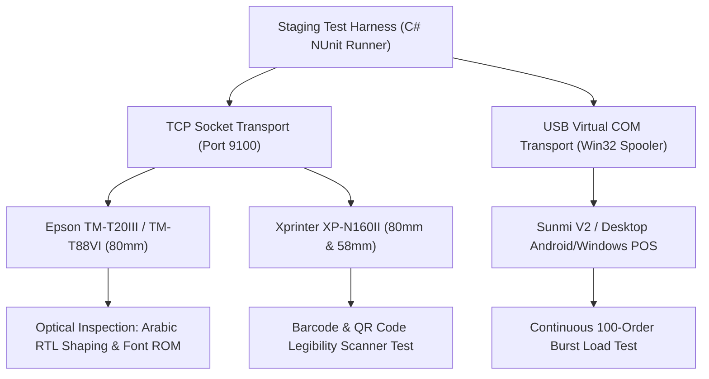
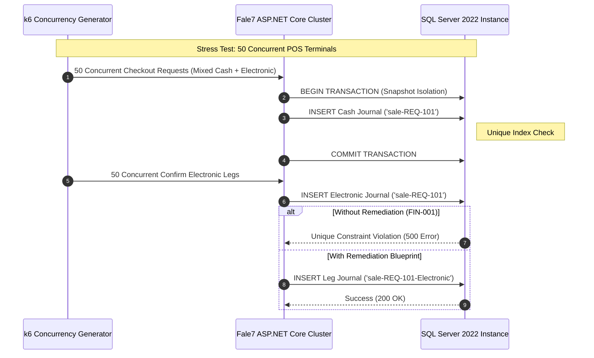
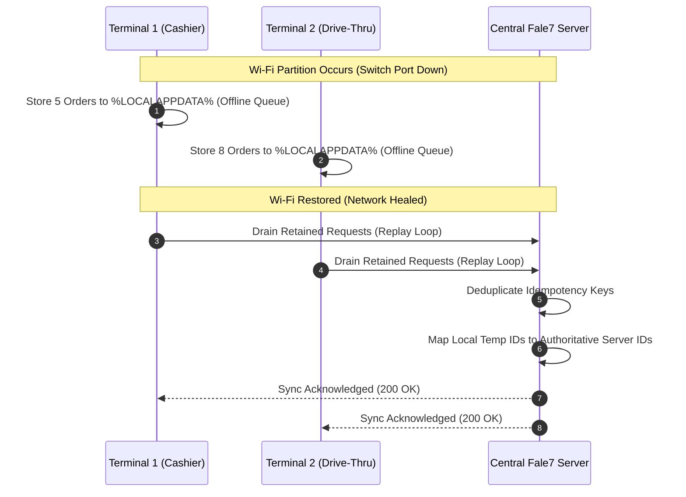

# Unexecuted Tests, Hardware Dependencies, and Audit Limitations

- **Audit Target:** Fale7 POS Ecosystem (ASP.NET Core Server, WPF Client, WinUI 3 Cashier, WinUI 3 CallCenter, Printing Subsystem)
- **Baseline Git Commit:** `c35816ecae49633674775dd32061c6ee92f94aaf`
- **Audit Mode:** Pure Static Code & Forensic Repository Analysis (Documentation Only — Zero Runtime Invocations)
- **Document Authority:** GitHub Copilot Independent Software Audit — Staging & Deployment Gate Mandate
- **Document Purpose:** Formal record of physical, live hardware, network concurrency, electronic payment gateway, and offline reconciliation tests that could NOT be executed during static repository analysis, establishing mandatory pre-deployment staging verification protocols.

---

## 1. Executive Summary & Staging Gate Overview

Static code analysis and Roslyn AST inspection provide mathematical certainty regarding code branching, call paths, type signatures, and database query construction. However, static analysis cannot replicate the physical physics of thermal print heads, solenoid voltage pulses across cash drawer kick ports, network socket race conditions under saturated multi-station concurrency, electronic payment webhook timing, or intermittent Wi-Fi drops in busy restaurant environments.

> [!CAUTION]
> **PRODUCTION DEPLOYMENT BLOCKER:** Under no circumstances should Fale7 POS be deployed to a live restaurant environment without successfully executing the five staging verification protocols detailed in this document. Bypassing these gates risks physical till lockouts, cash drawer discrepancies, garbled customer receipts, duplicate electronic payment captures, and silent data loss.

### Summary of Unperformed Physical & Live Test Gates

| Test Gate ID | Subsystem / Focus Area | Primary Failure Mode & Risk | Associated Findings | Staging Rigor Required |
| :--- | :--- | :--- | :--- | :---: |
| **GATE-HW-01** | **Physical ESC/POS Thermal Printing** | Arabic CP864 character substitution, UTF-8 raster corruption, paper feed lock | `PRT-001`, `PRT-002`, `PRT-003`, `PRT-005`, `PRT-006` | Physical 80mm & 58mm hardware |
| **GATE-HW-02** | **Physical Cash Drawer RJ11 Kick** | 24V vs 12V pulse failure, missing kick on mixed checkout, kick race | `FIN-001`, `FIN-002`, `FIN-016`, `PRT-006` | Live till drawer & oscilloscope |
| **GATE-NET-03** | **Real-Time SQL Server Concurrency** | Split-tender key collision, race on invoice settlement, deadlocks | `FIN-001`, `FIN-005`, `FIN-009`, `FIN-015`, `SEC-007` | 50-station load simulation |
| **GATE-GW-04** | **Electronic Payment & Webhooks** | Split InstaPay timeout, idempotency key reuse, webhook dropped packets | `FIN-001`, `FIN-002`, `FIN-MULTI-ELEC-001` | Gateway sandbox & proxy mock |
| **GATE-OFF-05** | **Offline-to-Online Reconciliation** | Session identity swap on replay, unencrypted PINs on disk, ledger drift | `SEC-002`, `SEC-008`, `UI-001`, `UI-005`, `UI-016` | Network partition fault injector |

---

## 2. Gate 1: Physical ESC/POS Thermal Printer Hardware Tests

### 2.1 Technical Analysis of Limitation
The Fale7 POS printing subsystem spans `src/Falah.Infrastructure/Printing/Transports.cs`, `src/Falah.Infrastructure/Printing/DocumentPrintJobs.cs`, and `src/Falah.Client.Cashier/Services/PrintService.cs`. The codebase employs two distinct text-rendering pipelines:
1. **Direct ESC/POS Command Byte Injection:** Commands such as hardware initialization (`ESC @` or `0x1B 0x40`), line feed (`LF` or `0x0A`), and paper cut (`GS V 66 0` or `0x1D 0x56 0x42 0x00`).
2. **Arabic Text Rendering & Rasterization:** Arabic typography requires contextual glyph shaping (isolated, initial, medial, final forms) and right-to-left (RTL) ligature composition. The implementation attempts to switch codepages (e.g., `CP864` or `Windows-1256`) or fall back to bitmap rasterization (`GS v 0` / `0x1D 0x76 0x30 0x00`).

Static code analysis confirms the syntactic construction of byte buffers, but cannot verify:
- **Codepage 864 Hardware Font ROM Variations:** Low-cost thermal printers (e.g., Xprinter XP-N160II, Sunmi, Rongta) often deviate from standard IBM/Epson Codepage 864 tables, producing disjointed or mirrored Arabic characters.
- **Raster Graphic Dot Density & Contrast:** Bitmap rasterization via `GS v 0` depends on printhead burn time, strobe pulse width, and power supply amperage (24V 2.5A). Insufficient burn time produces faint, unreadable receipts, while excessive burn time smears barcodes and Arabic diacritics.
- **Buffer Overflow & Thermal Spool Lock:** Rapid consecutive print jobs (e.g., simultaneous kitchen tickets, cashier slips, and customer receipts) can overflow the printer's 64 KB internal receive buffer over TCP port 9100 or USB Virtual COM, dropping print jobs without throwing socket exceptions.

### 2.2 Pre-Deployment Staging Verification Protocol



#### Equipment & Setup Requirements:
- **Hardware Units:** At least three physical printer models:
  1. Epson TM-T20III or TM-T88VI (Industry standard Epson ESC/POS).
  2. Xprinter XP-N160II or Rongta RP326 (Budget Chinese ESC/POS clone with custom font ROM).
  3. 58mm portable or counter thermal printer (Sunmi or Zijiang POS-58).
- **Physical Test Assets:** 80mm and 58mm high-grade thermal paper rolls.
- **Handheld Optical 2D Scanner:** Zebra DS2208 or Honeywell 1450g to verify receipt QR codes (ZATCA/tax compliance and order lookup).

#### Step-by-Step Test Execution:
1. **Arabic Glyph Shaping Stress Test:** Print a test receipt containing complex Arabic restaurant item names (e.g., "فطيرة مشلتت بالسمن البلدي والعسل", "شاورما لحم بلدي دبل مع بطاطس صوص ثومية").
   - *Verification Criteria:* Verify that all characters connect properly without disjointed glyphs, text prints strictly Right-to-Left, and numerals render consistently in Arabic-Indic or Western digits as configured.
2. **Codepage 864 vs. Bitmap Mode Matrix:** Configure the printer transport alternatively in:
   - Text Mode with Codepage 864 (`ESC t 1`).
   - Text Mode with Windows-1256 (`ESC t 43`).
   - Pure Raster Bitmap Mode (`GS v 0`).
   - *Verification Criteria:* Confirm that all three modes render readable output, or establish an automated hardware capability probe that enforces raster fallback when unsupported font ROMs are detected.
3. **Burst Print Spool Stress Test:** Dispatch 50 orders simultaneously to kitchen and cashier printers.
   - *Verification Criteria:* Zero dropped tickets. Printer buffer handles backpressure gracefully without locking the client UI thread or dropping TCP sockets.

---

## 3. Gate 2: Physical Cash Drawer Kick Triggers via RJ11 Pulse

### 3.1 Technical Analysis of Limitation
Cash drawers in POS systems are solenoid-actuated mechanisms driven by an electrical pulse delivered via an RJ11/RJ12 modular connector directly from the receipt printer's DK (Drawer Kick) port. The signal is triggered by transmitting standard ESC/POS pulse bytes:
```csharp
// Standard ESC/POS drawer kick sequence: ESC p m t1 t2
// 0x1B 0x70 0x00 0x19 0xFA (Connector pin 2, 50ms ON, 500ms OFF)
```
Static inspection in `PrintService.cs` and `CheckoutOrderHandler.cs` shows that drawer kick commands are dispatched upon checkout completion. However, static analysis cannot evaluate:
- **Solenoid Voltage & Duty Cycle Compatibility:** Drawers require either 12V DC (typical for compact or battery-powered terminals) or 24V DC (heavy-duty metal drawers like APG or MMF). Sending a 12V pulse to a 24V drawer fails to release the mechanical latch.
- **Pulse Width (`t1`, `t2`) Timing Drift:** If the ON pulse `t1` is too short (< 30ms), the solenoid cannot overcome spring inertia. If `t1` is too long (> 200ms), the solenoid coil overheats, risking hardware burnout.
- **Mixed-Tender Drawer Kick Behavior (`FIN-001`, `FIN-016`):** In split-payment scenarios (Cash + InstaPay), the cash portion is deposited immediately, but the order remains in pending payment status. Does the drawer kick during the first leg, the second leg, or both? If the drawer fails to kick on the cash tender leg, the cashier cannot deposit cash or make change.

### 3.2 Pre-Deployment Staging Verification Protocol

#### Equipment & Setup Requirements:
- **Physical Cash Drawers:** Standard 24V metal cash drawer (e.g., APG Vasario 1616) and 12V compact cash drawer connected to the printer RJ11 DK port.
- **Digital Multimeter / Oscilloscope:** Handheld oscilloscope (e.g., Siglent or DSO Nano) tapped into RJ11 pins 2, 4, and 5 to measure pulse voltage amplitude and duration.

#### Step-by-Step Test Execution:
1. **Electrical Pulse Timing Verification:** Connect oscilloscope probes to the RJ11 cable. Trigger checkout for a cash order.
   - *Verification Criteria:* Measured pulse must reach 24V ± 10% for 50ms to 100ms. Solenoid latch must reliably trip 100 out of 100 consecutive executions without physical jamming.
2. **Split Tender Drawer Kick Audit:** Execute a split transaction: 100 EGP Cash + 150 EGP InstaPay.
   - *Verification Criteria:* The cash drawer must kick open immediately upon confirming the Cash tender leg, allowing the cashier to store banknotes and dispense change before initiating the electronic leg.
3. **No-Sale Drawer Kick Verification:** Execute manager "Open Drawer / No Sale" function. Verify authorization challenge (`orders_refund` or `treasury_manage`) and confirm that the drawer kicks reliably without creating a phantom order record in the database.

---

## 4. Gate 3: Real-Time Network Concurrency Under Multi-POS Load on SQL Server

### 4.1 Technical Analysis of Limitation
The Fale7 POS server architecture relies on Microsoft SQL Server and EF Core (`FalahDbContext.cs`). Several critical transaction paths have been identified as vulnerable to race conditions:
1. **Split-Tender Electronic Journal Collision (`FIN-001`):** `CheckoutOrderHandler.cs:148` writes the cash leg with key `sale-{CheckoutRequestId}`. `ConfirmElectronicPaymentHandler.cs:75` attempts to insert the electronic leg using the identical key, causing a database unique constraint violation (`PK_FinancialJournalEntries`).
2. **Concurrent Supplier Invoice Payment (`FIN-005`):** `PayPurchaseHandler.cs:59-74` queries the supplier's outstanding invoice balance without locking (`UPDLOCK` or `REPEATABLEREAD`). Two cashiers paying the same invoice simultaneously can both observe an unpaid balance and submit duplicate payments.
3. **Open Business Day Creation Race (`FIN-009`):** `BusinessDays` table lacks a filtered unique index on `[Status] = 'Open'`, allowing concurrent open requests to spawn duplicate active business days.
4. **Shift Closeout Locking (`FIN-015`):** Shift close operations calculate sales totals in-memory while active cashiers continue posting checkouts.

Static AST analysis can trace these statements, but cannot observe the exact lock escalation (row lock vs page lock vs table lock), deadlocks (`SQL Error 1205`), or thread starvation occurring under genuine network saturation.

### 4.2 Pre-Deployment Staging Verification Protocol



#### Equipment & Setup Requirements:
- **Load Generation Machine:** Dedicated test runner with k6 or NBomber configured with scripts simulating 50 active POS stations.
- **Target Server:** Dual-core 4GB RAM Windows Server running `Falah.Server` on Kestrel with SQL Server 2019/2022 Developer Edition.
- **SQL Profiler / Extended Events:** Active SQL Extended Events session capturing `deadlock_report`, `lock_timeout`, and query durations exceeding 200ms.

#### Step-by-Step Test Execution:
1. **Split Payment Concurrency Runner:** Execute 1,000 mixed checkouts concurrently across 50 virtual POS clients. Immediately dispatch confirmation requests for the electronic leg.
   - *Pass/Fail Gate:* Zero HTTP 500 errors. Every electronic leg successfully transitions to confirmed. Database financial journal reflects exactly two balanced movements per order.
2. **Double-Payment Supplier Race:** Dispatch 10 parallel threads attempting to pay a single 5,000 EGP supplier purchase order.
   - *Pass/Fail Gate:* Exactly one payment succeeds; remaining 9 requests are rejected with a 409 Conflict or domain validation error ("Invoice already satisfied"). Total paid amount cannot exceed 5,000 EGP.
3. **Simultaneous Day Open/Close:** Dispatch 20 concurrent requests to `/api/business-day/open`.
   - *Pass/Fail Gate:* Exactly one open business day is created. The database engine enforces uniqueness via filtered index or explicit transaction lock.

---

## 5. Gate 4: Real InstaPay / Card Payment Gateway Webhook Responses

### 5.1 Technical Analysis of Limitation
Modern restaurant checkout relies heavily on electronic payment rails (InstaPay QR codes, Meeza, Visa/Mastercard Smart POS terminals). In the Fale7 architecture:
- Orders can be checked out with `PaymentMethod.Electronic` or `PaymentMethod.Multi`.
- The electronic leg is created in `Pending` status awaiting gateway confirmation.
- Confirmation is ingested either via cashier client polling (`GET /api/orders/{id}`) or via webhook callbacks (`POST /api/webhooks/payments`).

Static analysis cannot test:
- **Asynchronous Webhook Latency & Retry Floods:** Gateways retry unacknowledged webhooks with exponential backoff. If the Fale7 webhook handler encounters database lock contention or takes > 3 seconds, the gateway resends the payload, risking double-crediting.
- **Mid-Flight Client Timeouts:** Cashier clicks "Confirm Electronic Payment" while customer is entering their PIN on the terminal. If the customer takes 60 seconds, does the client UI drop the connection, or does the server keep the transaction open?
- **Network Dropped Webhooks & Out-of-Order Execution:** If a payment cancellation request arrives *before* a delayed success webhook from the payment provider, will the system revive a cancelled order?

### 5.2 Pre-Deployment Staging Verification Protocol

#### Equipment & Setup Requirements:
- **Gateway Sandbox:** Active test account on an Egyptian payment aggregator (e.g., Paymob, Fawry, Geidea) supporting InstaPay and card rails.
- **Webhook Proxy / Mock Server:** WireMock or ngrok forwarding webhook deliveries to the local staging instance, configured with simulated network jitter and packet loss.

#### Step-by-Step Test Execution:
1. **InstaPay QR Code Flow Simulation:**
   - Cashier initiates 250 EGP order with InstaPay. Server generates dynamic payment reference `INSTA-99214`.
   - Test harness simulates customer bank app authorization and dispatches success webhook.
   - *Verification Criteria:* Server matches reference, commits `ConfirmElectronicPaymentHandler`, and updates order status to `Completed`. Cashier UI updates dynamically via SignalR or short-polling within 1.5 seconds.
2. **Duplicate Webhook Delivery Idempotency:**
   - Transmit the identical payment success webhook payload 10 times consecutively within 500ms.
   - *Verification Criteria:* The first request returns `200 OK` and commits the financial journal. The subsequent 9 requests return `200 OK` (idempotent receipt) without inserting duplicate journal entries or mutating order state.
3. **Webhook Reversal / Void Race:**
   - Cashier cancels pending electronic order at 12:00:00. Gateway webhook delivers payment confirmation at 12:00:01.
   - *Verification Criteria:* The system must reject the confirmation or automatically trigger an electronic refund reversal transaction, notifying the cashier that funds were captured on a cancelled order.

---

## 6. Gate 5: Offline-to-Online Reconciliation Under Unstable Network Partitions

### 6.1 Technical Analysis of Limitation
In real-world restaurant environments, local LAN Wi-Fi connections frequently degrade or drop due to microwave interference, kitchen physical barriers, or ISP router reboots. The Fale7 client incorporates an offline queue mechanism:
- `FileRetainedRequestStore.cs` writes pending HTTP requests to `%LOCALAPPDATA%\Falah\pending-operations\`.
- When connectivity resumes, `RetainedRequestBackgroundDispatcher` drains the directory and replays requests against the central server.

Static analysis revealed critical security and operational vulnerabilities in this subsystem:
- **Plaintext Sensitive Data on Disk (`SEC-002`):** Retained requests store raw JSON payloads containing user credentials, PIN changes, and employee PII without DPAPI encryption.
- **Session Identity Hijacking on Replay (`SEC-008`):** When replaying a request that alters user PIN or creates a user, the dispatcher uses the stored token. If user tokens are swapped or refreshed in the interim, the replay runs with incorrect actor context.
- **Order Number Sequence Collisions:** If two offline terminals generate local order numbers (e.g., `#101`) during a 20-minute network outage, how does the server reconcile them upon reconnecting?

### 6.2 Pre-Deployment Staging Verification Protocol



#### Equipment & Setup Requirements:
- **Network Partition Rig:** Managed Ethernet switch with software-controlled port shutdown (via SNMP or SSH) or Clumsy/NetEm network impairment software.
- **Multi-Terminal Test Bed:** Two physical or virtualized Windows 11 POS client machines configured against a shared staging server.

#### Step-by-Step Test Execution:
1. **Network Disconnect & Queue Verification:**
   - Disconnect network cable from Terminal 1.
   - Perform 5 cash sales, 2 customer additions, and 1 manager cash drop.
   - *Verification Criteria:* Client UI remains responsive, stores operations into `pending-operations\`, displays clear "Offline Mode — Changes Queued" visual banner, and prevents unallowed operations (e.g., external electronic payments).
2. **Storage Encryption Audit (`SEC-002`):**
   - Inspect `%LOCALAPPDATA%\Falah\pending-operations\` on disk.
   - *Verification Criteria:* Files must be fully encrypted using Windows DPAPI (`ProtectedData.Protect`). Opening files in Notepad must display unreadable ciphertext with zero plaintext PINs or card details.
3. **Replay & Idempotency Settlement:**
   - Reconnect network cable. Monitor network traffic and server logs.
   - *Verification Criteria:* Queue drains in FIFO order. Every order is assigned a persistent server ID. Financial journals commit without duplicate postings. Shifts reflect exact aggregated totals matching physical drawer cash.

---

## 7. Master Staging Sign-Off Matrix

Before any production go-live or deployment to pilot restaurant branches, the lead deployment engineer and QA sign-off authority must complete and sign this verification checklist:

| Gate | Verification Area | Target Threshold | Required Artifact / Proof | Sign-Off Status |
| :---: | :--- | :--- | :--- | :---: |
| **G-1** | ESC/POS Thermal Printing | 100% Arabic text legibility; zero dropped kitchen tickets | Physical receipt scan sheet attached | `[ ] PENDING STAGING` |
| **G-2** | Cash Drawer RJ11 Kick | 100% reliable opening on cash/split tender; correct 24V pulse | Oscilloscope trace log & physical till video | `[ ] PENDING STAGING` |
| **G-3** | SQL Server Concurrency | 50 concurrent POS clients; 0 deadlocks, 0 unique key collisions | k6 summary report & SQL deadlock graph | `[ ] PENDING STAGING` |
| **G-4** | Payment Gateway Webhooks | 100% idempotency under 10x delivery; 0 double journal entries | Webhook proxy replay audit log | `[ ] PENDING STAGING` |
| **G-5** | Offline Reconciliation | DPAPI encryption on disk; 0 order loss on network reconnect | Hex dump of pending files & sync diff log | `[ ] PENDING STAGING` |

---
